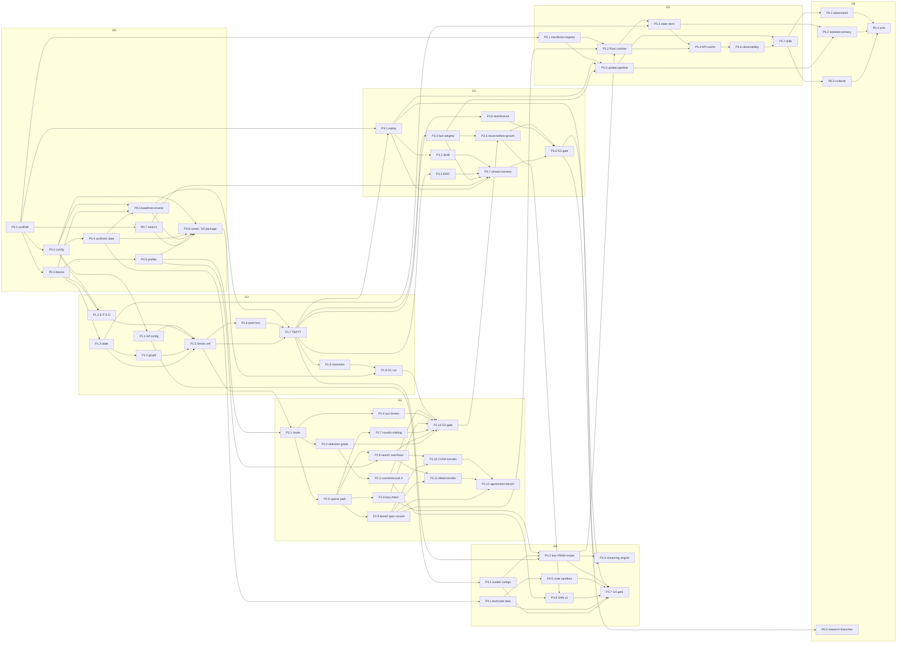

# Hierarchical Synaptic Network (HSN) — Implementation Plan

**Version 1.0 · 3 November 2026 · Derived from the HSN white paper v1.1 (3 Nov 2026)**

This document turns the HSN white paper into an executable, multi-phase, multi-chunk engineering plan. It is
written so that an implementer (a smaller language model or a junior engineer) can take **one chunk** and
complete it without reading the paper. Everything a chunk needs from the paper is restated inside the chunk or in
Sections 1–2.

Stack: **Python/PyTorch for training and experiments (gates G0–G4); Rust for the serving runtime, streaming
loader, replay store, registry and signing (gates G5–G6).** GPU kernels are written once per vendor (one CUDA
source, one Metal source) and used by both hosts. Targets: x86_64 CUDA (including a 12 GB RTX 3060),
NVIDIA DGX Spark (GB10, aarch64 + CUDA), Apple M-series (Metal), and CPU.

Status: the HSN architecture is a research proposal. No HSN results exist yet. Every threshold below is a
**proposed decision rule** from the paper, frozen at gate G0, not a performance promise.

---

## Table of contents

- §0 How to use this document
- §1 HSN in one page
- §2 Notation and equations
- §3 Target hardware and portability strategy
- §4 Repository layout, toolchain and conventions
- §5 Phase and chunk map
- §6 Phases and chunks
  - Phase 0 — Foundations (G0)
  - Phase 1 — Dense predictive cell (G1)
  - Phase 2 — Sparse routing, graph computation, kernels (G2)
  - Phase 3 — Continual learning (G3)
  - Phase 4 — Scale, text/code, memory and streaming (G4)
  - Phase 5 — Production service (G5)
  - Phase 6 — Security, pilot, research branches (G6)
- §7 Cross-cutting tracks (H hardware, S streaming/memory, T invariants, E evidence)
- §8 Gates, stop/pivot rules, risk register, evidence packages
- Appendix A — Configuration schema
- Appendix B — Unit manifest and release bundle schema
- Appendix C — Reference configuration A.1: parameters, compute, memory (re-derived)
- Appendix D — Ten-domain continual stream
- Appendix E — Hardware profiles and worked VRAM budgets
- Appendix F — Glossary
- Appendix G — Paper-section → chunk coverage matrix
- Appendix H — Errata found in the paper
- Appendix I — "Verify before use" list

---

## §0 How to use this document

### 0.1 Who this is for

- **Implementers** (models or engineers) who receive one chunk ID and must deliver it as one pull request.
- **Leads** who sequence chunks, run gates, and own the evidence packages.
- **Reviewers** who check a chunk against its *Definition of done* and *Do not* lists.

### 0.2 How work is organised

- **Phases** map one-to-one onto the paper's acceptance gates G0–G6. A phase ends when its gate passes.
- **Chunks** are the unit of work: one chunk = one pull request = one implementer. IDs are `P<phase>.<n>`
  (for example `P1.5`). Chunks list the chunk IDs they depend on; a chunk is *ready* when all of its
  dependencies are merged. The dependency table and graph are in §5.
- **Tracks** (§7) are cross-cutting concerns that several chunks contribute to: hardware backends, streaming
  and memory, the invariant test suite, and evidence packages.

### 0.3 Chunk anatomy

Every chunk has exactly these fields, in this order:

| Field | What it contains |
| --- | --- |
| Goal | One or two sentences: what exists after the chunk is merged. |
| Depends on | Chunk IDs that must be merged first (`none` if first). |
| Paper refs | Sections of the white paper the chunk implements (for provenance only; not required reading). |
| Context you need | The facts from the paper restated so the chunk is self-contained. |
| Files | Exact paths to create or modify. Do not touch other files. |
| Interfaces | Function/class signatures with tensor shapes, config keys, CLI flags. |
| Steps | Numbered implementation steps. |
| Tests | Named tests to add (`test_<chunk>_<property>`), with what each asserts. |
| Definition of done | Checklist a reviewer verifies. |
| Pitfalls | Known traps. |
| Do not | Hard prohibitions for this chunk. |
| Size | S (≤ 1 day), M (2–4 days), L (1–2 weeks) for one capable implementer. |

### 0.4 Prompt template for handing a chunk to a model

```
You are implementing chunk <ID> of the HSN project.
Read §0, §1, §2 and §4 of HSN_Implementation_Plan.md, then the chunk <ID> section in full.
Rules:
- Create or modify only the files listed under "Files" for chunk <ID>.
- Implement every signature under "Interfaces" exactly (names, argument order, shapes).
- Add every test under "Tests"; all tests in the repository must pass on the CPU profile.
- Never change frozen metrics, thresholds, or data splits.
- Report back: files changed, tests added, measured numbers (parameter count, memory, timings) and any
  deviation from the chunk text with its reason.
Do not start other chunks. If the chunk is blocked by a missing dependency, stop and say which.
```

### 0.5 Conventions used everywhere

**Shapes.** Written as `[B, N, d]`. Symbols: `B` batch, `T` input positions in a window, `N` cells, `d` width,
`M` capability units, `K` selected cells per round, `R` internal rounds, `D_g` graph in-degree, `H` MLP hidden
width, `V` vocabulary size, `P = B·K` flattened selected cell count, `E` number of graph edges.
Time and round indices follow the paper: `h[i, t, r]` is the state of cell `i` at position `t` after round `r`.

**Config keys.** Dotted paths into the YAML config (Appendix A), e.g. `model.k_select`, `train.unroll`.

**Hardware profiles.** Chunks never name a device. They refer to a profile: `profile:rtx3060`,
`profile:a100`, `profile:dgx_spark`, `profile:m_series`, `profile:cpu` (Appendix E).

**Tests.** pytest for Python (`tests/`), `cargo test` for Rust (inside each crate). Test names are
`test_<chunkid-without-dot>_<property>`, e.g. `test_p1_3_reset_clears_state`.

**Measured, not assumed.** Every run logs the measured parameter count, reserved and peak device memory,
tokens per second, and kernel-launch count. Target numbers from configs are never reported as results.

**Paper citations.** "§5" means Section 5 of the white paper v1.1; "A.2" means its Appendix A.2.

### 0.6 Global rules (apply to every chunk)

1. The **computation path changes recurrent state only**; the **learning path changes weights only** through
   the candidate-update protocol and a signed release. No code path in serving may write weights.
2. The router, predictor and scorer may use **only information available at or before position t**. Future
   targets never reach routing. Prediction of `z_t` is computed from the previous summary **before** `x_t` is
   encoded.
3. Thresholds, primary metrics and the G1 task set are **frozen at G0** (`metrics_freeze.json`). Relaxing a
   threshold after seeing test results requires a new test set and an explicit revised claim.
4. **Add one auxiliary loss or feature at a time.** No experiment starts with every loss term active.
5. Every efficiency number reports the **scorer cost as a separate line**.
6. Named domains (PHP, Go, SQL, …) are **metadata**. There is one trained network; no separately prompted models.
7. Natural-language text inside training data, replay or retrieved material **never carries authority**.
   Authorization lives outside learned routing.

---

## §1 HSN in one page

**What it is.** HSN is a recurrent neural network built from a graph of persistent *cells* (state locations)
and a bank of shared *capability units* (parameterised transformations). At each input position the model
(1) predicts what the next input's representation will be, (2) encodes the actual input and measures the
prediction error, (3) uses a cheap *router* to select a small budgeted set of cells and one unit per cell,
(4) updates only the selected cells with a bounded gated "delta" toward a candidate state, optionally
propagating to neighbours through a fixed sparse graph, and (5) decodes the next-symbol distribution from a
running summary of all cell states. This is the **Predictive Delta Graph Cell**.

**Components (paper §4).**

| Component | Role | Where in this plan |
| --- | --- | --- |
| Input encoder `E` | bytes/tokens/structured observations → width `d` | P1.2 |
| Shared workspace `S` | common latent features + summary `q` of cell states; always reachable | P1.2, P1.3 |
| Capability units `F_j` | trainable transformations with versioned interfaces and measured cost | P1.2 (bank), P5.1 (manifests) |
| Router | bounded per-input selection of cells and units under a cost budget | P2.1–P2.4 |
| SAN (Synaptic Association Network) | slower mechanism proposing edges, route reuse, split/merge/expansion | P3.5, P4.6 |
| Persistent cell graph | session-scoped recurrent state; synchronous round updates; bounded neighbour updates | P1.3, P1.4, P1.5 |
| Output and verification | decoder `D`; compilers/tests/environment rewards as external signals | P1.2, P4.5 |

**Two paths that never mix.** The *computation path* (serving) changes recurrent state only. The *learning
path* changes durable weights only through a signed release, after replay, regression, provenance and
security checks. Serving workers cannot publish weights; training workers cannot bypass release approval.

**Five kinds of change (paper §8).**

| Store | Updated | Scope |
| --- | --- | --- |
| Working state `h` | every selected execution | one session; reset or explicit snapshot |
| Episodic examples | after provenance and permission checks | encrypted bounded store with expiry |
| Fast adaptive weights `a` | validated local batches | tenant-local; reversible; optional |
| Specialist weights `θ` | scheduled candidate training | versioned local or organisational release |
| Shared weights and router | controlled consolidation | global only after broad validation |

Start with inference weights frozen; enable each level independently so its benefit and failure modes can be measured.

**Research hypothesis.** Dependency-aware sparse updates reduce unnecessary work, shared representations
improve transfer, and selective plasticity limits forgetting. **Central risk.** Deciding what matters may
require the computation the router avoids; hence dense fallback, exploration and delayed-relevance tests are
mandatory design features, not options.

**Proposed success criteria (paper §1, frozen at G0).**

1. At matched predictive quality, ≥ 20 % lower measured inference energy per token *or* end-to-end latency
   against the strongest relevant baseline.
2. Across the ten-stage learning stream, mean forgetting ≤ 2 percentage points while learning new tasks.
3. ≥ 3 percentage points better held-out cross-language composition than a matched monolithic control, with a
   confidence interval excluding zero.
4. Parameter growth, replay storage and update computation within fixed budgets; rollback and tenant
   isolation demonstrated before any pilot.

**Initial scope.** A ≈ 2M-parameter byte-level sequence model on synthetic tasks (reference configuration in
Appendix C: 1,820,361 parameters), ordinary gradient training, one GPU. Local biological learning rules,
adaptive graph growth and federated deployment come only after the simpler controls work.

**Not claimed.** Biological fidelity, consciousness, human-like understanding, brain-level energy
efficiency, novelty of sparse activation or hierarchy, or that any HSN component is superior before the
required comparisons.

---

## §2 Notation and equations

### 2.1 Symbols

| Symbol | Meaning | Shape (batched) |
| --- | --- | --- |
| `x_t` | input symbol at position t (byte id) | `[B]` |
| `context_t` | context symbol id (language, engine, version …; 16 symbols in A.1) | `[B]` |
| `z_t = E(x_t)` | encoded input | `[B, d]` |
| `q_t` | summary of cell states (mean over cells), maintained incrementally | `[B, d]` |
| `ẑ_t = P(q_{t-1})` | predicted representation of x_t, computed **before** encoding x_t | `[B, d]` |
| `ε_t = z_t − ẑ_t` | prediction error | `[B, d]` |
| `u_t = S([z_t; q_{t-1}; ctx_t])` | shared features (S input width 3d) | `[B, d]` |
| `h[i,t,r]` | state of cell i at position t after round r | `[B, N, d]` |
| `A`, `a_ij` | allowed directed edges (j → i) and learned edge weights; in-degree ≤ D_g | CSR, `[E]` |
| `m_i` | neighbour message into cell i | `[B, N, d]` or `[B, K, d]` |
| `v_i = [u_t; ε_t; h_i; m_i]` | cell input vector | `[B, K, 4d]` |
| `F_j` | capability unit j: MLP 4d → H → d | weights `[M, 4d, H]`, `[M, H, d]` |
| `α_ij` | mixing weights over the units selected for cell i; sum to one | `[B, K, M]` or `[B, K]` |
| `c_i` | candidate state | `[B, K, d]` |
| `b_i = σ(B v_i)` | per-coordinate gate in (0,1) | `[B, K, d]` |
| `I_{t,r}`, `J_{i,t,r}` | selected cells at round r; units selected for cell i | `[B, K]`, `[B, K]` |
| `U_e`, `c_e`, `B_t` | predicted utility, profiled cost, budget of candidate execution e | scalars |
| `K_max`, `R_max` | caps on selected cells and internal rounds | config |
| `θ(j)` | parameters of unit j; `θ^ref` reference release for EWC | — |
| `Ω_p` | diagonal importance of parameter p (empirical Fisher), normalised and capped | — |
| `A(i,j)` (metrics) | held-out accuracy on task j after learning stage i | `[T, T]` |

Reference values (A.1): `V = 256`, `d = 64`, `N = 32`, `M = 8`, `K = 4`, `R_max = 1`, `D_g = 4`, `H = 512`,
16 context symbols of width 64. Unroll 256, batch 4.

### 2.2 One input step (paper §5, §18) — the order matters

```
1.  check tenant scope; check pinned model version and state-schema version
2.  ẑ_t   = P(q_{t-1})                        # predict BEFORE encoding (no leakage)
    z_t   = E(x_t)
3.  ε_t   = z_t − ẑ_t
    u_t   = S([z_t ; q_{t-1} ; ctx_t])
4.  score every candidate (cell, unit) from information available now
5.  select ≤ K cells (and one unit each); execute synchronous updates for round r = 1
6.  if budget permits and R_max > 1: further rounds, messages read states of round r−1 only
7.  q_t   ← q_{t-1} + Σ_{i selected} (h[i,t,R] − h[i,t,0]) / N
    p(x_{t+1} | x_{1:t}) = softmax(D([q_t ; u_t]))
8.  record cost, route, uncertainty, version metadata
9.  queue only authorised observations for later validation
```

Steps 1–9 change recurrent state only. Nothing in this step writes weights.

### 2.3 Cell update (paper §5)

```
m_i      = Σ_{j ∈ N(i)} a_ij · V · h[j,t,r−1]                      V: d×d
v_i      = [ u_t ; ε_t ; h[i,t,r−1] ; m_i ]                       ∈ R^{4d}
c_i      = tanh( W_out · Σ_{j ∈ J_i} α_ij · F_j(v_i) )             W_out: d×d, F_j: 4d→H→d
b_i      = σ( B · v_i )                                            B: 4d→d, b_i ∈ (0,1)^d
h[i,t,r] = (1 − b_i) ⊙ h[i,t,r−1] + b_i ⊙ c_i        if i ∈ I_{t,r}
h[i,t,r] = h[i,t,r−1]                                otherwise
```

Properties to test: with `h = 0` initially and tanh candidates, every coordinate of `h` stays in `[−1, 1]`
(each update is a coordinatewise convex combination of two vectors in that range). This bounds the state; it
does not guarantee gradient stability. Clip gradients and log state/gradient statistics.

### 2.4 Summary and decoding

```
q_t = (1/N) Σ_{i=1..N} h[i,t,R_t]          maintained incrementally: q += Σ_{i selected} Δh_i / N
p(x_{t+1} | x_{1:t}) = softmax( D([q_t ; u_t]) )     D: 2d→H→V
```

Unselected cells go stale. An `age[i]` counter (rounds since last update) is a router feature, and mandatory
refresh probes are an experimental control (P2.2).

### 2.5 Routing (paper §6)

```
score_e = U_e − λ_cost · c_e
S*      = argmax_S Σ_{e∈S} score_e   subject to  Σ_{e∈S} c_e ≤ B_t,  |S| ≤ K_max,  rounds ≤ R_max
```

- `U_e` is *predicted reduction in downstream loss*, not raw surprise. Trained from counterfactual probes
  (execute selected + extra candidate paths on a training subset, measure loss difference over a fixed future
  horizon). Probes see training targets only.
- `c_e` is profiled cost (not parameter count). The shared path cost is included in `B_t`. A wall-clock
  deadline is enforced separately.
- First implementation: deterministic top-K cells, one unit per cell (argmax). Then compare a greedy budgeted
  selector. The scorer is **linear** (A.1: 200 → 8 per cell; a two-layer scorer costs more than the four
  selected cells execute).
- Router outputs never authorise data access or external actions.

### 2.6 Training objective (paper §7)

```
L = L_task + λ_p·L_pred + λ_r·L_replay + λ_d·L_distill + λ_e·L_EWC + λ_c·L_cost + λ_b·L_balance + λ_g·L_graph

L_task     next-symbol cross-entropy (or task-specific supervised loss)
L_pred     mean squared latent prediction error ‖ε_t‖², with collapse protection
           (fixed symbol-embedding target first; later stop-gradient EMA target encoder + variance floor)
L_replay   L_task applied to retained replay examples
L_distill  temperature-scaled KL( frozen_release(x) ‖ model(x) ) on approved replay inputs
L_EWC      ½ Σ_p Ω_p (θ_p − θ_p^ref)²
L_cost     (1/T) Σ_t profiled_executed_cost_t / reference_cost
L_balance  M · Σ_{j=1..M} f_j · p̄_j        f_j = fraction of assignments routed to unit j,
                                              p̄_j = mean router probability of unit j   (Switch Transformer)
L_graph    Σ_{(i,j)} |A_ij|                 on learned edge scores; complements the hard degree cap
```

Rules: optimiser is truncated BPTT with fixed unroll and a carried **detached** state between windows; reset
at document boundaries. Replay fraction starts at 25 % (sweep 0/10/25/50 %). Auxiliary terms are normalised so
their gradients can be inspected. Penalties are added one at a time.

### 2.7 Fast local weights (paper §8) and interference control (paper §9)

```
a_next = Π_{‖a‖ ≤ ρ} ( a − η ∇_a L_local )           low-rank residual, base weights fixed, steps and norm capped

g_A' = g_A − ( g_A·g_B / (‖g_B‖² + ε) ) · g_B        applied only when g_A·g_B < 0   (one PCGrad step)
```

### 2.8 Continual-learning metrics (paper §11)

`A(i, j)` = held-out accuracy on task j after learning stage i, T stages.

```
AverageFinalAccuracy = (1/T) Σ_{j=1..T} A(T, j)
Forgetting           = (1/(T−1)) Σ_{j=1..T−1} ( max_{i ∈ 1..T−1} A(i, j) − A(T, j) )     # max stops at T−1
BackwardTransfer     = (1/(T−1)) Σ_{j=1..T−1} ( A(T, j) − A(j, j) )
ForwardTransfer      = accuracy on a new task before training it, minus a same-budget model without earlier
                       tasks; also report examples needed to reach a fixed target
```

Report per task as well as macro averages; use normalised metrics or separate panels when tasks have
different output measures. Bootstrap over tasks or repositories (not tokens), paired by seed.

### 2.9 Efficiency gate statistics (paper §12)

Quality loss ≤ 1 percentage point accuracy (or ≤ 2 % relative perplexity) **and** measured latency *or*
energy improvement ≥ 20 % with a 95 % paired confidence interval excluding no improvement. Do not claim both
latency and energy unless both pass; the other must meet its non-regression budget. Audit under identical
hardware, warm and cold cache, concurrency and output length; report compile and startup separately. A slower
sparse kernel with fewer counted operations fails.

### 2.10 Cost arithmetic (paper §16)

```
wall_hours   = processed_tokens / (measured_tokens_per_second × 3600)
GPU_hours    = wall_hours × concurrent_GPUs
compute_cost = GPU_hours × hourly_rate
training_state_bytes ≈ 16 × trainable_parameters      (fp16 weights 2 + grads 2 + fp32 master 4 + Adam 8)
recurrent_state_bytes = B × N × d × bytes_per_value
```

---

## §3 Target hardware and portability strategy

Toolchain facts in this section were checked against vendor documentation and package indexes on
3 November 2026. Items that could not be confirmed are listed in Appendix I and marked **verify before use**.

### 3.1 Platforms and profiles

| Profile | Hardware | Compute API | Memory | Role in the program |
| --- | --- | --- | --- | --- |
| `profile:rtx3060` | NVIDIA RTX 3060 12 GB (GA106, compute capability 8.6, PCIe 4.0 x16) | CUDA | 12 GiB discrete (~11.5 usable) | Low-VRAM reference; day-one development; the "slow GPU" the streaming design targets |
| `profile:a100` | A100 80 GB (cc 8.0) or H100 (cc 9.0) | CUDA | discrete | Confirmation runs, G4–G6 budgets |
| `profile:dgx_spark` | NVIDIA DGX Spark, GB10 Grace Blackwell: aarch64 CPU + Blackwell GPU, **compute capability 12.1 (sm_121)** | CUDA 13.0.2 on DGX OS 7.4.0, driver 580.126.09 | 128 GB unified | Large configurations; aarch64 CUDA builds; nightly perf |
| `profile:m_series` | Apple M-series, macOS 15 or newer | Metal through PyTorch MPS | unified | Development; Metal kernels; parity tests |
| `profile:cpu` | any x86_64 or aarch64 | CPU | host RAM | Numerical oracle; CI on every PR; fp64 gradient checks |

"Apple M-series" and "DGX Spark" are both **unified-memory** machines: there is no separate VRAM to stream
into, but a byte budget is still enforced (MPS has a wired-memory limit; the Spark's 128 GB is finite).

### 3.2 Execution layers (what runs where)

| Layer | What | Platforms | Introduced in | Used by |
| --- | --- | --- | --- | --- |
| **L0 native ops** | PyTorch `index_select` / `gather` / `bmm` / `scatter_add` / grouped execution by sort-by-unit | CUDA, MPS, CPU | P1.5, P2.5 | correctness reference for every later layer; the only path until G2 profiling |
| **L1 launch-overhead reduction** | block-batched selected cells, CUDA Graphs / `torch.compile(mode="reduce-overhead")`, MPS graph capture where available | CUDA, MPS | P2.8 | first efficiency lever: at the 2M scale every path is launch-bound (A.2) |
| **L2 fused kernels** | one CUDA source (`kernels/cuda/hsn_ops.cu`) and one Metal source (`kernels/metal/hsn_ops.metal`) for the four HSN ops, compiled at build time | CUDA (x86_64 and aarch64), Metal | P2.9–P2.12 | PyTorch custom ops (training) **and** the Rust runtime (serving) load the same compiled binaries |
| **L3 Rust runtime** | `hsn-serve` on candle 0.11 behind a small `Backend` trait; loads safetensors + signed manifest; executes the one-input-step | CUDA, Metal, CPU | P5.2 | production serving; never trains |

The four fused ops (specified in P2.9):

| Op | Computes | Why fused |
| --- | --- | --- |
| (a) `gather_concat` | `v = [u; ε; h[idx]; m]` for selected cells | avoids three gathers and a concat |
| (b) `grouped_unit_mlp` | `F_{unit[p]}(v[p])` for P selected (cell, unit) pairs | per-unit GEMMs without padding; dominant per-cell cost |
| (c) `csr_messages` | `m_i = Σ_j a_ij V h_j` over CSR adjacency, in-degree ≤ 4 | gather + tiny GEMM + weighted sum |
| (d) `gated_delta_update` | `h[idx] = (1−b)⊙h[idx] + b⊙c`; `q += Σ Δh / N`; `age` reset | in-place scatter and summary update in one pass |

Build order: (b) and (d) first, then (c), then (a) — and only after a P2.8 profiler trace shows these ops
dominating. Do not write kernels speculatively.

### 3.3 Toolchain pins

| Item | Pin | Notes |
| --- | --- | --- |
| Python | 3.12 | |
| PyTorch | 2.15.0 | Default CUDA wheel is **cu132**; cu126/cu130 are no longer built. Official aarch64 Linux wheels exist. MPS requires **macOS 15+**. Ships Triton 3.9. |
| CUDA toolkit (x86 dev boxes) | 13.2 (driver ≥ 580) | Minor-version compatibility lets cu132 wheels run on any 580-series driver |
| CUDA toolkit (DGX Spark) | 13.0.2 as shipped by DGX OS 7.4.0, driver 580.126.09 | `nvcc` ≥ 12.9 is required for `sm_121`; the shipped 13.0.2 qualifies |
| Triton | bundled 3.9 (aarch64 wheels exist) | Not used for source kernels (no Metal). Only through inductor. On the Spark set `TRITON_PTXAS_PATH=/usr/local/cuda/bin/ptxas`; skip flash-attn (needs libcudart 12). |
| Rust | stable, pinned in `rust-toolchain.toml` | |
| candle | 0.11.1 | CUDA via cudarc 0.19, Metal via objc2-metal 0.3, CPU; `CustomOp1/2/3` and `InplaceOp` hooks for our kernels |
| cudarc | 0.19.10 | feature `dynamic-loading`; `load_module` of our fatbin; `upgrade_device_ptr` for foreign pointers in tests |
| objc2-metal | 0.3.2 | **metal-rs is deprecated**; do not use it |
| PyO3 / maturin | 0.28 / latest | `hsn-py` exposes `hsn_rs` to Python |
| pyo3-dlpack | 0.3.0 | kernel-parity tests only (DLPack 1.x, CPU/CUDA; Metal device helper) |
| safetensors / memmap2 | latest | release format and memory-mapped loading |

### 3.4 CUDA build targets

```
nvcc fatbin, SASS for:  sm_80  sm_86  sm_89  sm_90  sm_120  sm_121     + PTX: compute_120
(add sm_75 only if the hosted T4 CI runner is used)
```

- Never ship architecture-specific `sm_120a` cubins (they do not load on GB10 and have no PTX fallback).
- `sm_120` cubins load on GB10 (cc 12.1) by the minor-revision rule; `sm_121` is built anyway for exactness.
- Official PyTorch wheels may print "capability 12.1 is not in (8.0)–(12.0)" on the Spark; harmless. Whether the
  wheels include sm_121 is **verify before use**; the fallback is building torch with `TORCH_CUDA_ARCH_LIST="12.1"`.
- Avoid runtime NVRTC/JIT on the Spark: its toolkit (13.0.2) lags x86 dev boxes (13.2). Everything is
  compiled at build time on the machine that runs it.

### 3.5 Metal build and PyTorch integration

```
xcrun -sdk macosx metal -c kernels/metal/hsn_ops.metal -o build/hsn_ops.air
xcrun -sdk macosx metallib build/hsn_ops.air -o build/hsn_ops.metallib
```

- PyTorch side (P2.11): `lib = torch.mps.load_metallib("build/hsn_ops.metallib")`, kernels invoked as
  `lib.kernel_name(tensors…, scalars…)`, wrapped with `torch.library.custom_op(..., device_types="mps")` and
  `register_autograd`. `torch.mps.compile_shader(src)` is the development loop. The exact names of the dispatch
  arguments (threads / group size) are **verify before use**.
- Rust side (P5.2): objc2-metal `newLibraryWithURL` on the same `.metallib`.
- The older Objective-C++ extension pattern (`getMTLBufferStorage`) is community code, not a stable API: not used.
- MLX is **not** adopted (it would fork autograd, checkpoints and metrics across platforms). At most an
  optional Apple-only parity oracle in P2.12.

### 3.6 PyTorch ↔ Rust interface

| Flow | Mechanism | Platforms |
| --- | --- | --- |
| Release (production) | files: safetensors shards + signed JSON manifest written by Python (P5.1), loaded by Rust with `safetensors` + `memmap2` | all |
| Kernel-parity tests | DLPack zero-copy: `pyo3-dlpack` on CUDA (pass `stream=torch.cuda.current_stream().cuda_stream`); on MPS DLPack exists since PyTorch 2.9 (data pointer is the `MTLBuffer`), call `torch.mps.synchronize()` first, contiguous zero-offset tensors only | CUDA, MPS (tests only) |
| Replay / episodic / state stores | Rust crates expose PyO3 classes (`hsn_rs.ReplayReservoir`, `hsn_rs.ShardLoader`) that hand Python NumPy/torch CPU tensors or file paths | all |

### 3.7 Dtype policy

| Profile | Autocast | Master weights | Notes |
| --- | --- | --- | --- |
| CUDA (Ampere+) | bf16 | fp32 | Adam moments fp32 |
| MPS | fp16 | fp32 | bf16 autocast training on MPS is **verify before use** |
| CPU | fp32 | fp32 | |
| gradcheck | fp64 on CPU | — | `configs/tiny_gradcheck.yaml` only |

### 3.8 Energy and power measurement (paper §11 requires the meter method in every report)

| Profile | Method | Caveat |
| --- | --- | --- |
| NVIDIA discrete | NVML total-energy counter plus 10 Hz samples of `NVML_FI_DEV_POWER_INSTANT`; cross-check against a wall meter | On GA106 (3060) `nvmlDeviceGetPowerUsage` is a 1-second average; some driver/card combinations report junk — validate against the wall meter |
| Apple | `sudo powermetrics --samplers gpu_power,cpu_power -i 200` | needs sudo; `darwin-perf` reads the same counters without sudo but is fragile across OS releases |
| DGX Spark | `nvidia-smi` gives **GPU-only** power (~80–93 W under load); whole-system numbers require a wall meter | power-limit fields are N/A |

Report GPU-only and whole-system energy separately, with sampling interval, warm-up, precision and whether host
power is included.

### 3.9 Continuous integration

| Runner | What runs | Cost |
| --- | --- | --- |
| hosted `ubuntu-latest` (x86_64) | lint; CPU tests; `nvcc` compile-only of `hsn_ops.cu` for all targets (toolkit via apt); `cargo test` CPU | every PR |
| hosted `macos-26` (arm64) | lint; CPU tests; Metal **compile** of `hsn_ops.metal`; CPU oracle tests (Metal execution on hosted Mac runners is **verify before use**) | every PR |
| hosted `gpu-t4-4-core` (optional; Team/Enterprise) | CUDA kernel correctness on sm_75 | nightly |
| self-hosted `profile:rtx3060`, `profile:dgx_spark`, `profile:m_series` | kernel parity, perf gates, energy | nightly and on gate branches |

Every release manifest (Appendix B) records toolkit, driver, wheel and kernel binary hashes.

### 3.10 The 12 GB memory story (details in Appendix E)

Worked budgets show that an RTX 3060 holds both the paper's 2M reference configuration (training needs
< 1 GiB) and a 100M configuration (sparse training ≈ 3.5 GiB; the all-cells dense ablation ≈ 10.4 GiB without
checkpointing). Therefore:

- **Day one on 12 GB (P4.3):** per-internal-round activation checkpointing, micro-batching with gradient
  accumulation, memory-mapped checkpoint and shard loading, disk-backed replay and episodic stores,
  per-unit lazy Adam (P2.6), and a *simulated VRAM cap* test mode so eviction and OOM paths run in CI on any
  machine.
- **Unit-weight paging (P4.4):** NVMe → pinned host RAM → device, utility-weighted LRU residency, prefetch
  driven by router scores on a copy stream, host-side Adam for cold units. Fully specified; triggered when
  `16 B × trainable_params + activations > 0.7 × device_memory` (≈ 400–500M parameters on 12 GB), or when SAN
  growth multiplies the unit count. Paging granularity is the TBPTT window, never the token.
- Transfer planning numbers: pinned host→device ≈ 20–25 GB/s on PCIe 4.0 x16 (≥ 10–20 µs floor per copy);
  one A.1 unit is 0.33 MB fp16 (≈ 30 µs); one 100M-config unit is 5.25 MB (≈ 0.25 ms); NVMe 3–7 GB/s
  (0.75–1.75 ms per 100M-config unit).

---

## §4 Repository layout, toolchain and conventions

### 4.1 Layout (monorepo `hsn/`)

```
hsn/
  pyproject.toml            # uv-managed; package "hsn" under python/
  Cargo.toml                # cargo workspace for rust/*
  rust-toolchain.toml
  README.md
  .pre-commit-config.yaml   # ruff, ruff-format, mypy, rustfmt, clippy
  .github/workflows/        # ci.yml (hosted), nightly.yml (self-hosted)
  configs/
    ref_a1.yaml             # Appendix C reference configuration (1,820,361 params)
    tiny_gradcheck.yaml     # d=4, N=3, M=2, K=2, H=8, fp64 — for finite-difference checks
    scale_20m.yaml          # 20,104,445 params (Appendix E)
    scale_100m.yaml         # 100,722,757 params (Appendix E)
    hardware/               # rtx3060.yaml  m_series.yaml  dgx_spark.yaml  a100.yaml  cpu.yaml
  python/hsn/
    config.py               # pydantic schema (Appendix A), YAML load/validate, hashing
    device.py               # backend detection, dtype policy, seeding, determinism
    data/    synthetic.py splits.py leakage.py corpora.py
    model/   embeddings.py encoder.py state.py graph.py units.py cell.py router.py halting.py hsn.py
    losses.py
    train/   loop.py tbptt.py checkpoint.py amp.py lazy_adam.py memory_plan.py
    continual/ replay.py distill.py ewc.py fast_weights.py growth.py interference.py san.py
    baselines/ gru.py transformer.py selective_ssm.py
    eval/    metrics.py bootstrap.py gates.py energy.py suites/ sandbox/
    profiler/ timing.py memory.py launches.py power.py
    kernels/ __init__.py (dispatch native|cuda|metal) ops.py (torch.library custom ops + autograd)
    release/ manifest.py bundle.py sign_client.py
  kernels/
    include/hsn_ops.h       # C ABI shared by the PyTorch extension and the Rust host
    cuda/hsn_ops.cu         # the one CUDA source
    metal/hsn_ops.metal     # the one Metal source
    testvectors/            # .safetensors inputs/outputs generated by the CPU oracle (P2.9)
  rust/
    hsn-core/               # ids, hashes, manifests, config mirror, errors (no tensors)
    hsn-kernels/            # Backend trait; CPU oracle; cuda/ metal/ hosts loading the compiled binaries
    hsn-stream/             # shard loader (mmap), tiers, residency, prefetch
    hsn-replay/             # disk-backed reservoir, provenance, dedup
    hsn-registry/           # release registry, signing, verification
    hsn-serve/              # inference runtime + HTTP service
    hsn-py/                 # PyO3 bindings → python module hsn_rs
  scripts/
    count_params.py build_kernels.py evidence_package.py gate_g0.py … gate_g6.py
  tests/                    # pytest; mirrors python/hsn/ layout
```

### 4.2 Commands every implementer uses

```bash
uv sync --extra dev                       # Python env
maturin develop -m rust/hsn-py/Cargo.toml  # build hsn_rs into the env
cargo test --workspace                    # Rust tests
pytest -q                                 # Python tests (CPU profile by default)
python scripts/build_kernels.py --target cuda|metal|all   # compile L2 kernels (no-op on CPU)
pre-commit run --all-files
```

A test that needs a GPU is marked `@pytest.mark.cuda` / `@pytest.mark.mps` and skips when the device is absent.

### 4.3 Conventions

- **Configs** are the single source of truth; code never hard-codes dimensions. Every run writes
  `runs/<run_id>/config.resolved.yaml`, `run_manifest.json` (git revision, dependency lock hash, toolkit and
  driver versions, measured parameter count, measured peak/reserved memory, tokens/s, launch count, profile).
- **Logging** never includes raw private content; only aggregates, ids, versions and costs.
- **Pull requests**: one chunk per PR, titled `P<phase>.<n>: <chunk name>`; the PR description lists files,
  tests, measured numbers and deviations.
- **Seeds**: every random source is seeded from `run.seed`; data order is deterministic given the seed.
- **Errors over silence**: shape, version or scope mismatches raise; nothing is reinterpreted by shape alone.

---

## §5 Phase and chunk map

### 5.1 Chunk table (authoritative dependency list)

| ID | Chunk | Depends on | Gate | Size |
| --- | --- | --- | --- | --- |
| P0.1 | Repository scaffold and toolchain | none | G0 | S |
| P0.2 | Configuration schema and experiment manifest | P0.1 | G0 | S |
| P0.3 | Device and dtype layer | P0.1 | G0 | S |
| P0.4 | Synthetic generators, splits, leakage checker | P0.2 | G0 | M |
| P0.5 | Baselines and generic trainer | P0.2, P0.3, P0.4 | G0 | M |
| P0.6 | Profiler and energy meter | P0.3 | G0 | M |
| P0.7 | Metrics library | P0.1 | G0 | M |
| P0.8 | Runner, result store, reproducible rerun, G0 evidence package | P0.2, P0.4, P0.5, P0.6, P0.7 | G0 | M |
| P1.1 | Reference configuration as code; parameter, MAC and memory calculators | P0.2 | G1 | S |
| P1.2 | Embeddings, encoder E, predictor P, shared transform S, decoder D, unit bank | P0.2, P0.3 | G1 | S |
| P1.3 | Cell graph state | P0.3 | G1 | S |
| P1.4 | Fixed sparse graph and message passing | P1.3 | G1 | S |
| P1.5 | Dense PDG cell step and HSN module | P1.1, P1.2, P1.3, P1.4 | G1 | M |
| P1.6 | Prediction loss with collapse protection | P1.5 | G1 | S |
| P1.7 | TBPTT trainer | P0.5, P1.5, P1.6 | G1 | M |
| P1.8 | Correctness and invariant tests | P1.7 | G1 | M |
| P1.9 | G1 run and evidence package | P0.8, P1.8 | G1 | M |
| P2.1 | Router scorer and budgeted selection | P1.5, P0.6 | G2 | M |
| P2.2 | Selection gradients and routing controls | P2.1 | G2 | M |
| P2.3 | Counterfactual utility targets | P2.2 | G2 | M |
| P2.4 | Auxiliary losses | P2.1 | G2 | S |
| P2.5 | Sparse execution path in native ops | P2.1 | G2 | M |
| P2.6 | Per-unit lazy Adam | P2.5 | G2 | S |
| P2.7 | Multi-round computation and halting | P2.5 | G2 | M |
| P2.8 | Launch-overhead reduction (L1) | P2.5, P0.6 | G2 | M |
| P2.9 | Kernel specification, test vectors, CPU oracle | P2.5 | G2 | M |
| P2.10 | CUDA fused kernels | P2.8, P2.9 | G2 | L |
| P2.11 | Metal fused kernels | P2.8, P2.9 | G2 | L |
| P2.12 | Cross-backend agreement and kernel benchmarks | P2.9, P2.10 or P2.11 | G2 | M |
| P2.13 | G2 efficiency gate and ablation matrix | P1.9, P2.2, P2.3, P2.4, P2.6, P2.7, P2.8 | G2 | L |
| P3.1 | Replay reservoir (`hsn-replay`) | P0.1, P1.7 | G3 | M |
| P3.2 | Distillation from a frozen release | P3.1 | G3 | S |
| P3.3 | EWC importance penalty | P1.7 | G3 | S |
| P3.4 | Fast local weights | P1.7 | G3 | M |
| P3.5 | Reuse-before-growth controller | P2.13, P3.4 | G3 | L |
| P3.6 | Interference monitor and PCGrad option | P1.7 | G3 | S |
| P3.7 | Continual stream harness and baselines | P0.7, P3.1, P3.2, P3.3, P3.4 | G3 | M |
| P3.8 | G3 gate evaluation | P3.5, P3.6, P3.7 | G3 | M |
| P4.1 | Licensed text/code data pipeline | P0.4 | G4 | L |
| P4.2 | Scaled configurations and budget calculators | P1.1 | G4 | S |
| P4.3 | Low-VRAM training recipe (day one for 12 GB) | P1.7, P2.6, P4.2 | G4 | M |
| P4.4 | Tiered unit-weight streaming engine (`hsn-stream`) | P3.1, P4.3 | G4+ | L |
| P4.5 | Code evaluation sandbox | P4.1 | G4 | L |
| P4.6 | SAN v1 | P2.3, P3.5 | G4 | L |
| P4.7 | G4 gate | P3.8, P4.1, P4.2, P4.3, P4.5, P4.6 | G4 | M |
| P5.1 | Manifests, release bundles, signing, registry | P0.1 | G5 | M |
| P5.2 | Rust inference runtime (`hsn-serve`) | P2.9, P4.3, P5.1 | G5 | L |
| P5.3 | Session state store | P1.3, P5.2 | G5 | M |
| P5.4 | Serving API and authorization layer | P5.2, P5.3 | G5 | M |
| P5.5 | Candidate update pipeline | P3.1, P3.4, P5.1 | G5 | L |
| P5.6 | Observability and SLOs | P5.4 | G5 | M |
| P5.7 | Restore drill, 72-hour load test, chaos tests | P5.5, P5.6 | G5 | M |
| P6.1 | Adversarial test suites | P5.7 | G6 | L |
| P6.2 | Isolation suite and privacy accounting | P5.3, P5.5 | G6 | M |
| P6.3 | Incident runbook and governance | P5.7 | G6 | S |
| P6.4 | Pilot execution and model card | P6.1, P6.2, P6.3 | G6 | L |
| P6.5 | Research branches (optional, post-gate) | P3.8 | — | L |

Parallelism hints: P0.3/P0.4/P0.6/P0.7 are independent after P0.1–P0.2; P1.2/P1.3 are independent;
P2.2–P2.4 and P2.5–P2.9 form two parallel streams; P3.1–P3.4 and P3.6 are independent of each other;
P4.1, P4.2 and P5.1 can start as soon as their single dependency is merged.

### 5.2 Dependency graph



---

## §6 Phases and chunks

## Phase 0 — Foundations (gate G0, weeks 1–2)

**Gate G0 (paper §13):** data protocol, baselines and profiler exist; a reproducible rerun succeeds; leakage
checks pass; primary metrics, quality tolerances and the G1 task set are frozen in `configs/metrics_freeze.json`.

### P0.1 — Repository scaffold and toolchain

**Goal.** The monorepo skeleton of §4.1 exists: Python package, cargo workspace, PyO3 bridge, pre-commit and CI.
Every command in §4.2 succeeds on `profile:cpu` on Linux and macOS.

**Depends on.** none

**Paper refs.** §18 (components implemented separately; dense reference defines correctness), §14 (serving and
learning separated).

**Context you need.** Python trains, Rust serves (§3). GPU features are optional cargo features and optional
Python extras; the base install must work on a laptop with no GPU. CI runners cannot execute CUDA or Metal
kernels (§3.9), so CI builds them and runs CPU tests only.

**Files.** `pyproject.toml`, `uv.lock`, `Cargo.toml`, `rust-toolchain.toml`, `.pre-commit-config.yaml`,
`.github/workflows/ci.yml`, `.github/workflows/nightly.yml`, `README.md`, `python/hsn/__init__.py` and an empty
`__init__.py` in every package directory of §4.1, `rust/<crate>/Cargo.toml` + `src/lib.rs` for the seven crates,
`rust/hsn-py/src/lib.rs`, `scripts/build_kernels.py`, `tests/test_p0_1_smoke.py`.

**Interfaces.**
```python
hsn.__version__: str                                  # single source: pyproject version
hsn_rs.version() -> str                               # must equal hsn.__version__
hsn_rs.backend_names() -> list[str]                   # ["cpu"] for now
# scripts/build_kernels.py --target {cuda,metal,all,none} --out build/   (exit 0 and print "no toolchain" when absent)
```
Cargo features: `hsn-kernels` has default `cpu`, optional `cuda`, `metal` (empty for now). Python extras:
`dev` (pytest, ruff, mypy, pre-commit), `cuda` (pynvml), `viz` (matplotlib).

**Steps.**
1. `uv init`; dependencies `torch==2.15.0`, `pydantic>=2`, `numpy`, `pyyaml`, `safetensors`, `pyarrow`; extras above.
   Document CUDA/aarch64 wheel index URLs in README, not in `pyproject.toml`.
2. Cargo workspace with the seven crates; `hsn-core` depends only on `serde`, `serde_json`, `thiserror`, `blake3`.
3. `hsn-py` with PyO3 0.28 and maturin; module name `hsn_rs`; expose `version`, `backend_names`.
4. Pre-commit: ruff (lint + format), mypy (strict on `python/hsn`), rustfmt, clippy (`-D warnings`).
5. `ci.yml`: jobs `ubuntu-cpu` and `macos-arm64-cpu` (uv sync, maturin develop, pytest, cargo test,
   `build_kernels.py --target none`). `nightly.yml`: jobs with `runs-on: [self-hosted, rtx3060]`,
   `[self-hosted, dgx_spark]`, `[self-hosted, m_series]`, each skipped when no such runner is registered.
6. README with §4.2 commands and the profile names.

**Tests.** `test_p0_1_smoke_imports` (imports `hsn` and `hsn_rs`; versions equal); one trivial `#[test]` per crate.

**Definition of done.** §4.2 commands pass on both hosted CI jobs; pre-commit clean; `uv.lock` committed.

**Pitfalls.** maturin module name must match `[lib] name`; cargo feature unification can silently enable GPU
features — keep them off by default; PyTorch wheels for CUDA and aarch64 come from index URLs, so test the
base install from PyPI only.

**Do not.** Add model code; add GPU-only dependencies to the base install; add a `torch` index URL to `pyproject.toml`.

**Size.** S

### P0.2 — Configuration schema and experiment manifest

**Goal.** A validated, hashable configuration that covers every reproducibility key the paper lists; hardware
profile files; a run-manifest writer that records measured numbers.

**Depends on.** P0.1

**Paper refs.** §18 (reproducible configuration), §16 (log actual counts and measured memory).

**Context you need.** The paper requires a configuration to specify: data version, tokenizer, model
dimensions, topology, route budget, internal-round cap, precision, optimizer, unroll length, replay policy,
seed, and hardware; and requires logging *actual* parameter counts and *measured* memory. Penalties are added
one at a time (§7), which the schema enforces. The full schema is Appendix A; this chunk implements it.

**Files.** `python/hsn/config.py`, `configs/_example.yaml`, `configs/hardware/{rtx3060,m_series,dgx_spark,a100,cpu}.yaml`,
`tests/test_p0_2_config.py`.

**Interfaces.**
```python
class ModelConfig(BaseModel): ...      # Appendix A.1
class DataConfig(BaseModel): ...       # Appendix A.2
class TrainConfig(BaseModel): ...      # Appendix A.3 (includes loss weights and aux_enabled)
class ReplayConfig(BaseModel): ...     # Appendix A.4
class HardwareConfig(BaseModel): ...   # Appendix A.5 (one per profile file)
class RunConfig(BaseModel): model; data; train; replay; hardware; run_id: str; seed: int; notes: str
def load_config(path: str | Path, overrides: list[str] = ()) -> RunConfig      # overrides like "model.k_select=4"
def config_hash(cfg: RunConfig) -> str                                          # blake2b of canonical JSON
def dump_resolved(cfg: RunConfig, path: Path) -> None
@dataclass class RunManifest: git_rev; dirty: bool; lock_hash; python; torch; cuda_toolkit; driver; profile; measured: dict
def write_run_manifest(run_dir: Path, cfg: RunConfig, measured: dict) -> Path  # measured must contain
    # param_count, peak_bytes, reserved_bytes, tokens_per_s, launches_per_step
```

**Steps.**
1. Implement the models with validators: `k_select <= n_cells`; `in_degree < n_cells`; `r_max >= 1`;
   `len(train.aux_enabled) <= 1` unless `train.allow_multiple_aux` is a non-empty justification string.
2. Dotted overrides with type coercion through pydantic.
3. Hardware profile files with the Appendix A.5 fields filled from Appendix E.
4. Run manifest: gather git revision, lock-file hash, package versions, toolkit and driver strings when present.

**Tests.** `test_p0_2_roundtrip` (load → dump → load equal), `test_p0_2_overrides`, `test_p0_2_validators_reject`,
`test_p0_2_hash_stable_under_key_order`, `test_p0_2_manifest_requires_measured_keys`.

**Definition of done.** Every key in Appendix A exists in code with the same name and default; profiles load.

**Pitfalls.** Do not store derived quantities (parameter counts) in configs; keep enums as `Literal` strings so YAML stays readable.

**Do not.** Count parameters here (P1.1); detect devices here (P0.3).

**Size.** S

### P0.3 — Device and dtype layer

**Goal.** `hsn.device` turns a hardware profile into a torch device, dtype policy, seeding and memory helpers
that behave identically on CUDA, MPS and CPU.

**Depends on.** P0.1

**Paper refs.** §14 (start on one GPU), §16 (confirm VRAM and kernel compatibility, do not assume).

**Context you need.** Dtype policy §3.7; profiles §3.1; `torch.compile` stays off until P2.8; MPS needs
macOS 15+ with PyTorch 2.15; a simulated VRAM cap must be settable so low-memory paths can be tested anywhere.

**Files.** `python/hsn/device.py`, `tests/test_p0_3_device.py`.

**Interfaces.**
```python
@dataclass class DeviceContext:
    device: torch.device; autocast_dtype: torch.dtype | None; master_dtype: torch.dtype
    supports_bf16: bool; unified_memory: bool; vram_bytes: int; compile_enabled: bool = False; profile: str
def resolve(profile: HardwareConfig) -> DeviceContext        # raises if the profile's device is unavailable
def seed_everything(seed: int) -> None                        # python, numpy, torch, cuda, mps
def set_deterministic(flag: bool) -> None                     # use_deterministic_algorithms + CUBLAS_WORKSPACE_CONFIG
def memory_stats(device: torch.device) -> dict               # {"allocated", "reserved", "peak"} bytes, all backends
def reset_peak(device) -> None
def set_vram_cap(device, fraction: float) -> None             # cuda/mps set_per_process_memory_fraction; no-op on cpu
def synchronize(device) -> None
```

**Steps.** Detect CUDA (capability ≥ 8.0 → bf16), MPS (fp16 autocast), CPU; measure `vram_bytes` with
`torch.cuda.mem_get_info` or the MPS recommended working-set size; implement seeding across libraries;
implement the stats shim (`torch.cuda.*` vs `torch.mps.current_allocated_memory`/`driver_allocated_memory`).

**Tests.** `test_p0_3_cpu_always_resolves`, `test_p0_3_seed_reproducible` (two seeded draws equal),
`test_p0_3_memory_stats_keys`, GPU-marked `test_p0_3_vram_cap_applies` (allocating beyond the cap raises OOM).

**Definition of done.** Resolves all five profiles on the matching machines; cap test passes on one GPU profile.

**Pitfalls.** `torch.backends.mps.is_built()` differs from `is_available()`; MPS peak-memory statistics are coarser
than CUDA's — document which API is used in the report.

**Do not.** Enable `torch.compile`; touch kernels.

**Size.** S

### P0.4 — Synthetic generators, splits, leakage checker

**Goal.** Deterministic generators for five synthetic task families, with train/dev/test splits, in-range and
out-of-range dependency lengths, split hashes and a leakage checker that reports zero overlap.

**Depends on.** P0.2

**Paper refs.** §11 (suites: state update, delayed relevance, sequence structure), §7 (dependency lengths that
fit and exceed the unroll horizon), §18 (weeks 1–2: deterministic synthetic generators and splits).

**Context you need.** Tasks, each a byte stream where every example is one "document" (state is reset at
document boundaries):
1. **Key–value state**: operations `INS k v`, `OVR k v`, `DEL k` interleaved with distractor tokens, followed by
   queries `QRY k` whose target is the current value (or `NONE`). Measures exact recall and overwrite errors.
2. **Delayed relevance**: facts stated early, queried after a delay `D` sampled from a range; measures recall by delay.
3. **Brackets**: balanced-bracket (Dyck) validity and next-symbol prediction with depth up to `max_depth`.
4. **Arithmetic**: multi-digit addition streams with carries, digits emitted least significant first.
5. **Algorithmic**: copy, reverse, sort of short lists.
"In-range" means the longest dependency fits inside the unroll window (256 positions); "out-of-range" means it
does not (for length extrapolation). G1 evaluates designated in-range tasks only; the task set is frozen in P0.8.
Byte values 0–15 are reserved control symbols (`PAD=0, BOS=1, EOS=2, QRY=3, SEP=4, NONE=5`); context symbols are
ids 0–15 (synthetic tasks use `ctx = task_id`).

**Files.** `python/hsn/data/synthetic.py`, `python/hsn/data/splits.py`, `python/hsn/data/leakage.py`,
`python/hsn/data/dataset.py`, `configs/data/synthetic_v1.yaml`, `tests/test_p0_4_synthetic.py`.

**Interfaces.**
```python
@dataclass(frozen=True) class Example:
    tokens: np.ndarray    # uint8 [T]
    targets: np.ndarray   # uint8 [T]  (next symbol; control symbol where undefined)
    loss_mask: np.ndarray # bool  [T]  (True where the target counts; queries only for recall tasks)
    context: np.ndarray   # uint8 [T]
    meta: dict            # task, dep_len, doc_id, in_range: bool
class TaskSpec(BaseModel): name; n_train; n_dev; n_test; length_range: tuple[int,int]; dep_len_range: tuple[int,int]; seed: int; params: dict
def generate(spec: TaskSpec, split: Literal["train","dev","test"], index: int) -> Example   # pure function of (spec, split, index)
def build_splits(specs: list[TaskSpec], out_dir: Path) -> SplitManifest                       # writes .npz shards + manifest.json with blake2b per split
def check_leakage(train: Iterable[Example], test: Iterable[Example], n_gram: int = 32) -> LeakageReport  # exact duplicates and n-gram overlaps
class ByteDataset(torch.utils.data.Dataset)        # yields dict(tokens, targets, loss_mask, context, reset) as tensors
def collate_windows(examples, unroll: int) -> dict  # concatenates documents into [B, T] streams with reset: bool [B, T]
```

**Steps.** Implement each generator with a reference solver that computes targets independently of the
emitter (used in tests); seed each example as `blake2b(spec.seed, split, index)`; use disjoint key alphabets per
split for KV tasks; write shards and manifest; implement the n-gram leakage checker; implement the dataset and
window collation; add CLI `python -m hsn.data.synthetic build --spec configs/data/synthetic_v1.yaml --out data/synthetic_v1`.

**Tests.** `test_p0_4_deterministic` (same inputs → identical bytes), `test_p0_4_targets_match_reference_solver`
(per task), `test_p0_4_splits_disjoint_and_leakage_zero`, `test_p0_4_out_of_range_lengths_exceed_unroll`,
`test_p0_4_collate_reset_flags_at_doc_starts`.

**Definition of done.** `configs/data/synthetic_v1.yaml` and its manifest hashes committed; generator ≥ 10k
examples/s on CPU; leakage report zero for all task pairs.

**Pitfalls.** Python's built-in `hash` is salted per process — never use it for seeds; do not share one global
RNG across splits; keep `loss_mask` true only where the task defines a target, or accuracy is inflated by trivial tokens.

**Do not.** Include natural-language text; let dev/test influence any generator parameter; change reserved byte values later.

**Size.** M

### P0.5 — Baselines and generic trainer

**Goal.** GRU and small Transformer byte-level language models, and the generic windowed training loop,
evaluation and checkpoint utilities they share with HSN from P1.7 on.

**Depends on.** P0.2, P0.3, P0.4

**Paper refs.** §12 (baseline ladder; equal search budgets; matched parameters/compute/quality), §18 (basic GRU
and Transformer controls in weeks 1–2).

**Context you need.** Baselines must use the same data pipeline, trainer, evaluation and hyperparameter search
budget as HSN; results are compared in three regimes (matched total parameters, matched training compute,
matched achieved quality) and report active vs stored parameters separately. The selective state-space baseline
(Mamba / Gated DeltaNet) and a sparse-expert baseline come later (P2.13).

**Files.** `python/hsn/baselines/gru.py`, `python/hsn/baselines/transformer.py`, `python/hsn/train/loop.py`,
`python/hsn/train/checkpoint.py`, `python/hsn/train/amp.py`, `python/hsn/eval/evaluate.py`, `tests/test_p0_5_baselines.py`.

**Interfaces.**
```python
class SequenceModel(Protocol):
    def init_state(self, B: int, device) -> Any
    def reset_state(self, state, mask: torch.Tensor) -> Any          # mask [B] bool
    def forward(self, tokens, context, state, reset) -> tuple[torch.Tensor, Any, dict]   # logits [B,T,V]
    def param_report(self) -> dict[str, int]
class GRUBaseline(nn.Module): ...        # d_model, n_layers from config; ≈2M params documented
class TransformerBaseline(nn.Module): ... # context window = train.unroll; causal; ≈2M params documented
class Trainer:
    def __init__(self, model, cfg: RunConfig, ctx: DeviceContext, profiler=None)
    def fit(self, train_ds, dev_ds, steps: int) -> History
    def evaluate(self, ds, metrics: dict[str, Callable]) -> dict
def save_checkpoint(path, model, optimizer, scheduler, step, rng_state, loader_state) -> None
def load_checkpoint(path, model, optimizer=None, scheduler=None) -> dict
def autocast_ctx(ctx: DeviceContext)                    # bf16/fp16/none; GradScaler only for fp16
class SearchBudget: trials_allowed; record(trial_cfg, result); exhausted() -> bool
```

**Steps.** Implement both baselines; the loop iterates windows of `train.unroll` positions over the collated
streams, applies the `reset` mask, carries (and detaches) recurrent state for the GRU, clips gradients, uses
AMP, evaluates every `train.eval_every` steps and checkpoints every `train.ckpt_every`; implement the search
budget counter so every method gets the same number of trials.

**Tests.** `test_p0_5_gru_overfits_64_examples` (> 99 % train accuracy in ≤ 500 CPU steps on a tiny model),
`test_p0_5_transformer_overfits_64_examples`, `test_p0_5_resume_bit_exact_on_cpu`, `test_p0_5_param_report_logged`.

**Definition of done.** Both baselines train on `synthetic_v1` on `profile:cpu` and one GPU profile; parameter
counts are reported as measured.

**Pitfalls.** Detach GRU state between windows; the transformer must not attend across window boundaries; the
GRU under autocast needs cuDNN-compatible dtypes.

**Do not.** Implement any HSN module; exceed the search budget; compare on the test split.

**Size.** M

### P0.6 — Profiler and energy meter

**Goal.** One profiler that reports wall time, device time, peak/reserved memory, kernel-launch counts and
energy per named segment, with the scorer always a separate segment.

**Depends on.** P0.3

**Paper refs.** §2 (measure dispatch, synchronisation, memory movement), §6 (scorer cost as a separate line),
§11 (energy method must be stated), §12 (latency audit conditions), §14 (measure launch time, bandwidth,
gather/scatter, synchronisation), A.2 (launch-bound at small scale).

**Context you need.** Efficiency claims require p50/p95 latency at batch 1, 8 and 32 across sequence lengths,
throughput, peak memory and energy per token, with warm and cold cache, concurrency and output length
controlled, compile/startup reported separately, and the meter method stated (§3.8). At the 2M scale every path
is launch-bound, so launch counts are a primary diagnostic.

**Files.** `python/hsn/profiler/__init__.py`, `timing.py`, `memory.py`, `launches.py`, `power.py`, `tests/test_p0_6_profiler.py`.

**Interfaces.**
```python
class Profiler:
    def __init__(self, ctx: DeviceContext, power: PowerMeter | None = None, count_launches: bool = False)
    @contextmanager
    def segment(self, name: str, tokens: int = 0): ...      # nestable; names used everywhere:
        # "shared_path" | "scorer" | "selected_cells" | "messages" | "decode" | "backward" | "optimizer" | "compile" | "startup"
    def report(self) -> ProfileReport                        # per segment: n, wall_ms_p50, wall_ms_p95, device_ms, peak_bytes, launches, energy_j, tokens
    def to_json(self, path: Path) -> None
class PowerMeter(Protocol):
    def start(self) -> None
    def stop(self) -> EnergyReading        # joules, n_samples, method: str, interval_ms, includes_host: bool, notes
class NvmlEnergyMeter(PowerMeter)         # energy counter delta + 10 Hz NVML_FI_DEV_POWER_INSTANT samples
class PowermetricsMeter(PowerMeter)       # macOS; requires sudo; raises PermissionError with instructions otherwise
class NullMeter(PowerMeter)
def count_launches(fn: Callable, ctx: DeviceContext) -> int   # torch.profiler kernel events on CUDA; "unsupported" → -1 on MPS/CPU
```

**Steps.** Timing with CUDA events (CUDA) or synchronise-and-wall-clock (MPS/CPU); memory deltas through P0.3;
launch counting through `torch.profiler`; NVML through `pynvml` (energy counter plus sampled instant power in a
background thread); `powermetrics` subprocess parser; JSON report writer.

**Tests.** `test_p0_6_segments_nest_and_sum`, `test_p0_6_null_meter`, `test_p0_6_report_schema`,
`test_p0_6_nvml_mocked`, GPU-marked `test_p0_6_launch_count_small_loop` (counts N kernels for N matmuls).

**Definition of done.** Report JSON contains every field above; the `scorer` segment is present whenever
routing runs; the `method` string of each meter matches §3.8.

**Pitfalls.** CUDA events need a synchronise before reading; NVML on GA106 is a 1 s average, so energy
segments must span ≥ 5 s or use the energy counter; `powermetrics` needs sudo — fail loudly, never silently zero.

**Do not.** Estimate energy from TDP; include compile or warm-up in steady-state segments.

**Size.** M

### P0.7 — Metrics library

**Goal.** Continual-learning metrics, paired bootstrap confidence intervals and the gate decision functions,
exactly as §2.8–2.9 define them.

**Depends on.** P0.1

**Paper refs.** §11 (metrics), §12 (statistical plan, efficiency gate), §13 (gate thresholds), §1 (success criteria).

**Context you need.** Forgetting takes the maximum over stages 1..T−1 (never the final stage), so it can be
negative. At least five seeds for prototypes, three for expensive confirmations (report reduced certainty).
Bootstrap over tasks or repositories, paired by seed and data stream; never over tokens. The primary metric is
predeclared. Efficiency gate: quality loss ≤ 1 pp accuracy or ≤ 2 % relative perplexity, and ≥ 20 % latency or
energy improvement with a 95 % paired CI excluding zero.

**Files.** `python/hsn/eval/metrics.py`, `python/hsn/eval/bootstrap.py`, `python/hsn/eval/gates.py`, `tests/test_p0_7_metrics.py`.

**Interfaces.**
```python
def accuracy_matrix(results: dict[tuple[int, int], float], T: int) -> np.ndarray     # A[i, j]; NaN where unmeasured
def average_final_accuracy(A) -> float
def forgetting(A) -> float                     # max over i in 1..T-1
def backward_transfer(A) -> float
def forward_transfer(acc_new_before: np.ndarray, acc_control: np.ndarray) -> float
def per_task_loss(A) -> np.ndarray             # max_{i<=T-1} A[i,j] - A[T,j] for each j (for the 5 pp rule)
def paired_bootstrap(a: np.ndarray, b: np.ndarray, n_boot=10_000, seed=0, alpha=0.05) -> CI   # a, b aligned by unit (task/repo × seed)
def efficiency_gate(quality: PairedSamples, speed: PairedSamples, quality_kind: Literal["accuracy","perplexity"], claim: Literal["latency","energy"], other: PairedSamples | None) -> GateResult
def retention_gate(A, mean_forgetting_max=0.02, task_loss_max=0.05, new_task_gain_min=0.03, control_gain: float) -> GateResult
def composition_gate(gain: PairedSamples, min_gain=0.03) -> GateResult
@dataclass class GateResult: passed: bool; reasons: list[str]; numbers: dict
```

**Steps.** Implement with NumPy only; docstrings quote the formula and paper section.

**Tests.** `test_p0_7_forgetting_ignores_final_stage`, `test_p0_7_forgetting_can_be_negative`,
`test_p0_7_hand_computed_3x3`, `test_p0_7_bootstrap_covers_known_mean`, `test_p0_7_efficiency_gate_examples`
(pass, fail on quality, fail on CI), `test_p0_7_retention_gate_per_task_rule`.

**Definition of done.** 100 % branch coverage on `gates.py`; formulas in docstrings match §2.8–2.9.

**Pitfalls.** Mixing fractions and percentage points; misaligned pairing across seeds.

**Do not.** Bootstrap over tokens; add plotting.

**Size.** M

### P0.8 — Runner, result store, reproducible rerun, G0 evidence package

**Goal.** A CLI that runs a configuration over seeds, stores results, reruns exactly, and assembles the G0
evidence package including the frozen metrics file.

**Depends on.** P0.2, P0.4, P0.5, P0.6, P0.7

**Paper refs.** §13 (G0 gate and the milestone evidence package), §18 (reproducibility artifacts).

**Context you need.** The evidence package for every gate contains: source and environment versions, data
manifests, exact configuration, full seed results, uncertainty estimates, per-task regressions, profiler traces,
total training and serving cost, model and adapter hashes, and an independent rerun. `metrics_freeze.json`
fixes the primary metric per suite, the quality tolerance, the G1 task set and difficulty, and every gate
threshold; after it is committed it may only be superseded by a new versioned file with a written justification.

**Files.** `python/hsn/runner.py`, `python/hsn/eval/results.py`, `scripts/gate_g0.py`, `scripts/evidence_package.py`,
`configs/metrics_freeze.json`, `tests/test_p0_8_runner.py`.

**Interfaces.**
```
hsn run   --config configs/<x>.yaml --seeds 0,1,2,3,4 --profile cpu --out runs/      # one run dir per seed
hsn rerun runs/<run_id> [--tolerance 0]                                               # reproduces metrics; exact on cpu
hsn package --gate G0 --runs runs/<a> runs/<b> ... --out evidence/G0.zip
```
```python
class ResultStore: append(run_id, record: dict) -> None; query(**filters) -> pyarrow.Table; path: Path
def evidence_package(gate: str, run_dirs: list[Path], out: Path) -> Path    # zip + SUMMARY.md listing every required artifact
# configs/metrics_freeze.json: {"frozen_at", "git_rev", "primary_metrics": {suite: metric}, "quality_tolerance": {...},
#   "g1_tasks": [{"task", "variant": "in_range", "threshold": 0.95}], "thresholds": {"G1":..., "G2":..., ..., "G6":...}, "sha256_of_body"}
```

**Steps.** Runner wires config → device → data → model (baselines now, HSN later via a registry of model
names) → trainer → evaluation → result store → run manifest; rerun loads the resolved config and compares;
`gate_g0.py` builds data, runs leakage checks, trains 5-seed GRU and Transformer on in-range tasks, runs the
profiler, performs a rerun and writes the package; the freeze file is validated against a JSON schema and
protected by an embedded hash.

**Tests.** `test_p0_8_rerun_exact_on_cpu`, `test_p0_8_store_roundtrip`, `test_p0_8_package_has_all_artifacts`,
`test_p0_8_freeze_tamper_detected`.

**Definition of done.** G0 package produced on `profile:cpu` and one GPU profile; `metrics_freeze.json`
committed with the git revision it was frozen at; G0 decision recorded.

**Pitfalls.** cuDNN nondeterminism — keep the exact-rerun test on CPU and use a tolerance on GPU; store results
as append-only.

**Do not.** Edit the freeze file in place; run anything on the test split before freezing.

**Size.** M

## Phase 1 — Dense predictive cell (gate G1, weeks 3–6)

**Gate G1 (paper §13):** a dense predictive cell of about 2M parameters reaches ≥ 95 % on the designated
in-range state tasks, with finite gradients throughout and correct reset behaviour. G1 is an implementation
sanity check, not an architectural claim.

### P1.1 — Reference configuration as code; parameter, MAC and memory calculators

**Goal.** `configs/ref_a1.yaml` and closed-form calculators that reproduce the Appendix C tables exactly.

**Depends on.** P0.2

**Paper refs.** A.1–A.3, §16.

**Context you need.** Appendix C lists the reference configuration (V=256, d=64, N=32, M=8, K=4, R=1, D_g=4,
H=512, 16 context symbols of width 64) and its parameter table (total 1,820,361), the MAC table (biases count as
MACs) and the memory table. The per-token shared activation count is 2,560 (the paper's 2,816 is a typo; see
Appendix H). Closed forms (every linear layer is `in×out + out`; `W_out` and `V` have no bias):

```
byte_emb = V·d                      ctx_emb = n_ctx·d
E = P = d·H + H + H·d + d           S = 3d·H + H + H·d + d            D = 2d·H + H + H·V + V
unit    = 4d·H + H + H·d + d        units = M · unit
W_out   = d·d                       V_msg = d·d                        B_gate = 4d·d + d
scorer_linear = (3d + 8)·M + M      scorer_mlp = (3d+8)·s_h + s_h + s_h·M + M       halting = 2d + 1
MACs: shared = E + P + S + D ; per_cell = unit + W_out + D_g·V_msg + B_gate ; scorer = N · scorer_linear
      sparse = shared + K·per_cell + scorer ; dense = shared + N·per_cell + scorer
Memory: train_state = 16·params ; rec_state = B·N·d·2 ;
        act_shared = 4d + 4H + V ; act_cell = 4d + H + 3d ;
        saved_sparse = B·T·(act_shared + R·K·act_cell)·2 ; saved_dense = B·T·(act_shared + R·N·act_cell)·2
```

**Files.** `configs/ref_a1.yaml`, `configs/tiny_gradcheck.yaml`, `python/hsn/train/memory_plan.py`,
`scripts/count_params.py`, `tests/test_p1_1_calculators.py`.

**Interfaces.**
```python
def expected_param_count(m: ModelConfig) -> dict[str, int]          # per component + "total"
def macs_per_token(m: ModelConfig) -> dict[str, int]                 # shared, per_cell, selected, scorer, sparse_total, dense_total
def memory_plan(m: ModelConfig, batch: int, unroll: int, value_bytes: int = 2) -> MemoryPlan
@dataclass class MemoryPlan: train_state_bytes; rec_state_bytes; saved_sparse_bytes; saved_dense_bytes; overhead_bytes; total_sparse; total_dense
# scripts/count_params.py --config configs/ref_a1.yaml   → prints the three tables
```
`tiny_gradcheck.yaml`: V=16, d=4, N=3, M=2, K=2, R=1, D_g=2, H=8, n_ctx=4, precision fp64.

**Steps.** Write the YAML; implement the closed forms; print tables in the Appendix C layout.

**Tests.** `test_p1_1_ref_a1_total_is_1_820_361` with per-row equality to Appendix C.1;
`test_p1_1_macs_match_appendix_c2` (461,248 / 201,344 / 805,376 / 51,456 / 1,318,080 / 6,955,712; two-layer
scorer 856,320); `test_p1_1_memory_matches_appendix_c3` (27.8 MiB, 16 KiB, 512 KiB, 12.5 MiB, 65 MiB).

**Definition of done.** Printed tables match Appendix C to the digit.

**Pitfalls.** Use 2,560 not 2,816; include biases in MACs; `MiB` = 2^20.

**Do not.** Build modules.

**Size.** S

### P1.2 — Embeddings, encoder E, predictor P, shared transform S, decoder D, unit bank

**Goal.** All dense modules with documented shapes, plus a unit bank with stacked weights that supports both a
dense all-units pass and a grouped selected-pairs pass.

**Depends on.** P0.2, P0.3

**Paper refs.** §4 (components), §5 (E, P, S, D), A.1 (shapes), §4 (unit versioning).

**Context you need.** E, P, S, D are two-layer MLPs with hidden width H (512 in A.1). S consumes
`[z_t; q_{t−1}; ctx_t]` (3d). D consumes `[q_t; u_t]` (2d) and outputs V logits. Units `F_j` map 4d → H → d. The
paper does not fix the activation or initialisation; use GELU and `trunc_normal(std=0.02)` with zero biases and
record both in `model.activation` / `model.init`.

**Files.** `python/hsn/model/embeddings.py`, `python/hsn/model/encoder.py`, `python/hsn/model/units.py`, `tests/test_p1_2_modules.py`.

**Interfaces.**
```python
class ByteEmbedding(nn.Module):     forward(tokens: LongTensor[B]) -> Tensor[B, d]
class ContextEmbedding(nn.Module):  forward(ctx: LongTensor[B]) -> Tensor[B, d]
class MLP2(nn.Module):              __init__(in_dim, hidden, out_dim, activation); forward(x[..., in]) -> [..., out]
Encoder = MLP2(d, H, d); Predictor = MLP2(d, H, d); SharedTransform = MLP2(3*d, H, d); Decoder = MLP2(2*d, H, V)
class UnitBank(nn.Module):
    W1: Parameter[M, 4d, H]; b1: Parameter[M, H]; W2: Parameter[M, H, d]; b2: Parameter[M, d]
    unit_ids: list[str]; versions: list[int]
    def forward_all(self, v: Tensor[B, N, 4d]) -> Tensor[B, N, M, d]           # dense reference (einsum)
    def forward_selected(self, v: Tensor[P, 4d], unit_idx: LongTensor[P]) -> Tensor[P, d]   # sort by unit, per-unit bmm, unsort
    def param_count(self) -> int
```

**Steps.** Implement modules; `forward_selected` sorts pairs by `unit_idx`, runs one matmul per present unit,
and restores order.

**Tests.** `test_p1_2_shapes`, `test_p1_2_forward_selected_equals_forward_all_gathered` (fp32, atol 1e-6),
`test_p1_2_param_counts_match_p1_1`.

**Definition of done.** Modules run on cpu/cuda/mps; counts match P1.1 per component.

**Pitfalls.** `forward_all` materialises `[B, N, M, d]` — fine for the dense reference at A.1, unusable at scale.

**Do not.** Implement routing or the cell update.

**Size.** S

### P1.3 — Cell graph state

**Goal.** `CellGraphState` holding per-cell states, the incrementally maintained summary, age counters, resets,
and versioned snapshot/restore that refuses mismatched versions, tenants, hashes or expired state.

**Depends on.** P0.3

**Paper refs.** §4 (persistent cell graph), §5 (q maintained incrementally; stale states and age features),
§14 (state carries model version, schema version, tenant, expiry, integrity hash; never load by shape),
§18 (reset test; session reset removes prior state).

**Context you need.** `q_t = mean_i h[i,t,R]`; after each round add selected deltas divided by N. Training
needs a *functional* update (new tensors, autograd intact) while serving uses in-place updates under
`no_grad`. State is reset at document boundaries and restored only from an explicitly authorised snapshot.

**Files.** `python/hsn/model/state.py`, `tests/test_p1_3_state.py`.

**Interfaces.**
```python
@dataclass class StateMeta: model_version: str; state_schema_version: int; tenant_id: str; expires_at: float | None
class CellGraphState:
    h: Tensor[B, N, d]; q: Tensor[B, d]; age: LongTensor[B, N]; pos: LongTensor[B]
    @classmethod def zeros(cls, B, N, d, device, dtype) -> "CellGraphState"
    def reset(self, mask: BoolTensor[B] | None = None) -> "CellGraphState"                    # functional
    def with_delta(self, cell_idx: LongTensor[B, K], h_new: Tensor[B, K, d]) -> "CellGraphState"   # functional; q += Σ(h_new − h[idx]) / N; age[idx] = 0
    def with_dense(self, h_new: Tensor[B, N, d]) -> "CellGraphState"
    def tick(self, selected_mask: BoolTensor[B, N]) -> "CellGraphState"                        # age += 1 where not selected; pos += 1
    def apply_delta_(self, cell_idx, h_new) -> None                                            # in-place, no_grad only (asserts)
    def recompute_q(self) -> Tensor[B, d]                                                      # exact mean, for tests and periodic resync
    def detach(self) -> "CellGraphState"
    def snapshot(self, meta: StateMeta) -> StateSnapshot                                       # CPU tensors + meta + blake2b over bytes and meta
    @staticmethod def restore(snap: StateSnapshot, expected: StateMeta, device) -> "CellGraphState"
    # raises VersionMismatch | SchemaMismatch | TenantMismatch | IntegrityError | StateExpired
```

**Steps.** Implement; `with_delta` uses `scatter` on a cloned `h`; keep the integrity hash over the raw bytes
of `h`, `q`, `age`, `pos` and the serialised meta.

**Tests.** `test_p1_3_incremental_q_matches_recompute` (random deltas, atol 1e-5 fp32),
`test_p1_3_reset_masks_rows_only`, `test_p1_3_snapshot_roundtrip`, `test_p1_3_restore_rejects_version_tenant_hash_expiry`,
`test_p1_3_inplace_asserts_under_grad`, `test_p1_3_detach_breaks_graph`.

**Definition of done.** All tests pass on cpu and one GPU profile.

**Pitfalls.** In-place updates on tensors that require grad corrupt autograd; floating-point drift in the
incremental `q` — P1.8 adds a periodic resync knob.

**Do not.** Serialise state without meta; accept a snapshot because its shape matches.

**Size.** S

### P1.4 — Fixed sparse graph and message passing

**Goal.** A CSR adjacency with in-degree ≤ D_g (optionally plus random candidate edges), learnable edge
weights, and message computation that reads the previous round only, for all cells or for selected cells.

**Depends on.** P1.3

**Paper refs.** §6 (fixed sparse graph, maximum in-degree four, random candidate edges, topology updated only
between windows, cycles allowed across rounds), §5 (`m_i`), §7 (`L_graph` on learned edge scores).

**Context you need.** `m_i = Σ_{j∈N(i)} a_ij · V · h[j, t, r−1]`. Start with a fixed sparse graph; SAN
(P4.6) later proposes edges. A limited number of random candidate edges keeps missed relationships
discoverable. Message work scales with K·D_g·(d×d); full pairwise discovery would be N², so adjacency is
always explicit.

**Files.** `python/hsn/model/graph.py`, `tests/test_p1_4_graph.py`.

**Interfaces.**
```python
class CellGraph(nn.Module):
    def __init__(self, n_cells: int, in_degree: int, seed: int, random_edges: int = 0, edge_norm: Literal["softmax","sigmoid"] = "softmax")
    indptr: LongTensor[N+1]; indices: LongTensor[E]; is_random: BoolTensor[E]; edge_logit: Parameter[E]
    def edge_weights(self) -> Tensor[E]                               # a_ij normalised over incoming edges of i
    def dense_adjacency(self) -> Tensor[N, N]
    def messages_dense(self, h_prev: Tensor[B, N, d], V: nn.Linear) -> Tensor[B, N, d]
    def messages_selected(self, h_prev: Tensor[B, N, d], V: nn.Linear, cell_idx: LongTensor[B, K]) -> Tensor[B, K, d]
    def set_topology(self, indptr, indices, is_random) -> None        # allowed only between windows (guard flag `in_step`)
    def l1(self) -> Tensor                                            # Σ |a_ij| for L_graph
```

**Steps.** Build sources for each cell with a seeded generator (D_g distinct sources ≠ self); compute
`Vh = V(h_prev)` once per round for all N and gather; implement the guard flag.

**Tests.** `test_p1_4_in_degree_exact`, `test_p1_4_no_self_loops`, `test_p1_4_selected_equals_dense_gathered`,
`test_p1_4_grad_reaches_edge_logits`, `test_p1_4_set_topology_inside_step_raises`.

**Definition of done.** Tests pass; graph construction deterministic by seed.

**Pitfalls.** Apply `V` before weighting; keep `indices` sorted within each CSR row for the later CSR kernel.

**Do not.** Score candidate edges (P4.6).

**Size.** S

### P1.5 — Dense PDG cell step and HSN module

**Goal.** The complete one-input-step in dense mode (every cell updated, soft α over all units, one round) and
the `HSN` module that loops over positions with resets. The measured parameter count on `ref_a1` is 1,820,361.

**Depends on.** P1.1, P1.2, P1.3, P1.4

**Paper refs.** §5 (all equations), §18 (one input step; prediction before encoding), §6 (linear scorer 200→8), A.1.

**Context you need.** Order of operations is §2.2. The dense reference uses the same linear scorer as the sparse
model (so parameter counts match A.1): per cell, a 200-dimensional feature vector is scored to M logits; in
dense mode `α = softmax(logits)` over units and every cell is updated. Scorer features per cell (fixed layout,
200 = 3d + 8 at d = 64):
```
[ u_t (d) ; ε_t (d) ; h[i, t, r−1] (d) ;
  age_i / age_max ; budget_remaining_fraction ; round_index / R_max ; context_id / n_ctx ;
  ema_utility_i ; ema_selected_i ; pos / unroll ; 1.0 ]
```
EMA features are zero until P2.3 populates them. `q_{t−1}` feeds the predictor and S; the decoder uses the
*updated* `q_t`. Disabled cells (`model.disabled_cells`) are never updated — this is a test hook.

**Files.** `python/hsn/model/cell.py`, `python/hsn/model/router.py` (feature builder + `Scorer` only),
`python/hsn/model/halting.py` (head defined, unused while R=1), `python/hsn/model/hsn.py`, `tests/test_p1_5_hsn.py`.

**Interfaces.**
```python
class Scorer(nn.Module):            # linear (3d+8) → M ; or MLP when model.scorer == "mlp"
    def features(self, u, eps, state, ctx, budget_frac: float, round_idx: int, ema: EMAFeatures | None) -> Tensor[B, N, 3d+8]
    def forward(self, feats: Tensor[B, N, F]) -> Tensor[B, N, M]
class PDGCell(nn.Module):           # owns V (Linear d→d, no bias), W_out (Linear d→d, no bias), gate B (Linear 4d→d), UnitBank, CellGraph
    def step_dense(self, u, eps, state: CellGraphState, alpha: Tensor[B, N, M]) -> tuple[Tensor[B, N, d], dict]
@dataclass class StepOutput: logits: Tensor[B, V]; z: Tensor[B, d]; z_hat; eps; u; state: CellGraphState; cost: float; n_rounds: int; aux: dict
class HSN(nn.Module):
    def __init__(self, cfg: ModelConfig)
    def init_state(self, B: int, device) -> CellGraphState
    def step(self, x_t: LongTensor[B], ctx_t: LongTensor[B], state, mode: Literal["dense","sparse"] = "dense") -> StepOutput
    def forward(self, tokens[B, T], ctx[B, T], state, reset: BoolTensor[B, T]) -> tuple[Tensor[B, T, V], CellGraphState, dict]
    def param_report(self) -> dict[str, int]
```

**Steps.** Wire exactly: reset → `ẑ = P(q)` → `z = E(x)` → `ε` → `u = S([z; q; ctx])` → features → logits →
`α` → messages (dense) → `v_i` → `c_i = tanh(W_out Σ_j α_ij F_j(v_i))` → `b_i = σ(B v_i)` → gated update →
`q` update → `logits = D([q_t; u_t])`; collect `aux` (state abs max, mean |ε|, α entropy).

**Tests.** `test_p1_5_param_count_is_1_820_361_and_per_component`, `test_p1_5_state_bounded_after_1000_steps`,
`test_p1_5_prediction_independent_of_x_t`, `test_p1_5_matches_pure_python_reference_tiny_fp64`,
`test_p1_5_disabled_cell_never_changes`, `test_p1_5_shapes`.

**Definition of done.** Forward on `ref_a1` runs on cpu/cuda/mps; measured count equals the P1.1 closed form.

**Pitfalls.** Using the updated `q` for the prediction (leakage); forgetting that the decoder uses the updated
`q_t`; `tanh` on the mixed unit output, not on each unit.

**Do not.** Hard selection; more than one round; custom kernels; `torch.compile`.

**Size.** M

### P1.6 — Prediction loss with collapse protection

**Goal.** `L_pred` with a fixed symbol-embedding target first, and a flagged alternative using a stop-gradient
EMA target encoder plus a variance floor.

**Depends on.** P1.5

**Paper refs.** §5 (BYOL-style stop-gradient target; VICReg-style variance floor), §7 (`L_pred`).

**Context you need.** The predictor must not be able to minimise its loss by collapsing the encoder. Fixed
targets (the byte embedding of `x_t`, detached) avoid collapse trivially and are the first experiment. The EMA
alternative predicts the output of a slowly updated copy of E with a variance floor on the batch.

**Files.** `python/hsn/losses.py` (prediction part), `python/hsn/model/encoder.py` (`EMATarget`), `tests/test_p1_6_pred_loss.py`.

**Interfaces.**
```python
def pred_loss(z_hat: Tensor[B, d], target: Tensor[B, d]) -> Tensor          # mean squared error
class EMATarget(nn.Module): __init__(online: nn.Module, tau: float); forward(x) (no grad); update() -> None
def variance_floor(z: Tensor[B, d], gamma: float = 1.0, eps: float = 1e-4) -> Tensor   # mean(relu(gamma − sqrt(var + eps)))
# config: model.predictor_target ∈ {"fixed_embedding","ema_encoder"}; train.lambda_p; train.ema_tau; train.variance_floor_gamma
```

**Steps.**
1. Add `pred_loss` and `variance_floor` to `losses.py`.
2. Implement `EMATarget` as a deep copy of E updated under `no_grad` by `p_t ← τ·p_t + (1−τ)·p_online` after each optimiser step.
3. In `HSN.step`, expose `z_target` according to `model.predictor_target` (detached byte embedding of `x_t`, or the EMA encoder output).
4. Provide the `λ_p` term for `assemble_loss` (consumed by P1.7).
5. Run 100 steps in both modes on `profile:cpu` and record the loss curves in the PR.

**Tests.** `test_p1_6_fixed_target_is_detached`, `test_p1_6_ema_moves_toward_online`,
`test_p1_6_variance_floor_penalises_collapse`, `test_p1_6_loss_finite_on_ref_a1`.

**Definition of done.** Both modes train for 100 steps without NaN on `profile:cpu`.

**Pitfalls.** Target must be detached in both modes; the EMA update happens after the optimiser step.

**Do not.** Add contrastive discrimination (optional later ablation).

**Size.** S

### P1.7 — TBPTT trainer

**Goal.** HSN training with truncated backpropagation through time: fixed unroll, detached carried state,
document resets, AMP, gradient clipping, state and gradient statistics, and a full checkpoint round trip.

**Depends on.** P0.5, P1.5, P1.6

**Paper refs.** §7 (TBPTT with fixed unroll and carried detached state; reset at document boundaries; include
dependency lengths beyond the horizon; add penalties one at a time), §5 (clip gradients; monitor statistics),
§18 (store model, optimiser, RNG and data-loader state).

**Context you need.** The total loss is §2.6 but in Phase 1 only `L_task` and `L_pred` are active; the
assembly function must already accept all terms and enforce the one-at-a-time rule for auxiliary terms. Long
dependencies that exceed the unroll window are included in data so that failure there is visible.

**Files.** `python/hsn/train/tbptt.py`, `python/hsn/losses.py` (`assemble_loss`), `python/hsn/train/checkpoint.py` (extend), `tests/test_p1_7_tbptt.py`.

**Interfaces.**
```python
class TBPTTTrainer(Trainer):
    def fit(self, train_loader, dev_loader, steps: int) -> History
    # per window: state = state.detach(); logits, state, aux = model(tokens, ctx, state, reset)
    #             total, parts = assemble_loss(outputs, batch, cfg); backward; clip(train.grad_clip); step; log(parts, aux.stats)
def assemble_loss(out: dict, batch: dict, cfg: TrainConfig, extras: dict | None = None) -> tuple[Tensor, dict[str, float]]
    # terms: task, pred, replay, distill, ewc, cost, balance, graph — each multiplied by its λ and included only if enabled
# checkpoint adds: loader_state (epoch, index), rng (python, numpy, torch, cuda/mps), q_resync counter
# config: train.unroll=256, train.batch=4, train.grad_clip=1.0, train.q_resync_every=64 (windows), train.stats_every
```

**Steps.** Implement the window loop; assemble the loss; log `state_abs_max`, `grad_norm` per parameter group,
`eps_mean`, `alpha_entropy`; periodic `q` resync through `recompute_q`; extend checkpoints; implement `resume`.

**Tests.** `test_p1_7_resume_bit_exact_cpu_20_steps`, `test_p1_7_state_detached_at_window_start`,
`test_p1_7_reset_applied_at_doc_boundaries`, `test_p1_7_one_at_a_time_rule_enforced`,
`test_p1_7_loss_parts_logged`, GPU-marked `test_p1_7_amp_runs`.

**Definition of done.** `ref_a1` trains on in-range KV tasks on `profile:cpu` (slowly) and one GPU profile; statistics in logs.

**Pitfalls.** fp16 on MPS overflows without a scaler; the data-loader state must be restorable (use a sampler
with an explicit index); `torch.compile` remains off.

**Do not.** Enable replay, distillation, EWC, cost, balance or graph losses (Phase 2–3); hard routing.

**Size.** M

### P1.8 — Correctness and invariant tests

**Goal.** The permanent invariant suite (Track T) for the dense model, including a finite-difference gradient check.

**Depends on.** P1.7

**Paper refs.** §18 (gradient checks on a tiny case; state reset; checkpoint round trip; invariants: disabled
cell unchanged, reset removes prior state, budget cannot be exceeded, forbidden tenant state unreachable), §5 (bounds).

**Context you need.** These invariants establish implementation correctness; benchmark controls establish
research value. The tiny configuration (`tiny_gradcheck.yaml`) runs in fp64 on CPU so `torch.autograd.gradcheck`
is exact enough.

**Files.** `tests/invariants/test_p1_8_gradcheck.py`, `tests/invariants/test_p1_8_state.py`,
`tests/invariants/test_p1_8_leakage.py`, `tests/invariants/test_p1_8_checkpoint.py`, `tests/invariants/conftest.py`.

**Interfaces.** Test-only; `conftest.py` provides fixtures `tiny_model`, `ref_model`, `synthetic_batch`.

**Steps.**
1. Create `tests/invariants/conftest.py` with fixtures `tiny_model` (fp64, from `tiny_gradcheck.yaml`), `ref_model` (`ref_a1.yaml`) and `synthetic_batch`.
2. Write each test listed below; mark GPU variants with `@pytest.mark.cuda` / `@pytest.mark.mps`.
3. Add the `train.q_resync_every` window counter check to the trainer if P1.7 did not expose it.
4. Add `pytest tests/invariants -q` to the hosted CI job and to every nightly GPU job.

**Tests.**
- `test_p1_8_gradcheck_tiny_fp64` — `gradcheck` on `HSN.forward` over 3 positions including edge logits and the gate.
- `test_p1_8_state_in_unit_interval` — after 10,000 random steps, `|h| ≤ 1`.
- `test_p1_8_disabled_cell_unchanged` — `model.disabled_cells=[1]` → its row of `h` never changes.
- `test_p1_8_reset_removes_prior_state` — after reset, outputs equal a fresh model's outputs bit-for-bit.
- `test_p1_8_prediction_no_leakage` — `ẑ_t` unchanged when `x_t` or `x_{t+1}` is perturbed.
- `test_p1_8_checkpoint_exact` — save/load/resume reproduces the next 20 losses exactly on CPU.
- `test_p1_8_incremental_q_drift_bounded` — after 10,000 steps with resync every 64 windows, `|q − recompute_q| < 1e-5` (fp32).
- `test_p1_8_determinism_same_seed` — two runs, same seed, identical logits on CPU.
- `test_p1_8_restore_rejects_wrong_tenant` — reuse P1.3 negative test through the model API.

**Definition of done.** All pass on `profile:cpu`; GPU-marked variants pass on at least one GPU profile.

**Pitfalls.** Gradcheck must use double precision and small sizes; keep nondeterministic kernels disabled.

**Do not.** Skip gradcheck because it is slow — shrink the configuration instead.

**Size.** M

### P1.9 — G1 run and evidence package

**Goal.** Train `ref_a1` on the frozen G1 task set across five seeds, perform the overfit check, compare with
the Phase 0 baselines at matched parameters, and produce the G1 evidence package.

**Depends on.** P0.8, P1.8

**Paper refs.** §13 (G1: ≥ 95 % on designated in-range state tasks; finite gradients; correct reset),
§18 (overfit a tiny dataset, then evaluate the frozen G1 tasks across seeds).

**Context you need.** The G1 task set and threshold come from `configs/metrics_freeze.json` (P0.8). G1 is a
sanity check; the comparison with baselines is reported without a superiority claim.

**Files.** `scripts/gate_g1.py`, `configs/experiments/g1_ref_a1.yaml`, `tests/test_p1_9_gate_script.py`.

**Interfaces.** `python scripts/gate_g1.py --profile <p> --seeds 0,1,2,3,4 --out evidence/G1/` exits 0 only if
every seed reaches the threshold on every designated task, all logged gradient norms are finite, and the P1.8
suite passed in the same environment.

**Steps.** 1. Overfit 64 examples to > 99 % train accuracy. 2. Train 5 seeds on the in-range tasks. 3. Evaluate on
dev and (once) on test. 4. Run GRU and Transformer at matched parameters with the same search budget.
5. Profiler run (tokens/s, memory, launches, energy). 6. `hsn package --gate G1`.

**Tests.** `test_p1_9_gate_script_fails_below_threshold` (mocked results), `test_p1_9_package_contains_profiler_trace`.

**Definition of done.** Package archived; G1 decision (PASS/FAIL with numbers) recorded in the result store.

**Pitfalls.** Tuning on test; reporting target instead of measured numbers.

**Do not.** Change the G1 task set; introduce hard routing before this gate passes.

**Size.** M

## Phase 2 — Sparse routing, graph computation, kernels (gate G2, weeks 7–12)

**Gate G2 (paper §13):** sparse routing and graph ablations; quality tolerance met (≤ 1 pp accuracy or ≤ 2 %
relative perplexity loss) **and** ≥ 20 % *measured* energy or latency gain against the strongest relevant
baseline at matched quality; five seeds; 95 % paired CI excluding no improvement. The efficiency claim is
decided here. **Stop rule:** if G2 fails after two pre-budgeted optimisation cycles, stop the sparse-efficiency
claim and compare a dense recurrent variant instead.

Two parallel streams: **routing** (P2.1 → P2.2 → P2.3, plus P2.4) and **execution** (P2.5 → P2.6/P2.7/P2.8/P2.9
→ P2.10/P2.11 → P2.12). Both feed P2.13.

### P2.1 — Router scorer and budgeted selection

**Goal.** Selection on top of the P1.5 scorer: a profiled cost table, `score = U − λ·c`, deterministic top-K
cells with one unit each, a greedy budgeted selector, a separate wall-clock deadline, and routing outputs that
carry no authority.

**Depends on.** P1.5, P0.6

**Paper refs.** §6 (budgeted selection; profiled cost; shared path inside the budget; deadline separate; router
outputs never authorise access), A.2 (scorer cost).

**Context you need.** For each candidate execution e = (cell i, unit j) the scorer predicts a utility `U_e`
(§2.5). Cost `c_e` is the *profiled* execution cost of unit j plus the per-cell overhead (messages, gate),
normalised so the dense all-cells step costs 1.0; it is not the parameter count. The budget `B_t` includes the
shared path. Exact constrained search is unnecessary at first: deterministic top-K cells (cell score = best
unit score) with the argmax unit, then a greedy budgeted variant to compare. Scorer cost is reported as its own
profiler segment. Until P2.3 supplies counterfactual targets, `U` is trained only through the task loss via the
P2.2 gate mechanisms.

**Files.** `python/hsn/model/router.py` (extend), `python/hsn/kernels/costs.py`, `tests/test_p2_1_router.py`.

**Interfaces.**
```python
@dataclass class Selection:
    cell_idx: LongTensor[B, K]; unit_idx: LongTensor[B, K]; alpha: Tensor[B, K]      # alpha = 1.0 for hard top-1
    valid: BoolTensor[B, K]            # False for padded slots (static K; see P2.8)
    logits: Tensor[B, N, M]; cost: Tensor[B]; scorer_cost: float; n_rounds_used: int
class Router(nn.Module):               # wraps Scorer from P1.5
    cost_table: Buffer[M]; cell_overhead: float; shared_cost: float; lambda_cost: float
    def select(self, logits: Tensor[B, N, M], budget: float, k_max: int, k_min: int,
               mode: Literal["topk","greedy_budget","random","fixed","dense"], fixed: LongTensor[K] | None = None,
               generator: torch.Generator | None = None) -> Selection
    def deadline_exceeded(self, start_ns: int, deadline_ms: float) -> bool
def load_cost_table(profile_json: Path, n_units: int) -> tuple[Tensor[M], float, float]   # per-unit, cell overhead, shared cost from P0.6 segments
# config: model.routing, model.k_select, model.k_min=1, model.budget=<fraction of dense cost>, model.lambda_cost, model.deadline_ms
```
Algorithms: `topk` — `s_i = max_j (U_ij − λ c_j)`, take top-K cells, unit = argmax_j; `greedy_budget` — sort all
(i, j) by score, add while the cell is unchosen and `Σ c ≤ B_t`, stop at `k_max`; `random` — uniform cells and
units; `fixed` — a preset list; `dense` — all cells, soft α (P1.5 behaviour).

**Steps.** Implement the four modes; cost accounting per sample; the deadline helper (used by serving, P5.2);
a lint-style test that `Selection` has no fields related to permissions.

**Tests.** `test_p2_1_budget_never_exceeded`, `test_p2_1_k_bounds`, `test_p2_1_topk_deterministic`,
`test_p2_1_random_differs_by_seed`, `test_p2_1_scorer_cost_reported`, `test_p2_1_cost_table_from_profile`.

**Definition of done.** All modes run on cpu/cuda/mps; the profiler shows a `scorer` segment on every step.

**Pitfalls.** Ties in top-K must be broken deterministically (stable sort by index); the cost table must be
regenerated whenever the unit shape or the profile changes (store its hash in the run manifest).

**Do not.** Let any routing output gate data access, tool use or state loading; use parameter counts as cost.

**Size.** M

### P2.2 — Selection gradients and routing controls

**Goal.** Training through hard selection: soft-gate warm-up, straight-through estimation, an optional
REINFORCE policy gradient, temperature and exploration schedules, dense-fallback sampling, stale-cell refresh
probes, and random/fixed routing controls that run end to end.

**Depends on.** P2.1

**Paper refs.** §6 (warm up with soft gates; hard selection with a documented straight-through estimator or
REINFORCE; soft training charged to the training budget; compare with fixed and random routing; report
sensitivity to temperature and exploration; age features and mandatory refresh probes), §1 (dense fallback and
exploration are essential).

**Context you need.** Straight-through gradients are biased, so the random and fixed controls are not optional.
Exploration replaces one selected cell with a random one with probability `ε(step)`; dense fallback runs the
dense step for a sample with probability `p_dense(step)` and charges it to the training budget; refresh probes
force cells with `age > age_max` into the selection so stale states are observed.

**Files.** `python/hsn/model/router.py` (extend), `python/hsn/train/schedules.py`, `tests/test_p2_2_selection_grads.py`.

**Interfaces.**
```python
class SelectionSchedule: temperature(step) -> float; epsilon(step) -> float; p_dense(step) -> float; soft_until: int
# config: train.gate_mode ∈ {"soft","ste","reinforce"}; train.soft_until_step; train.temperature_{start,end,steps};
#         train.epsilon_{start,end,steps}; train.p_dense; model.age_max (refresh probe)
# straight-through cell mask:  mask_hard = topk(s); mask_soft = sigmoid((s − s_(K).detach()) / τ);  mask = mask_hard + (mask_soft − mask_soft.detach())
# straight-through unit weights: alpha = onehot(argmax) + (softmax(logits/τ) − softmax(logits/τ).detach())
# reinforce: sample K cells without replacement by Gumbel-top-k on s/τ; loss += −log p(sample) · (R − baseline), R = −(task loss over the window), EMA baseline
```

**Steps.** Implement the three gate modes inside `Router.select` (gradient path only; forward decisions are
identical); implement schedules; exploration and refresh probes as post-processing of the selection (recorded
in `Selection` as flags so counterfactual probes can exclude them); dense-fallback sampling in `HSN.forward`.

**Tests.** `test_p2_2_ste_grad_reaches_scorer`, `test_p2_2_soft_with_k_equal_n_equals_dense`,
`test_p2_2_exploration_rate_measured`, `test_p2_2_refresh_probe_forces_stale_cells`,
`test_p2_2_reinforce_loss_finite`, `test_p2_2_random_and_fixed_modes_train` (loss decreases on KV in-range).

**Definition of done.** Hard-routed `ref_a1` reaches the G1 threshold on in-range KV tasks on one GPU profile
with STE; random and fixed routing results are logged for the same budget.

**Pitfalls.** The threshold `s_(K)` must be detached; temperature annealed too fast kills gradient flow; dense
fallback samples must be charged in `Selection.cost`.

**Do not.** Present soft-gate results as sparse efficiency results; disable the controls to save compute.

**Size.** M

### P2.3 — Counterfactual utility targets

**Goal.** Utility targets from counterfactual probes on a training subset, an auxiliary regression loss that
trains `U` on them, and the EMA utility/selection features used by the scorer.

**Depends on.** P2.2

**Paper refs.** §6 (utility means predicted reduction in downstream loss; counterfactual probes over a fixed
future horizon on a training subset; probes see training targets only; exploration and dense fallback reduce
observation bias), §3 (surprise is not usefulness).

**Context you need.** With probability `train.probe_fraction` a training window is a probe window: the
selected path runs normally; for `train.n_probe` alternative candidates (cell, unit) not selected at position t,
a forked copy of the state executes the alternative and continues for `train.probe_horizon` positions under the
normal policy without gradient; the target utility of the candidate is `loss_selected − loss_with_candidate`
(positive means the candidate would have helped). The selected candidates get `loss_without − loss_selected`.
The scorer's `U` is regressed onto these targets. Probes are extra compute and are charged to the training
budget under a `probe` profiler segment.

**Files.** `python/hsn/train/probes.py`, `python/hsn/model/router.py` (EMA features), `python/hsn/losses.py`
(`utility_loss`), `tests/test_p2_3_probes.py`.

**Interfaces.**
```python
def run_probe(model, state, batch_window, t: int, candidates: LongTensor[B, n_probe, 2], horizon: int) -> ProbeResult
    # returns per-candidate loss deltas [B, n_probe]; asserts batch["split"] == "train"; never mutates `state`
class EMAFeatures: ema_utility: Tensor[N]; ema_selected: Tensor[N]; update(selection, realised_utility, decay)
def utility_loss(U_pred: Tensor[*, 1], U_target: Tensor[*, 1]) -> Tensor      # MSE on probe pairs
# config: train.probe_fraction=0.05; train.n_probe=4; train.probe_horizon=16; train.lambda_u; train.ema_decay=0.99
```

**Steps.** Fork the state (`CellGraphState` is functional, so forking is cheap); implement the horizon rollout
under `no_grad`; buffer (feature, target) pairs for the regression; update EMA features once per window.

**Tests.** `test_p2_3_probe_only_on_train_split` (eval split raises), `test_p2_3_probe_does_not_mutate_state`,
`test_p2_3_target_sign_convention` (a candidate that lowers loss gets a positive target),
`test_p2_3_ema_features_update`, `test_p2_3_probe_cost_in_profiler`.

**Definition of done.** With probes on, scorer utility correlates positively (Spearman > 0.2 on dev probes)
with realised loss reduction on KV in-range tasks after training.

**Pitfalls.** Probes on evaluation data invalidate every later result; horizon rollouts must use the same
schedule state (temperature) as training.

**Do not.** Use probes outside the training split; let probe results change the current window's selection.

**Size.** M

### P2.4 — Auxiliary losses

**Goal.** `L_cost`, `L_balance`, `L_graph` and per-term gradient-norm reporting, under the one-at-a-time rule.

**Depends on.** P2.1

**Paper refs.** §7 (definitions; mild balance regularisation; graph sparsity complements the degree cap;
normalise auxiliary terms; add penalties one at a time).

**Context you need.** Formulas in §2.6. `L_cost` uses `Selection.cost` divided by the reference (dense) cost.
`L_balance` uses `f_j` (fraction of routed assignments to unit j in the batch) and `p̄_j` (mean softmax
probability of unit j); forced uniform use fights real specialisation, so the coefficient is small.
`L_graph` applies to the learned edge weights.

**Files.** `python/hsn/losses.py` (extend), `tests/test_p2_4_aux_losses.py`.

**Interfaces.**
```python
def cost_loss(selection: Selection, reference_cost: float) -> Tensor
def balance_loss(logits: Tensor[B, N, M], unit_idx: LongTensor[B, K], valid: BoolTensor[B, K]) -> Tensor
def graph_loss(graph: CellGraph) -> Tensor
def grad_norm_report(model, parts: dict[str, Tensor]) -> dict[str, float]     # per-term gradient norm on a probe batch
# config: train.lambda_c, train.lambda_b, train.lambda_g; train.aux_enabled: list[str] (≤ 1 unless justified)
```

**Steps.**
1. Implement the three loss functions with the shapes above, masking padded slots.
2. Extend `assemble_loss` so each term is included only when named in `train.aux_enabled`, multiplied by its λ.
3. Implement `grad_norm_report`: per-term backward on a detached probe batch every `train.stats_every` steps.
4. Register the term names with the P0.2 one-at-a-time validator.

**Tests.** `test_p2_4_balance_minimised_at_uniform`, `test_p2_4_cost_scales_with_selection`,
`test_p2_4_graph_loss_shrinks_edges`, `test_p2_4_one_at_a_time_rule`, `test_p2_4_grad_norm_report_keys`.

**Definition of done.** Each term can be enabled alone from config and its gradient norm appears in logs.

**Pitfalls.** `f_j` must count only valid (non-padded) slots; balance over *routed* units only.

**Do not.** Start any experiment with all terms on; tune coefficients on the test split.

**Size.** S

### P2.5 — Sparse execution path in native ops

**Goal.** `HSN.step(mode="sparse")`: gather the selected cells, compute messages and inputs for K cells only,
run the grouped unit pass, scatter the gated update back, maintain `q` incrementally — all with native PyTorch
ops that run on CUDA, MPS and CPU, and numerically equal to the dense step when every cell is selected.

**Depends on.** P2.1

**Paper refs.** §18 (record sparse-versus-dense numerical agreement when all cells are selected), §5, §14
(group selected cell updates into regular blocks).

**Context you need.** The four op boundaries below are the exact places the fused kernels (P2.9–P2.11) will
replace; keep them as separate functions so dispatch can swap implementations. `UnitBank.forward_selected`
(P1.2) already does the grouped pass.

**Files.** `python/hsn/kernels/native.py`, `python/hsn/kernels/__init__.py` (dispatch), `python/hsn/model/cell.py`
(`step_sparse`), `python/hsn/model/hsn.py` (mode wiring), `tests/test_p2_5_sparse_path.py`.

**Interfaces.**
```python
# python/hsn/kernels/native.py — the L0 reference implementations
def gather_concat(u[B,d], eps[B,d], h[B,N,d], m[B,K,d], cell_idx[B,K]) -> v[B,K,4d]
def grouped_unit_mlp(v[P,4d], unit_idx[P], bank: UnitBank) -> out[P,d]
def csr_messages(h[B,N,d], graph: CellGraph, V: nn.Linear, cell_idx[B,K]) -> m[B,K,d]
def gated_delta_update(state: CellGraphState, cell_idx[B,K], c[B,K,d], b[B,K,d], valid[B,K]) -> CellGraphState   # functional
# python/hsn/kernels/__init__.py
def set_backend(name: Literal["native","cuda","metal"]) -> None ; def current_backend() -> str
class PDGCell: def step_sparse(self, u, eps, state, sel: Selection) -> tuple[Tensor[B, K, d], dict]
```

**Steps.** Implement the four functions; `step_sparse` composes them; `HSN.step` chooses dense or sparse from
`model.routing`; profiler segments `messages`, `selected_cells`, `scorer`, `decode`.

**Tests.** `test_p2_5_sparse_equals_dense_when_all_selected` (K = N, one-hot α; atol 1e-5 fp32),
`test_p2_5_unselected_cells_unchanged`, `test_p2_5_incremental_q_consistent`, `test_p2_5_cost_within_budget`,
`test_p2_5_runs_on_all_backends`, `test_p2_5_padded_slots_ignored`.

**Definition of done.** Sparse training of `ref_a1` on KV in-range tasks reaches the G1 threshold with STE on
one GPU profile; tokens/s for sparse and dense logged side by side.

**Pitfalls.** `index_select` on MPS with int64 indices; `scatter` must not be in-place on tensors requiring grad
(use the functional state update); messages must read the pre-round `h`.

**Do not.** Fuse anything yet; change the dense path.

**Size.** M

### P2.6 — Per-unit lazy Adam

**Goal.** An AdamW variant in which unit parameters not executed in a window receive no update and keep their
own step counter, so bias correction stays correct and stale momentum never moves an untouched unit. Identical
to AdamW for always-active parameters.

**Depends on.** P2.5

**Paper refs.** §8 (specialist weights updated by scheduled candidate training), §14 (weight residency and
optimiser state dominate at scale).

**Context you need.** Standard Adam applies a step even when a gradient is zero (moments decay, the bias
correction advances, and the stale first moment still moves the weights). For sparsely executed units this is a
correctness problem and it blocks later unit offloading (P4.4), which must know exactly which units changed.

**Files.** `python/hsn/train/lazy_adam.py`, `tests/test_p2_6_lazy_adam.py`.

**Interfaces.**
```python
class LazyAdamW(torch.optim.Optimizer):
    # param groups may carry {"unit_dim": 0, "n_units": M} for stacked unit tensors [M, ...]
    def step(self, active_units: BoolTensor[M] | None = None, closure=None) -> None
    # state per stacked tensor: exp_avg [M, ...], exp_avg_sq [M, ...], step [M] (int64); ordinary tensors use scalar step
    def active_mask_from_selection(self, sel: Selection) -> BoolTensor[M]
# config: train.optimizer ∈ {"adamw","lazy_adamw"}; train.lr; train.betas; train.weight_decay
```

**Steps.** Implement with vectorised per-unit bias correction; apply weight decay only to active units at their
own step; checkpoint the per-unit steps.

**Tests.** `test_p2_6_equals_adamw_when_all_active` (max abs diff < 1e-7 fp32 over 50 steps),
`test_p2_6_inactive_units_unchanged`, `test_p2_6_per_unit_bias_correction_matches_separate_adams`,
`test_p2_6_state_checkpoint_roundtrip`.

**Definition of done.** `train.optimizer=lazy_adamw` is the default for sparse runs from this chunk on.

**Pitfalls.** Gradients of inactive units are zero tensors, not `None`, when the stacked parameter was used —
rely on the explicit active mask, not on `grad is None`.

**Do not.** Apply this to shared parameters (E, P, S, D, V, W_out, B, scorer, edges).

**Size.** S

### P2.7 — Multi-round computation and halting

**Goal.** Up to three synchronous internal rounds per position with a halting head, a ponder-cost penalty, a
minimum of one round and an unconditional stop at the cap.

**Depends on.** P2.5

**Paper refs.** §6 (begin with one round; up to three synchronous rounds only after sparse routing works;
halting head with task loss plus a ponder cost in the manner of ACT; minimum one round; stop at the cap; never an
unlimited loop), §3 (extra steps are not evidence of reasoning).

**Context you need.** Round r > 1 reselects cells (the budget `B_t` is shared across rounds), messages read the
states of round r−1, `age` ticks per round, and the halting head reads `[q; u]` after each round.

**Files.** `python/hsn/model/halting.py` (complete), `python/hsn/model/hsn.py` (round loop), `python/hsn/losses.py`
(`ponder_loss`), `tests/test_p2_7_rounds.py`.

**Interfaces.**
```python
class HaltingHead(nn.Module):  # Linear(2d → 1); forward([q; u]) -> p_halt [B]
def ponder_loss(halt_probs: list[Tensor[B]], r_max: int) -> Tensor      # expected rounds, ACT-style remainder
# config: model.r_max ∈ {1,2,3}; model.halt_threshold=0.5; train.lambda_ponder
# HSN.step: for r in 1..r_max: select → execute → state update → p_halt; stop if p_halt > threshold (inference) ; always ≥ 1 round; aux["n_rounds"]
```

**Steps.**
1. Complete `HaltingHead` and `ponder_loss`.
2. Restructure `HSN.step` into a round loop: per round select (P2.1), execute (P2.5), `state.with_delta`, `state.tick`, compute `p_halt`; decrement the budget by the round's cost.
3. Training collects `halt_probs` per round for `ponder_loss`; inference stops at the threshold or the cap, never below one round.
4. Record `n_rounds` in `StepOutput.aux` and as a profiler field.

**Tests.** `test_p2_7_r_max_1_identical_to_p2_5`, `test_p2_7_never_exceeds_cap`, `test_p2_7_min_one_round`,
`test_p2_7_messages_read_previous_round`, `test_p2_7_ponder_penalty_reduces_rounds`, `test_p2_7_cost_counts_all_rounds`.

**Definition of done.** `r_max=3` trains on brackets tasks; the ablation "fix one round" (P2.13) is a config change only.

**Pitfalls.** Budget accounting across rounds; halting during training uses the expected-rounds loss, not hard stops.

**Do not.** Expose an unbounded loop in any mode.

**Size.** M

### P2.8 — Launch-overhead reduction (L1)

**Goal.** Fewer kernel launches per position without custom kernels: static shapes with padded selection,
CUDA Graphs / `torch.compile(mode="reduce-overhead")` on CUDA, the MPS equivalent where available, and a
profiler trace that decides whether fused kernels are justified.

**Depends on.** P2.5, P0.6

**Paper refs.** §14 (group selected cell updates into regular blocks; batch compatible unit calls; cache
routing summaries; measure launch time, bandwidth, gather/scatter, synchronisation; compile only after a correct
dense reference and gradient checks exist), A.2 (every path at this scale is launch-bound; ratios bound the
speedup and do not predict it), §12 (a slower sparse kernel with fewer counted operations fails).

**Context you need.** P1.8 satisfied the precondition for compilation. Static shapes are required for graph
capture: K is fixed and unselected slots are padded with a sentinel cell index and `valid=False`. Sparse
execution's first efficiency lever is fewer launches, not fewer FLOPs.

**Files.** `python/hsn/train/compile.py`, `python/hsn/model/router.py` (padding to static K), `scripts/profile_step.py`,
`tests/test_p2_8_compile.py`.

**Interfaces.**
```python
def compile_step(model: HSN, ctx: DeviceContext, mode: Literal["none","reduce-overhead","max-autotune"]) -> Callable
# config: hardware.compile_mode; model.static_k=true
# scripts/profile_step.py --config ... --profile ... --level L0|L1 → profiles/<profile>_<level>.json with per-segment
#   launches, device_ms, bytes, and a final line: "L2 justified: yes|no — <segment> is <x>% of step time after L1"
```

**Steps.** Pad selection to static K; preallocate state buffers in serving mode (in-place updates under
`no_grad`) so CUDA Graphs can capture the step; compile the training window function; on MPS use
`torch.compile` where supported and fall back to eager with a logged notice; produce the L0 and L1 profiles on
every self-hosted profile.

**Tests.** `test_p2_8_compiled_equals_eager` (atol by dtype), GPU-marked `test_p2_8_launches_drop_at_least_2x`,
`test_p2_8_no_recompiles_after_warmup` (dynamo recompile counter), `test_p2_8_invariant_subset_with_compile`.

**Definition of done.** `profiles/rtx3060_L1.json` and `profiles/m_series_L1.json` exist with the decision line;
if "L2 justified: no", P2.10/P2.11 are postponed and G2 proceeds on L1.

**Pitfalls.** Dynamic K breaks graphs; CUDA Graphs need stable tensor addresses; compile time must be reported
in the `compile` segment, never inside steady-state numbers.

**Do not.** Write fused kernels in this chunk; enable compile for `tiny_gradcheck`.

**Size.** M

### P2.9 — Kernel specification, test vectors, CPU oracle

**Goal.** A precise C-ABI specification of the four HSN ops (forward and backward, shapes, dtypes, strides,
tolerances), a pure-Rust CPU implementation that is the numerical oracle for every backend, and test vectors
generated from it and cross-checked against the PyTorch native path.

**Depends on.** P2.5

**Paper refs.** §14 (dense reference defines correctness before sparse optimisation), §18 (sparse-vs-dense agreement).

**Context you need.** The Rust runtime (P5.2) and the PyTorch extensions (P2.10/P2.11) load the same compiled
kernels; the oracle guarantees they compute the same function. Index tensors are `int32`; tensors are
row-major and contiguous; `P = B·K`; activations use GELU.

**Files.** `kernels/include/hsn_ops.h`, `rust/hsn-kernels/src/{lib.rs,spec.rs,cpu/mod.rs,cpu/ops.rs}`,
`kernels/testvectors/{MANIFEST.json,*.safetensors}`, `python/hsn/kernels/spec.py`, `python/hsn/kernels/testvectors.py`,
`rust/hsn-kernels/tests/oracle.rs`, `tests/kernels/test_p2_9_vectors.py`.

**Interfaces.**
```c
/* kernels/include/hsn_ops.h — T ∈ {f32, f16, bf16 (CUDA only)}; stream is cudaStream_t / MTLCommandBuffer* / NULL */
int hsn_gather_concat(const void* u, const void* eps, const void* h, const void* m, const int32_t* cell_idx,
                      void* v, int B, int N, int d, int K, int dtype, void* stream);
int hsn_grouped_unit_mlp_fwd(const void* v, const int32_t* unit_idx, const void* W1, const void* b1, const void* W2, const void* b2,
                      void* hidden_saved, void* out, int P, int M, int d, int H, int dtype, void* stream);
int hsn_grouped_unit_mlp_bwd(const void* v, const int32_t* unit_idx, const void* W1, const void* W2, const void* hidden_saved,
                      const void* grad_out, void* grad_v, void* grad_W1, void* grad_b1, void* grad_W2, void* grad_b2,
                      int P, int M, int d, int H, int dtype, int deterministic, void* stream);
int hsn_csr_messages(const void* h, const int32_t* indptr, const int32_t* indices, const void* a, const void* V,
                      const int32_t* cell_idx, void* m, int B, int N, int d, int K, int E, int dtype, void* stream);
int hsn_gated_delta_update(void* h, void* q, int32_t* age, const int32_t* cell_idx, const int32_t* valid, const void* c, const void* b,
                      void* h_old_saved, int B, int N, int d, int K, int dtype, void* stream);   /* in-place on h, q, age */
```
```rust
pub trait Backend {
    fn gather_concat(&self, ...) -> Result<()>;  fn grouped_unit_mlp_fwd(&self, ...) -> Result<()>;
    fn grouped_unit_mlp_bwd(&self, ...) -> Result<()>;  fn csr_messages(&self, ...) -> Result<()>;
    fn gated_delta_update(&self, ...) -> Result<()>;  fn name(&self) -> &'static str;
}
pub struct CpuBackend;   // f32 and f64 implementations; f64 used for finite-difference checks
```
Backward formulas (document in `spec.rs` and `spec.py`):
```
gated update:   dh_prev[idx] += dh_new ⊙ (1 − b) − dq/N ;  dc = dh_new ⊙ b + dq/N ⊙ b ... (derive from h_new = (1−b)h + b c, q += (h_new − h)/N)
messages:       dh_j += a_ij · Vᵀ dm_i ;  dV += Σ_i Σ_j a_ij · dm_i ⊗ h_j ;  da_ij = dm_i · (V h_j)
gather_concat:  scatter-add of the four slices of dv into du, dε, dh[idx], dm
grouped MLP:    standard two-layer MLP backward per unit segment; grad_W accumulated per unit
```
Tolerances: fp32 `atol=rtol=1e-5`; fp16/bf16 `atol=rtol=1e-2` against the fp32 oracle. Test-vector sizes:
`tiny` (B=2, N=3, d=4, K=2, M=2, H=8), `ref` (B=4, N=32, d=64, K=4, M=8, H=512), `odd` (B=3, N=37, d=96, K=5, M=5, H=256).

**Steps.** Write the header; implement the oracle in Rust (f32 + f64); write finite-difference tests in f64;
generate vectors (inputs, outputs, gradients) as safetensors with a manifest of hashes; verify the PyTorch native
path (P2.5) against the vectors.

**Tests.** `oracle.rs`: `fd_check_all_ops_f64`, `vectors_regenerate_deterministically`; Python:
`test_p2_9_native_matches_oracle_vectors` (all three sizes, fp32).

**Definition of done.** Manifest committed; both sides pass; the header compiles under `gcc`, `nvcc` and `clang`.

**Pitfalls.** Derive the backward with the `q` coupling included — the summary update makes `dq` flow into
every selected delta; int32 index overflow is impossible at these sizes but assert anyway.

**Do not.** Optimise the oracle; add ops beyond the four.

**Size.** M

### P2.10 — CUDA fused kernels

**Goal.** `kernels/cuda/hsn_ops.cu` implementing the four ops (forward and backward) for f32/f16/bf16, built
as one fatbin for the §3.4 targets, loaded by a PyTorch extension exposing `torch.library` custom ops with
autograd and by the Rust `CudaBackend` through cudarc. Rebuilt unchanged on `profile:dgx_spark` (aarch64).

**Depends on.** P2.8 (only if its decision line says L2 is justified), P2.9

**Paper refs.** §14 (fuse after measurement), §12 (fewer counted operations but slower = fail), §2 (measure
dispatch and memory movement).

**Context you need.** Order of implementation: (d) gated delta update, (b) grouped unit MLP, (c) CSR messages,
(a) gather/concat — the first two dominate per-cell work (A.2). GEMM-heavy parts may use cuBLAS grouped-batched
GEMM (`cublasGemmGroupedBatchedEx`, CUDA ≥ 12.5) with a small fused bias+GELU kernel; the hand-written kernels
are the memory-bound gather, scatter, gated update and CSR message passes (one thread per output element,
coalesced along `d`). Streams come from the host (`at::cuda::getCurrentCUDAStream()` in PyTorch; cudarc stream
in Rust). Everything is compiled at build time; no NVRTC at run time.

**Inputs from P2.8 (PR #33, 7 Nov 2026).**

- **The decision.** `profiles/rtx3060_L1.json` (the G2 sparse model: g1 recipe, top-K STE, bf16
  B16 T256) says "L2 justified: yes — selected_cells is 26.9% of step time after L1". `messages`
  is at 18.4 %. `other` (17 %) holds about 6.7 ms of inductor `scatter_reduce` fallbacks with no
  source frame: gather backwards and the router's `scatter_add`, most of them `messages` work.
- **Where (b)'s share comes from.** The unit bank's share is mostly the price of static shapes.
  The capturable round (`UnitBank.forward_static`) runs all M units on the K selected cells and
  gathers one, so (b) running only the selected unit is the main gain.
- **The baseline is L1.** `profile:rtx3060` compiles by default since P2.8 (CUDA Graphs, 0.091 s
  per top-K step against 1.63 s eager). `scripts/bench_kernels.py` must compare each fused op
  against that compiled path, not only the eager one (§12: fewer counted operations but slower is
  a fail).
- **The ops must work inside the compiled window:**
  - `register_fake` shapes;
  - no host synchronisation;
  - static shapes;
  - stable addresses under CUDA Graph capture.

  `PDGCell.step_sparse(static=True)` is where they plug in.
- **Measure DRAM traffic per op with Nsight Compute.** P2.8 could not, and listed it as a
  deviation. On the `profile:rtx3060` dev box:
  - `ncu` is installed (2026.2.1, `/usr/local/cuda/bin/ncu`; put `/usr/local/cuda/bin` on
    `PATH`).
  - The GPU counters were opened to non-admin users with
    `options nvidia NVreg_RestrictProfilingToAdminUsers=0` in
    `/etc/modprobe.d/nvidia-profiling.conf` (initramfs rebuilt; effective from the next reboot).
    Check that `grep RmProfilingAdminOnly /proc/driver/nvidia/params` prints `0`; otherwise run
    `ncu` under `sudo`.
  - `ncu` replays every kernel several times to read its counters, and a step runs 20k–30k
    kernels, so narrow it: `--kernel-name regex:...`, `--launch-skip` / `--launch-count`, or NVTX
    ranges (`torch.cuda.nvtx.range_push`) around a few positions.
  - Profile on an exclusive GPU slot.

**Files.** `kernels/cuda/hsn_ops.cu`, `kernels/cuda/hsn_common.cuh`, `python/hsn/kernels/cuda_ext.cpp`,
`python/hsn/kernels/ops.py`, `scripts/build_kernels.py` (nvcc + extension build), `rust/hsn-kernels/src/cuda/mod.rs`,
`rust/hsn-kernels/build.rs` (locates the fatbin), `scripts/bench_kernels.py`, `tests/kernels/test_p2_10_cuda.py`,
`rust/hsn-kernels/tests/cuda_parity.rs`.

**Interfaces.**
```python
# python/hsn/kernels/ops.py
@torch.library.custom_op("hsn::grouped_unit_mlp", mutates_args=())           # + register_fake, register_autograd
@torch.library.custom_op("hsn::gated_delta_update", mutates_args=("h","q","age"))
@torch.library.custom_op("hsn::csr_messages", mutates_args=())
@torch.library.custom_op("hsn::gather_concat", mutates_args=())
# dispatch: hsn.kernels.set_backend("cuda") swaps native.* for these when tensors are on CUDA
# scripts/build_kernels.py --target cuda → build/hsn_ops.fatbin (SASS sm_80,86,89,90,120,121 + PTX compute_120) and the torch extension
```
```rust
pub struct CudaBackend { module: cudarc::driver::CudaModule, stream: Arc<CudaStream> }   // loads build/hsn_ops.fatbin via load_module
```

**Steps.** 1. (d) forward + backward. 2. (b) forward + backward, deterministic segmented reduction when
`train.deterministic` (no float atomics). 3. (c). 4. (a). 5. Extension + custom ops + `register_fake` shapes.
6. Fatbin build and cudarc loading; `nm` check that no `nvrtc` symbol is linked. 7. Nightly jobs on
`profile:rtx3060` and `profile:dgx_spark` (same source, `TORCH_CUDA_ARCH_LIST="12.1"` on `profile:dgx_spark`).

**Tests.** `test_p2_10_parity_vs_vectors_all_dtypes`, `test_p2_10_opcheck_each_op` (`torch.library.opcheck`),
`test_p2_10_gradcheck_fp32_tiny`, `test_p2_10_deterministic_backward_when_flagged`, `test_p2_10_no_nvrtc_symbols`;
Rust `cuda_parity.rs` on the same vectors (`cargo test --features cuda`, GPU-marked).

**Definition of done.** All parity tests pass on `profile:rtx3060` and `profile:dgx_spark`;
`scripts/bench_kernels.py` shows each fused op faster than the native path at `ref_a1` sizes, or the op is
disabled by default with the measurement recorded.

**Pitfalls.** bf16 atomics (accumulate in fp32 scratch); `mutates_args` must list every in-place tensor or
autograd silently breaks; `sm_120a` must never be in the gencode list; compute capability 12.1 needs nvcc ≥ 12.9; keep the extension
ABI-matched to the installed torch (build in the same environment).

**Do not.** JIT-compile at import time on `profile:dgx_spark`; change op semantics from P2.9; skip the aarch64 nightly.

**Size.** L

### P2.11 — Metal fused kernels

**Goal.** `kernels/metal/hsn_ops.metal` implementing the same four ops for f32 and f16, compiled to one
`.metallib`, exposed to PyTorch through `torch.mps.load_metallib` under the same `torch.library` custom ops
(`device_types="mps"`), and later loaded by the Rust runtime through objc2-metal (P5.2).

**Depends on.** P2.8 (decision line), P2.9

**Paper refs.** as P2.10.

**Context you need.** PyTorch 2.15 provides `torch.mps.compile_shader(source)` for the development loop and
`torch.mps.load_metallib(path)` for shipping; kernels are invoked as `lib.kernel_name(tensor, …, scalar, …)`.
The names of the dispatch arguments (threads / group size) are **verify before use** (Appendix I). Apple
unified memory removes host↔device copies but not command-buffer submission cost. Recommended split: hand-write
the memory-bound kernels (gather, scatter, gated update, CSR messages, fused bias+GELU) and keep the per-unit
GEMM segments on PyTorch's own `bmm` unless profiling shows segmentation dominates.

**Files.** `kernels/metal/hsn_ops.metal`, `python/hsn/kernels/metal_ext.py`, `python/hsn/kernels/ops.py` (MPS
registrations), `scripts/build_kernels.py` (`xcrun metal` / `metallib`), `tests/kernels/test_p2_11_metal.py`.

**Interfaces.**
```python
# scripts/build_kernels.py --target metal → build/hsn_ops.metallib
lib = torch.mps.load_metallib("build/hsn_ops.metallib")           # loaded once in hsn.kernels.metal_ext
# the same custom_op names as P2.10 registered for device_types="mps"; dispatch swaps when tensors are on MPS
```

**Steps.** 1. Write kernels with `threadgroup`-tiled loops over `d`; accumulate in f32. 2. Build the metallib.
3. Register MPS implementations and `register_autograd`. 4. Nightly job on `profile:m_series`; compile-only on hosted macOS.

**Tests.** `test_p2_11_parity_vs_vectors_f32_f16`, `test_p2_11_opcheck_each_op`, `test_p2_11_gradcheck_fp32_tiny`,
`test_p2_11_metallib_builds_in_ci` (compile only).

**Definition of done.** Parity on `profile:m_series`; bench shows each op faster than native or it stays disabled with the measurement recorded.

**Pitfalls.** Non-contiguous MPS tensors (call `.contiguous()`); f16 accumulation error; metallib must be built
against the running macOS SDK; `torch.mps.synchronize()` before timing.

**Do not.** Use Objective-C++ extensions; adopt MLX for the training path.

**Size.** L

### P2.12 — Cross-backend agreement and kernel benchmarks

**Goal.** One agreement suite and one benchmark harness that run every available implementation (native L0,
compiled L1, CUDA L2, Metal L2, Rust CPU oracle, Rust CUDA, Rust Metal) on the shared vectors and on a
`ref_a1` step, reporting agreement per dtype and per-op timing and launch counts.

**Depends on.** P2.10 or P2.11 (whichever exists), P2.9

**Paper refs.** §12 (audit under identical hardware; compile/startup separate), §14 (measure gather/scatter and synchronisation).

**Context you need.** The agreement suite is the single source of truth for whether an implementation may be enabled by default
(Track H, rule 1). Each implementation is identified by (host, level, device, dtype). Benchmarks compare only
within one profile and report launches, p50/p95 and bytes moved per op under the §12 audit rules (warm-up
excluded, compile reported separately).

**Files.** `tests/kernels/test_p2_12_agreement.py`, `scripts/bench_kernels.py` (extend), `rust/hsn-kernels/tests/parity.rs`,
`rust/hsn-py/src/kernels.rs` (`hsn_rs.kernels.run_op(name, tensors)` through pyo3-dlpack, tests only).

**Interfaces.** Outputs `profiles/kernels_<profile>.json` (per op: p50/p95 µs, launches, bytes moved) and
`profiles/agreement_<profile>.md` (table: implementation × dtype × size → max abs/rel error, pass/fail).

**Steps.**
1. Build a registry of available implementations at test time (probe `hsn.kernels` backends and `hsn_rs.backend_names()`).
2. Run every implementation on the P2.9 vectors; emit the agreement table.
3. Benchmark each op at the three vector sizes and a full `ref_a1` step; write `profiles/kernels_<profile>.json`.
4. Add the DLPack parity path to `hsn-py` behind a `tests` feature flag only.

**Tests.** `test_p2_12_all_backends_within_tolerance`, `test_p2_12_bench_refuses_cross_profile_comparison`,
`test_p2_12_dlpack_roundtrip_cuda` (GPU-marked), `test_p2_12_dlpack_roundtrip_mps` (GPU-marked; may be skipped
with a reason while MPS DLPack is "verify before use").

**Definition of done.** Agreement tables committed for every self-hosted profile; the DLPack path is used only
under `tests/`.

**Pitfalls.** Comparing timings across machines; forgetting warm-up; MPS DLPack requires contiguous zero-offset tensors.

**Do not.** Use DLPack in production code.

**Size.** M

### P2.13 — G2 efficiency gate and ablation matrix

**Goal.** The G2 experiment: sparse HSN (best level available) against dense HSN and the baseline ladder at
matched quality, the nine ablations, five seeds, batch 1/8/32, several sequence lengths, p50/p95 latency,
energy, the scorer cost line, paired confidence intervals, and the stop/pivot decision.

**Depends on.** P1.9, P2.2, P2.3, P2.4, P2.6, P2.7, P2.8

**Paper refs.** §12 (baseline ladder, three comparison regimes, ablations, statistical plan, efficiency gate,
latency audit), §13 (G2 and its stop rule), §6 (scorer cost line), §11 (efficiency suite).

**Context you need.** Baseline ladder at this gate: GRU, small Transformer (P0.5), an optimised selective
state-space baseline (Mamba or Gated DeltaNet; on CUDA use the authors' packages when available, on MPS/CPU a
pure-PyTorch reference clearly labelled as such), and a sparse-expert baseline with shared units (Switch-style
top-1 routing plus one always-active expert, matched parameters). Compare at matched total parameters, matched
training compute and matched achieved quality; report active and stored parameters separately. The ablations
(each exactly one change from full HSN):

| Ablation | Config change |
| --- | --- |
| Update all cells | `model.routing=dense` |
| Random / fixed routing | `model.routing=random` / `fixed` |
| Remove prediction-error feature | `model.scorer_features.exclude=["eps"]` and `train.lambda_p=0` |
| Remove graph propagation | `model.in_degree=0` |
| Fix one internal round | `model.r_max=1` (vs 3) |
| Remove shared path / specialist residuals | `model.ablate_shared_u=true` / `model.n_units=1` |
| Remove replay or importance penalty | deferred to G3 (P3.8) |
| Disable growth | deferred to G3/G4 (P3.5) |
| Linear vs learned scorer | `model.scorer=linear` vs `mlp` |

Staged design: establish the base cell, then each feature's marginal effect; interactions only for survivors.
Identical seeds and data order across arms.

**Files.** `configs/experiments/g2/*.yaml` (full HSN, dense HSN, each ablation, each baseline),
`python/hsn/baselines/selective_ssm.py`, `python/hsn/baselines/moe.py`, `python/hsn/eval/suites/efficiency.py`,
`scripts/gate_g2.py`, `tests/test_p2_13_gate.py`.

**Interfaces.**
```python
# eval/suites/efficiency.py
def measure(model_fn, ctx, batches=(1, 8, 32), lengths=(256, 1024, 4096), warm=True, cold=True, concurrency=(1,), repeats=50) -> EfficiencyReport
#   reports p50/p95 ms per token and per request, tokens/s, peak bytes, energy J/token (meter method), scorer_cost share, compile_ms, startup_ms
# scripts/gate_g2.py --profile ... --out evidence/G2/ → runs all arms, calls efficiency_gate (P0.7), prints PASS | FAIL | PIVOT
```

**Steps.** 1. Train all arms (5 seeds) to matched quality on the frozen G2 task set. 2. Efficiency measurements
under §12 audit conditions on each self-hosted profile. 3. Ablation table with paired CIs. 4. Decision via P0.7
gates. 5. Evidence package. 6. If FAIL: spend at most two pre-budgeted optimisation cycles (recorded as such),
then PIVOT to the dense recurrent variant comparison.

**Tests.** `test_p2_13_each_ablation_config_differs_by_one_key`, `test_p2_13_gate_decision_logic_mocked`,
`test_p2_13_efficiency_report_schema`.

**Definition of done.** G2 evidence package with the scorer cost line in every efficiency table; decision
recorded; failed configurations preserved.

**Pitfalls.** Claiming both latency and energy when only one passed; comparing against a weak dense model; a
synthetic-task result is a synthetic-task result.

**Do not.** Relax the 20 % threshold; drop the random/fixed controls; compare across different profiles.

**Size.** L

## Phase 3 — Continual learning (gate G3, months 4–5)

**Gate G3 (paper §13):** replay, residuals and controlled local adaptation; across the learning stream mean
forgetting ≤ 2 pp, no task loses more than 5 pp, new-task gain ≥ 3 pp over a frozen control, and final macro
accuracy within 1 point of the strongest same-budget continual baseline. Rare-capability losses are reported
individually. **Stop rule:** if G3 fails, keep frozen production weights and offer only explicit memory
retrieval or offline updates.

Stages 1–2 of the ten-domain stream (Appendix D) are synthetic and available now; stages 3–10 need the P4.1
corpora. The gate script reports **PRELIMINARY** until the full stream exists; the official G3 decision is made
with the full stream, which may land after P4.1.

### P3.1 — Replay reservoir (`hsn-replay`)

**Goal.** A bounded, stratified, provenance-tracking, deduplicating replay reservoir implemented in Rust with an
append-only on-disk log that survives `kill -9`, exposed to Python through `hsn_rs`, and mixed into TBPTT
training at a configurable fraction.

**Depends on.** P0.1, P1.7

**Paper refs.** §8 (bounded reservoir; stratified quotas for rare languages, historical capabilities, safety
cases, conflicting semantics; an evaluation set that never enters replay; provenance and duplicate clusters;
replay selection needs ablation), §9 (exact hashes, similarity clusters, repository lineage, capped sampling
weight), §10 (capture record fields), §11 (replay storage budget).

**Context you need.** Replay is the strongest practical continual-learning baseline and part of full HSN. It
must be disk-backed from day one (Track S) and tenant-partitioned. Records carry provenance (source, context,
timestamps, consent scope, licence, validation evidence, base model version). Exact duplicates are rejected;
near-duplicates are clustered and the cluster's total sampling weight is capped. A record can be marked
eval-only and is then never sampled.

**Files.** `rust/hsn-replay/src/{lib.rs,record.rs,store.rs,index.rs,dedup.rs,quota.rs}`, `rust/hsn-py/src/replay.rs`,
`python/hsn/continual/replay.py`, `python/hsn/train/tbptt.py` (replay mixing), `rust/hsn-replay/tests/*.rs`,
`tests/test_p3_1_replay.py`.

**Interfaces.**
```rust
pub struct Provenance { source: String, tenant: String, consent_scope: String, license: String, validation: String, captured_at: i64, base_model_version: String }
pub struct ReplayRecord { id: u128, tokens: Vec<u8>, targets: Vec<u8>, loss_mask: Vec<bool>, context: Vec<u8>, stratum: String,
                          provenance: Provenance, content_hash: [u8; 32], cluster_id: Option<u64>, label_version: u32, eval_only: bool, expires_at: Option<i64> }
pub enum Offer { Accepted, Replaced { evicted: u128 }, Rejected { reason: String } }
impl Reservoir {
    pub fn open(path: &Path, capacity: usize, quotas: HashMap<String, usize>, near_dup_threshold: f32, seed: u64) -> Result<Self>;
    pub fn offer(&mut self, rec: ReplayRecord) -> Result<Offer>;              // reservoir sampling within stratum; dedup; fsync per batch
    pub fn sample(&self, n: usize, rng: &mut impl Rng) -> Vec<ReplayRecord>;  // stratified; cluster weight cap; never eval_only
    pub fn mark_eval_only(&mut self, id: u128) -> Result<()>;
    pub fn evict_expired(&mut self, now: i64) -> usize;
    pub fn stats(&self) -> Stats;                                             // per stratum counts, clusters, bytes
}
```
```python
hsn_rs.ReplayReservoir(path, capacity, quotas: dict[str, int], near_dup_threshold=0.9, seed=0)
    .offer(record: dict) -> str ; .sample(n) -> list[dict] ; .mark_eval_only(id) ; .stats() -> dict
class ReplayMixer: # in tbptt.py: each window draws round(train.replay_fraction · B) rows from the reservoir as separate documents
# config: replay.path, replay.capacity, replay.quotas, replay.near_dup_threshold, train.replay_fraction=0.25 (sweep 0/0.1/0.25/0.5)
```
Storage: segment files of `(len, CRC32, record bytes)`; an index rebuilt on open by scanning segments and
truncating after the last valid CRC. Near-duplicate detection: MinHash (128 permutations) over byte 8-grams
after whitespace normalisation.

**Steps.** Record and provenance types; append-only store with CRC and fsync; index; stratified reservoir
sampling (Algorithm R per stratum); dedup; quotas; PyO3 wrapper; replay mixing in the trainer; CLI `hsn replay stats`.

**Tests.** Rust: `reservoir_uniform_within_stratum`, `quotas_enforced`, `exact_duplicate_rejected`,
`near_duplicate_clustered_and_capped`, `eval_only_never_sampled`, `crash_recovery_truncated_tail`,
`expiry_evicts`. Python: `test_p3_1_mixing_fraction_measured`, `test_p3_1_eval_set_disjoint_by_hash`.

**Definition of done.** 100k records of 4 KB stored and sampled at ≥ 20k samples/s on CPU; crash test passes.

**Pitfalls.** Reservoir sampling must be per stratum, not global; `fsync` cost — batch it; Python-side dict
conversion cost — sample in batches.

**Do not.** Keep raw sensitive content outside the tenant's namespace; allow eval-only records into sampling.

**Size.** M

### P3.2 — Distillation from a frozen release

**Goal.** `L_distill`: temperature-scaled KL divergence from a frozen release on approved replay inputs, with
versioned labels so obsolete behaviour is never distilled.

**Depends on.** P3.1

**Paper refs.** §7 (`L_distill`; do not distil known obsolete answers; version contexts and labels), §8 (consolidation distils compatible old behaviour).

**Context you need.** The teacher is a frozen release bundle (P5.1 format; until then a plain checkpoint) run
with its own state on the replay rows only. Replay records carry `label_version`; versions listed in
`train.obsolete_label_versions` are excluded from distillation.

**Files.** `python/hsn/continual/distill.py`, `python/hsn/losses.py` (extend), `tests/test_p3_2_distill.py`.

**Interfaces.**
```python
class FrozenRelease: @staticmethod load(path) -> HSN (eval mode, requires_grad False); def logits(self, batch) -> Tensor[B, T, V]
def distill_loss(student_logits, teacher_logits, temperature: float, mask: BoolTensor) -> Tensor   # KL(teacher ‖ student) · T²
# config: train.lambda_d; train.distill_temperature=2.0; train.obsolete_label_versions: list[int]; train.distill_on="replay"
```

**Steps.**
1. Implement `FrozenRelease.load` (plain checkpoint now, bundle format after P5.1) in eval mode with `requires_grad=False`.
2. Implement `distill_loss` with masking and T² scaling.
3. In the trainer, run the teacher on the replay rows with the same `reset` mask; drop rows whose `label_version` is obsolete.
4. Wire `λ_d` in `assemble_loss`.

**Tests.** `test_p3_2_kl_zero_when_equal`, `test_p3_2_obsolete_versions_excluded`, `test_p3_2_teacher_has_no_grad`,
`test_p3_2_teacher_state_reset_per_document`.

**Definition of done.** Distillation runs on replay rows only; its gradient norm appears in the loss report.

**Pitfalls.** Teacher and student must see identical resets; temperature scaling of both sides.

**Do not.** Distil on fresh (non-replay) data; distil from a teacher of a different state-schema version.

**Size.** S

### P3.3 — EWC importance penalty

**Goal.** Diagonal empirical Fisher importance computed on a reference release, normalised and capped per
parameter group, and the `L_EWC` penalty.

**Depends on.** P1.7

**Paper refs.** §7 (`L_EWC`; Ω normalised and capped per group), §2 (importance is an imperfect proxy; compare
replay alone, importance alone, and combinations).

**Context you need.** EWC slows the movement of parameters estimated to matter for earlier tasks by penalising distance from a
reference release, weighted by a diagonal Fisher estimate. The estimate is computed once per reference release
on its approved replay set and stored with it. It is one retention mechanism among several and is compared
alone and in combination with replay in the P3.8 ablations.

**Files.** `python/hsn/continual/ewc.py`, `python/hsn/losses.py` (extend), `tests/test_p3_3_ewc.py`.

**Interfaces.**
```python
def compute_fisher(model: HSN, loader, n_batches: int) -> dict[str, Tensor]     # squared gradients of L_task, averaged
def normalise_and_cap(fisher: dict, cap: float, groups: dict[str, list[str]]) -> dict
class EWCPenalty: __init__(theta_ref: dict, omega: dict); loss(model) -> Tensor; save(path); load(path)
# config: train.lambda_e; train.ewc_cap=1.0; train.ewc_batches=64; train.ewc_groups (shared | units | router | edges)
```

**Steps.**
1. Implement `compute_fisher`: accumulate squared gradients of `L_task` over `train.ewc_batches` replay batches and average.
2. Normalise per group (divide by the group mean) and cap at `train.ewc_cap`.
3. Implement `EWCPenalty.loss` as `½ Σ Ω (θ − θ_ref)²` over the configured groups; save and load with the release.
4. Wire `λ_e` in `assemble_loss`.

**Tests.** `test_p3_3_fisher_nonnegative`, `test_p3_3_cap_applied_per_group`, `test_p3_3_zero_at_reference`,
`test_p3_3_roundtrip`.

**Definition of done.** Ω is saved alongside every release that will be a reference.

**Pitfalls.** Fisher on replay vs fresh data — use the reference release's approved replay set; normalise before capping.

**Do not.** Apply EWC to fast weights.

**Size.** S

### P3.4 — Fast local weights

**Goal.** Optional low-rank residuals (LoRA style) on unit and shared-transform weights, confined to an
authorised scope, trained by bounded projected updates on validated local examples, activated only after a
held-out local retention check, and expired or reset when context changes.

**Depends on.** P1.7

**Paper refs.** §8 (fast local adaptation; the projected update `a_next = Π_{‖a‖≤ρ}(a − η ∇_a L_local)`; cap
steps and norm; held-out local retention set; reset or expire on context change; production requests never
train the shared model from unverified text), §10 (where an update runs and who receives it are separate).

**Context you need.** Base weights stay fixed. A norm bound limits movement but does not guarantee harmless
behaviour, hence the retention check. Fast weights have their own state dict and scope tag and are never part
of a shared release.

**Files.** `python/hsn/continual/fast_weights.py`, `tests/test_p3_4_fast_weights.py`.

**Interfaces.**
```python
@dataclass class ScopeTag: tenant: str; context_ids: list[int]; expires_at: float | None
class FastWeights(nn.Module):
    def __init__(self, model: HSN, targets: list[str], rank: int, scope: ScopeTag)      # targets ∈ {"units", "shared_transform"}
    def apply(self, active: bool) -> None                                               # hooks add B·A to the target weights
    def local_update(self, examples, steps_max: int, eta: float, rho: float) -> LocalUpdateReport   # projection after each step
    def retention_check(self, holdout_local, holdout_global, max_global_loss_pp: float) -> bool
    def activate(self) -> None  # refuses unless retention_check passed
    def expire(self) -> None; def state_dict(self) -> dict (separate from base)
# config: fast.rank=8, fast.rho, fast.eta, fast.steps_max, fast.retention_max_loss_pp=1.0
```

**Steps.**
1. Implement low-rank residual modules for the stacked unit weights (`[M, 4d, H]` → per-unit A and B) and for S.
2. Register forward hooks that add `B·A` to the target weight only when the request's scope matches and the residual is active.
3. Implement `local_update` with the projection `Π_{‖a‖≤ρ}` after every step and a hard step cap.
4. Implement `retention_check` on the local holdout and a global holdout slice; refuse activation on failure.
5. Implement expiry through a timer and a context-change hook that call `expire()`.

**Tests.** `test_p3_4_base_params_unchanged`, `test_p3_4_norm_projected_each_step`,
`test_p3_4_activation_refused_without_retention`, `test_p3_4_expiry_resets`, `test_p3_4_scope_mismatch_not_applied`,
`test_p3_4_separate_state_dict`.

**Definition of done.** A local update on a synthetic tenant-specific task improves that task without exceeding
the global retention budget on `ref_a1`.

**Pitfalls.** Hooks must be removed on `expire`; the projection applies to the whole residual norm, not per-matrix.

**Do not.** Merge fast weights into base weights (consolidation is the P5.5 pipeline); apply across tenants.

**Size.** M

### P3.5 — Reuse-before-growth controller

**Goal.** The lifecycle from §7: on a persistent shortfall, first re-route over frozen units, then train a
local residual, and only then propose expansion — validated against the retention suite and an equally
enlarged dense control, under a 25 % growth cap, with versioning, migration and rollback. Also split/merge
proposals evaluated by distillation and held-out behavioural tests.

**Depends on.** P2.13, P3.4

**Paper refs.** §7 (reuse before growth; growth cap 25 %; split/merge criteria; version identifiers; retire
units only after dependents migrate; reversible checkpoints), §2 (every growth experiment needs a fixed-capacity comparison).

**Context you need.** Trigger: performance below the task threshold for three independent validation windows.
Stage 1 optimises routing over frozen units; stage 2 trains a local residual (P3.4) protecting shared weights;
stage 3 proposes a new unit only if both failed under the same data and compute allowance. A merge is
nominated by activation similarity but decided by distillation and held-out behavioural tests. The growth cap
is 25 % above the stage's starting parameter budget.

**Files.** `python/hsn/continual/growth.py`, `python/hsn/model/units.py` (add/remove unit), `python/hsn/model/router.py`
(scorer output growth), `tests/test_p3_5_growth.py`.

**Interfaces.**
```python
class GrowthController:
    def __init__(self, model, cfg: GrowthConfig, retention_suite, dense_control_factory)
    def observe(self, window_metrics: dict[str, float]) -> None
    def triggered(self, task: str) -> bool                                  # three consecutive windows below threshold
    def stage_route_only(self, task, budget) -> StageResult                 # units frozen; scorer/edges trainable
    def stage_residual(self, task, budget) -> StageResult                   # P3.4 on the task's scope
    def propose_expansion(self, task) -> ExpansionProposal | None           # only after both stages failed with the same budget
    def apply_expansion(self, proposal) -> str                              # new unit slice, scorer M→M+1, cost table, new version id
    def propose_merge(self, j1, j2) -> MergeProposal ; def propose_split(self, j) -> SplitProposal
    def validate(self, proposal) -> ValidationReport                        # whole retention suite + enlarged dense control at equal params
    def rollback(self, version_id) -> None
    def growth_ok(self) -> bool                                             # total_params ≤ 1.25 · starting_params
# config: growth.threshold_per_task, growth.windows=3, growth.cap=0.25, growth.budget_per_stage, growth.quality_tolerance_pp
```
A newly added unit is initialised so that routing never selects it until trained (scorer bias for the new
column set to −10); existing behaviour must be bit-identical immediately after expansion.

**Steps.**
1. Implement `observe` / `triggered` with a per-task window buffer.
2. Stage 1: freeze the `UnitBank`; train scorer and edges for `growth.budget_per_stage`; evaluate.
3. Stage 2: attach a P3.4 residual for the task's scope under the same budget; evaluate.
4. Stage 3: build the proposal; `apply_expansion` extends the stacked parameters and optimiser state, adds the scorer column with bias −10, the cost-table entry and a new manifest version; validate on the retention suite and against the enlarged dense control.
5. Merge/split: nominate by unit-output similarity; decide by distillation into the merged unit plus held-out behavioural tests.
6. Record every decision and validation report in the result store; implement rollback from the reversible checkpoint.

**Tests.** `test_p3_5_trigger_needs_three_consecutive_windows`, `test_p3_5_stage_order_enforced`,
`test_p3_5_cap_enforced`, `test_p3_5_expansion_preserves_outputs_exactly`, `test_p3_5_rollback_restores`,
`test_p3_5_dense_control_param_match_within_0_5_percent`, `test_p3_5_merge_requires_behavioural_tests`.

**Definition of done.** The controller runs on a synthetic stream with an injected novel task and records the
decision path (route-only → residual → expansion) with validation reports.

**Pitfalls.** Expansion changes stacked tensor shapes — optimiser state (P2.6) must be extended, not reset.

**Do not.** Grow before both cheaper stages are tried; retire a unit still referenced by a composition.

**Size.** L

### P3.6 — Interference monitor and PCGrad option

**Goal.** Gradient-cosine monitoring between context groups on shared parameters, persistence detection tied to
behavioural regressions, and an optional PCGrad projection with a numerical floor — always followed by full re-evaluation.

**Depends on.** P1.7

**Paper refs.** §9 (interference control; a negative cosine is a local optimisation conflict, not proof of
contradiction; reduce shared learning rate, separate residuals, or test projection; PCGrad step with ε floor;
randomise or specify task ordering; compare with replay alone).

**Context you need.** Gradients from different contexts (languages, engines) on shared parameters can point in opposing directions.
The monitor measures this per window. A persistently negative cosine that coincides with a behavioural
regression triggers one of three responses — lower the shared learning rate, separate residuals, or PCGrad —
each followed by full re-evaluation. Task ordering is randomised with the run seed so order effects are visible.

**Files.** `python/hsn/continual/interference.py`, `tests/test_p3_6_interference.py`.

**Interfaces.**
```python
class InterferenceMonitor:
    def __init__(self, shared_params: list[nn.Parameter], contexts: list[int], window: int)
    def record(self, grads_by_context: dict[int, list[Tensor]]) -> None
    def cosine_matrix(self) -> Tensor[C, C]
    def persistent_negative(self, k_windows: int) -> list[tuple[int, int]]
def pcgrad(grads: list[list[Tensor]], eps: float = 1e-8, generator=None) -> list[Tensor]   # random pairwise order; project only when dot < 0
# config: train.pcgrad=false; train.pcgrad_eps; train.interference_window; train.shared_lr_scale_on_conflict
```

**Steps.**
1. Sample `C` contexts per window; compute per-context gradients on the shared parameter list with separate backward passes.
2. Flatten, compute the cosine matrix, keep a ring buffer of `interference_window` matrices.
3. `persistent_negative` returns pairs negative in ≥ k consecutive windows; log next to dev metrics.
4. Implement `pcgrad` and the optional pre-optimiser hook enabled by `train.pcgrad`.

**Tests.** `test_p3_6_identical_grads_cosine_one`, `test_p3_6_projection_removes_negative_component`,
`test_p3_6_projection_only_when_negative`, `test_p3_6_order_seeded`, `test_p3_6_persistence_flagged`.

**Definition of done.** Monitor output is part of the per-window stats; PCGrad is off by default.

**Pitfalls.** Per-context gradients require separate backward passes (cost — sample contexts); flatten
gradients consistently.

**Do not.** Treat a negative cosine as a conceptual conflict; enable PCGrad without the replay-alone comparison.

**Size.** S

### P3.7 — Continual stream harness and baselines

**Goal.** A stage scheduler that runs the ten-domain stream with revisit and drift semantics, computes the
accuracy matrix after each stage on held-out sets that never enter replay, and implements the continual
baselines: naive fine-tuning, replay-only, EWC-only, frozen-backbone local adapters, and the joint-training
reference (labelled offline, privileged).

**Depends on.** P0.7, P3.1, P3.2, P3.3, P3.4

**Paper refs.** §11 (ten-domain stream; metrics), §12 (continual baselines; joint training is an offline
reference with privileged data access), §13 (G3 thresholds).

**Context you need.** The stream (Appendix D) is ten stages with held-out evaluation sets per stage, a composition test at stage 8
and a revisit with drift at stage 10. Every method trains stage by stage under the same budget and is
evaluated on all stages after each one to fill `A(i, j)`. The baselines isolate what full HSN adds: naive
fine-tuning (lower bound), replay-only and EWC-only (single mechanisms), frozen-backbone adapters (no shared
learning), and joint training (an offline upper reference with privileged access to all data).

**Files.** `configs/streams/ten_domain_v1.yaml` (Appendix D), `python/hsn/continual/stream.py`,
`python/hsn/continual/methods.py`, `tests/test_p3_7_stream.py`.

**Interfaces.**
```python
class ContinualMethod(Protocol): before_stage(i); train_stage(i, data, budget); after_stage(i)
NaiveFT | ReplayOnly | EWCOnly | FrozenAdapters | JointReference | HSNFull      # implementations
def run_stream(model_factory, method: ContinualMethod, spec: StreamSpec, seeds: list[int], budget) -> dict[seed, np.ndarray]   # A[i, j]
# stages absent from disk are skipped with a logged "stream truncated at stage k" and gate_eligible=False
```

**Steps.**
1. Write `configs/streams/ten_domain_v1.yaml` from Appendix D (stage ids, data paths, context ids, evaluation sets).
2. Implement `StreamSpec` loading and the stage loop with per-stage budgets and evaluation of every stage after each stage.
3. Implement the five baseline methods and `HSNFull` (replay + distillation + optional EWC + fast weights + growth controller).
4. Mark evaluation sets `eval_only` in the reservoir before any training and verify by hash.
5. Emit the accuracy matrix per seed to the result store.

**Tests.** `test_p3_7_matrix_shape_and_nan_for_unmeasured`, `test_p3_7_eval_never_in_replay_by_hash`,
`test_p3_7_joint_reference_labelled_privileged`, `test_p3_7_truncated_stream_not_gate_eligible`.

**Definition of done.** Stages 1–2 run end to end for all methods with 5 seeds on one GPU profile.

**Pitfalls.** Equal budgets per method per stage; revisit stage (10) must reuse stage-3 evaluation sets plus the drift set.

**Do not.** Let any method see the held-out sets; run the gate on a truncated stream.

**Size.** M

### P3.8 — G3 gate evaluation

**Goal.** Run the stream with full HSN (replay + residuals + controlled local adaptation) and all continual
baselines at matched budget, five seeds, apply the retention gate, report rare-capability losses individually,
and run the retention ablations (remove replay; remove importance penalty; disable growth).

**Depends on.** P3.5, P3.6, P3.7

**Paper refs.** §13 (G3 criteria and stop rule), §12 (ablations: remove replay or importance penalty; disable growth).

**Context you need.** G3 asks whether the retention mechanisms work: mean forgetting ≤ 2 pp, no single task losing more than 5 pp,
new-task gain ≥ 3 pp over a frozen control, and macro accuracy within 1 point of the strongest same-budget
continual baseline. The decision is made on the full ten-domain stream; on the synthetic-only stream the script
reports PRELIMINARY.

**Files.** `scripts/gate_g3.py`, `configs/experiments/g3/*.yaml`, `tests/test_p3_8_gate.py`.

**Interfaces.** `python scripts/gate_g3.py --profile ... --seeds 0,1,2,3,4 --out evidence/G3/` → prints
`PRELIMINARY` while the stream is truncated, else `PASS | FAIL`, using `retention_gate` (P0.7).

**Steps.**
1. Write experiment configs for every arm (HSN full; HSN without replay; HSN without the importance penalty; HSN with growth disabled; each baseline).
2. Run `run_stream` for five seeds per arm under equal budgets.
3. Apply `retention_gate`; produce the per-task table including every rare capability.
4. Package evidence and record the decision (PRELIMINARY / PASS / FAIL).

**Tests.** `test_p3_8_preliminary_when_truncated`, `test_p3_8_decision_logic_mocked`.

**Definition of done.** Evidence package; per-task table including every protected rare capability; decision recorded.

**Pitfalls.** Macro averages hiding a 5 pp loss on a rare task; unequal search budgets between methods.

**Do not.** Enable multiple new mechanisms in one arm without the single-change ablations.

**Size.** M

## Phase 4 — Scale, text/code, memory and streaming (gate G4, months 6–8)

**Gate G4 (paper §13):** text/code transfer at 20M–100M parameters; ≥ 3 pp held-out cross-language
composition gain over a matched monolithic control with a confidence interval excluding zero; parameter growth
≤ 25 %. **Stop rule:** if gains disappear when capacity and data are matched, publish the negative result and do
not scale on the basis of uncontrolled comparisons.

### P4.1 — Licensed text/code data pipeline

**Goal.** PHP, Go and SQL (PostgreSQL and MySQL dialect) corpora under verified licences, with
repository-level and chronological splits, exact and near deduplication, contamination checks against every
evaluation suite, a licence manifest, and per-stage datasets for Appendix D stages 3–10 including the
library-version drift set for stage 10.

**Depends on.** P0.4

**Paper refs.** §11 (frozen dataset versions; repository-level and chronological separation; identical
permitted information across models; hold out combinations of known components; contamination checks and
licences), §9 (duplication control incl. translated or reformatted copies), §1 (modest licensed text and code).

**Context you need.** Byte-level input with context symbols for language (php, go), engine (postgresql,
mysql), version bucket, and task family (fundamentals, transactions, error handling). Composition tests hold
out *combinations* (for example Go + PostgreSQL transactions) whose components were seen separately.

**Files.** `python/hsn/data/corpora.py`, `python/hsn/data/contamination.py`, `configs/data/code_v1.yaml`,
`configs/data/licenses.json`, `tests/test_p4_1_corpora.py`.

**Interfaces.**
```python
class Source(BaseModel): name; location; license: str; sha256: str; snapshot_date: str; language: str; engine: str | None
def ingest(sources: list[Source], out: Path) -> RawStore
def split_by_repository(records, ratios=(0.9, 0.05, 0.05), seed) -> Splits
def split_chronological(records, cutoff: str) -> Splits
def dedup(records, exact=True, near_threshold=0.9, normalise_whitespace=True) -> DedupReport
def contamination_check(train, eval_suites: list[Path], n_gram=32) -> ContaminationReport     # must be zero
def build_stages(spec: StreamSpec, store: RawStore) -> dict[int, StageData]                   # stages 3..10 with context ids
# context symbol table: configs/data/context_symbols.yaml (ids 0–15)
```

**Steps.**
1. Define sources in `configs/data/code_v1.yaml` with licence, snapshot date and hash; record the verifier and date in `licenses.json`.
2. Ingest to a raw store (one record per file with repository id, path, commit date, language and engine tags).
3. Split by repository, and chronologically where dates exist; deduplicate exact and near copies (whitespace- and identifier-normalised).
4. Run contamination checks against every evaluation suite; fail the build on any hit.
5. Build stage datasets 3–10 with context ids; withhold stage-8 training data; build the stage-10 drift set from a later library version.
6. Write manifests with hashes.

**Tests.** `test_p4_1_splits_disjoint_by_repo`, `test_p4_1_chronological_order`,
`test_p4_1_dedup_catches_reformatted_copy`, `test_p4_1_contamination_detects_planted_snippet`,
`test_p4_1_license_manifest_complete`, `test_p4_1_stage10_drift_set_differs_by_version`.

**Definition of done.** `code_v1` manifests and licence file committed; contamination report zero against
HumanEval, MultiPL-E subsets and the custom suite (P4.5); stage datasets for 3–10 produced.

**Pitfalls.** Licence verification is manual — record who verified and when; translated test problems leak
through naive n-gram checks (also check identifier-normalised forms).

**Do not.** Include sources without a verified licence; split by file instead of repository.

**Size.** L

### P4.2 — Scaled configurations and budget calculators

**Goal.** `scale_20m.yaml` and `scale_100m.yaml` with calculators validated against Appendix E, growth-cap
bookkeeping, and a memory planner that works for any profile.

**Depends on.** P1.1

**Paper refs.** §13 (G4 at 20M–100M), §16 (parameter-state budget 16 B/param; memory formulas), §7 (growth cap).

**Context you need.** Reference scaled configurations (Appendix E): 20M — d=128, N=48, M=28, K=6, R=2, H=1024
(20,104,445 params); 100M — d=256, N=64, M=36, K=8, R=2, H=2048 (100,722,757 params). The stage starting
parameter budget is recorded when a stage begins; growth may not exceed 25 % above it.

**Files.** `configs/scale_20m.yaml`, `configs/scale_100m.yaml`, `python/hsn/train/memory_plan.py` (extend),
`scripts/count_params.py` (extend), `tests/test_p4_2_scaled.py`.

**Interfaces.**
```python
def memory_plan(m, batch, unroll, value_bytes=2, checkpoint: Literal["none","per_round","per_window"]="none", profile: HardwareConfig | None=None) -> MemoryPlan
def check_growth_cap(current_params: int, starting_params: int, cap: float = 0.25) -> bool
# scripts/count_params.py --config configs/scale_100m.yaml --profile rtx3060 --batch 16 --unroll 512 [--checkpoint per_round]
```

**Steps.**
1. Write the two YAML configs; verify counts with `scripts/count_params.py`.
2. Extend `memory_plan` with the checkpointing modes and a per-profile overhead estimate from `configs/hardware/*.yaml`.
3. Record `growth.starting_params` at stage start and implement `check_growth_cap`.
4. Commit planner outputs under `profiles/plans/`.

**Tests.** `test_p4_2_scale_20m_is_20_104_445`, `test_p4_2_scale_100m_is_100_722_757`,
`test_p4_2_rtx3060_budget_matches_appendix_e` (1.08 GiB sparse, 7.64 GiB dense saved activations at 100M),
`test_p4_2_growth_cap`.

**Definition of done.** Planner output for every profile committed under `profiles/plans/`.

**Pitfalls.** Overhead model (context, allocator, cuBLAS workspace) is an estimate — label it.

**Do not.** Hard-code device names; treat planner numbers as measurements.

**Size.** S

### P4.3 — Low-VRAM training recipe (day one for 12 GB)

**Goal.** Everything a 12 GB (or 8 GB) GPU needs to train the paper's configurations: per-round activation
checkpointing, micro-batching with gradient accumulation, memory-mapped shard loading through the `hsn-stream`
loader interface, a simulated VRAM cap test mode, hardware-profile recipes and a planner command.

**Depends on.** P1.7, P2.6, P4.2

**Paper refs.** §16 (a local 8–12 GB GPU may support the small configuration; confirm actual VRAM; saved
activations dominate; sparse execution does not eliminate storage for inactive weights), §14 (start on one GPU).

**Context you need.** Appendix E shows the 2M and 100M sparse configurations fit `profile:rtx3060` with headroom; the dense
ablation at 100M (7.64 GiB of saved activations) needs per-round checkpointing. Unified-memory profiles use the
same knobs with a byte budget. Replay and episodic stores are already disk-backed (P3.1).

**Files.** `python/hsn/train/checkpointing.py`, `python/hsn/train/tbptt.py` (micro-batching), `rust/hsn-stream/src/{lib.rs,loader.rs}`,
`rust/hsn-py/src/stream.rs`, `python/hsn/train/checkpoint.py` (sharded save), `python/hsn/cli_plan.py`,
`configs/hardware/rtx3060.yaml` (recipe section), `configs/hardware/gpu8gb.yaml`, `tests/test_p4_3_low_vram.py`.

**Interfaces.**
```python
# config: train.activation_checkpoint ∈ {"none","per_round","per_window"}; train.micro_batch; train.grad_accum; hardware.vram_cap_fraction
hsn_rs.ShardLoader(path).names() -> list[str]; .tensor(name) -> torch.Tensor (CPU, memory-mapped, zero-copy); .to_device(name, device, pinned=True)
def save_sharded(path: Path, state: dict, shard_bytes: int = 512 << 20) -> ShardManifest
hsn plan --config <cfg> --profile <p> --target-fraction 0.7 → {batch, micro_batch, grad_accum, unroll, activation_checkpoint}
```

**Steps.** Wrap each internal round's cell block in `torch.utils.checkpoint` (recompute on backward);
micro-batch loop with accumulation; mmap loader (Rust `memmap2` + safetensors header parsing) exposed to
Python; sharded checkpoint writer/reader; planner using P4.2 formulas and the profile's `vram_bytes`;
simulated cap through P0.3 `set_vram_cap` in tests.

**Tests.** `test_p4_3_checkpointed_equals_plain` (bit-exact on CPU; GPU tolerance by dtype),
`test_p4_3_accumulation_equals_full_batch_fp32`, `test_p4_3_trains_under_2gib_simulated_cap` (ref_a1 and scale_20m),
`test_p4_3_shard_loader_zero_copy` (RSS growth below shard size), `test_p4_3_planner_within_20_percent_of_measured`
(self-hosted `profile:rtx3060`).

**Definition of done.** `scale_100m` dense ablation trains on `profile:rtx3060` with `per_round` checkpointing
at batch 16, unroll 512; the measured peak is recorded in `profiles/plans/rtx3060_100m.json`.

**Pitfalls.** Checkpointing with RNG-dependent ops (dropout, REINFORCE sampling) needs `preserve_rng_state`;
MPS `set_per_process_memory_fraction` semantics differ from CUDA; accumulation with lazy Adam needs the union of active units across micro-batches.

**Do not.** Build unit paging here (P4.4); report planner numbers as measurements.

**Size.** M

### P4.4 — Tiered unit-weight streaming engine (`hsn-stream`)

**Goal.** The engine for configurations that exceed device memory: NVMe → pinned host RAM → device tiers for
unit weights and optimiser state, per-unit residency with utility-weighted LRU eviction, prefetch on a copy
stream driven by router scores, lazy-Adam integration so only resident active units update, host-side Adam for
cold units, and graceful degeneration on unified-memory profiles.

**Depends on.** P3.1, P4.3

**Paper refs.** §16 (sparse execution does not eliminate storage for inactive weights; weight residency and
optimiser state can dominate), §14 (co-locate frequently communicating units; replicate hot shared units;
count replica memory and synchronisation), §6 (cached summaries and hierarchical indexing are optimisations to benchmark).

**Context you need.** Trigger condition: `16 B × trainable_params + activations > 0.7 × device_memory`
(≈ 400–500M parameters on 12 GB), or SAN growth multiplying the unit count. Until then this chunk is
*specified* and its tests run under a simulated cap; schedule it after G4 or when triggered. Paging granularity
is the TBPTT window: the hot set is the units selected in the last W windows ∪ the top-2K units by EMA router
score; prefetch is advisory and never changes routing; a miss is a synchronous page-in counted as a stall.
Transfer planning numbers are in §3.10 and Appendix E.

**Files.** `rust/hsn-stream/src/{tiers.rs,policy.rs,prefetch.rs,host_adam.rs}`, `rust/hsn-py/src/stream.rs` (extend),
`python/hsn/train/offload.py`, `python/hsn/train/lazy_adam.py` (host shards), `tests/test_p4_4_streaming.py`,
`rust/hsn-stream/tests/*.rs`.

**Interfaces.**
```rust
pub enum Policy { Lru, UtilityLru { ema_weight: f32 }, Pinned(Vec<UnitId>) }
pub struct TieredStore;   // open(shards, device, host_budget_bytes, device_budget_bytes, policy)
impl TieredStore {
    pub fn acquire(&self, unit: UnitId) -> Result<Resident>;       // pins; blocking page-in on miss (stall)
    pub fn release(&self, unit: UnitId);
    pub fn prefetch(&self, units: &[UnitId]);                        // async on the copy stream; events ordered before use
    pub fn mark_dirty(&self, unit: UnitId); pub fn writeback(&self, unit: UnitId) -> Result<()>;
    pub fn evict_to(&self, device_budget_bytes: u64) -> Result<()>;
    pub fn stats(&self) -> Stats; // hits, misses, stall_ms, bytes_h2d, bytes_d2h, resident_bytes, nvme_reads
}
```
```python
hsn_rs.TieredStore(...)  # same API
class OffloadHooks:     # registered on TBPTTTrainer
    def before_window(self, forecast: BoolTensor[M]) -> None     # prefetch hot set
    def after_window(self, active: BoolTensor[M]) -> None        # writeback dirty units, update residency
class HostAdamShard:    # LazyAdamW state for cold units, pinned host memory; step applied on writeback
# config: stream.enabled, stream.device_budget_bytes, stream.host_budget_bytes, stream.policy, stream.hot_windows=4, stream.prefetch_top=2K
```

**Steps.**
1. Implement the tiers: NVMe shard mapping (reusing the P4.3 loader), a pinned host pool and a device pool, each with an explicit byte budget.
2. Implement the residency policies and the eviction loop with event ordering.
3. Implement prefetch on a dedicated copy stream (CUDA) or background command buffer (Metal); unified-memory profiles degrade to pointer sharing with the budget still enforced.
4. Integrate with `LazyAdamW`: cold units' optimiser state lives in host shards; write back after each window.
5. Expose `hsn_rs.TieredStore` and add `OffloadHooks` to the trainer.
6. Build the simulated-cap harness and the invariant tests below.

**Tests.** `test_p4_4_streamed_equals_resident`, `test_p4_4_resident_bytes_within_budget`, `test_p4_4_no_eviction_in_flight`, `test_p4_4_adam_steps_match_reference`, `test_p4_4_tenant_partition_all_tiers`, `test_p4_4_checkpoint_roundtrip_tiers`, `test_p4_4_simulated_cap_evicts`, `test_p4_4_stall_accounting` — one per invariant: `streamed_run_equals_resident_run` (weight bytes identical; routing identical with
prefetch on/off); `resident_bytes_never_exceed_budget` (asserted every window); `no_eviction_while_in_flight`
(event-ordered); `per_unit_adam_steps_match_reference`; `tenant_session_keys_partition_tiers` (negative test);
`checkpoint_roundtrip_through_tiers`; `simulated_cap_exercises_eviction` (`set_vram_cap(0.1)` on a GPU profile and
a fake device budget on CPU); `stall_accounting_matches_misses`.

**Definition of done.** Under a simulated 1 GiB device budget, `scale_100m` trains with identical loss curves
to the resident run on `profile:rtx3060`; stats report hit rate and stall time per window.

**Pitfalls.** Eviction while a captured CUDA Graph still references the buffer; pinned-memory exhaustion;
double-free when wrapping foreign pointers in cudarc (`leak()` the wrapper); unified memory still needs the byte budget.

**Do not.** Page per token; let prefetch change selection; enable by default below the trigger condition.

**Size.** L

### P4.5 — Code evaluation sandbox

**Goal.** Disposable, network-less, credential-less execution of PHP, Go and SQL (PostgreSQL and MySQL) with
resource limits; verified HumanEval and MultiPL-E subsets; a separately authored PHP/Go/database transaction
suite; a hidden suite; and mutation testing of the suite's own tests.

**Depends on.** P4.1

**Paper refs.** §11 (HumanEval, EvalPlus lesson, MultiPL-E; the custom suite varies language, engine,
isolation level, library version and failure scenario; rollback, retries, partial failure, concurrency,
misleading examples; disposable environments; hidden suite; mutation testing), §15 (test or compiler escape:
disposable sandbox, no credentials, network denied; escape review).

**Context you need.** Functional pass rate on executed code is the primary code metric. Candidates run only inside disposable
containers with no network and no credentials. HumanEval and MultiPL-E give precedent and multilingual
coverage, but translated problems do not establish framework or transaction correctness, so a separately
authored transaction suite varies language, engine, isolation level, library version and failure scenario. A
hidden suite guards against overfitting to the public one; mutation testing exposes weak tests.

**Files.** `python/hsn/eval/sandbox/{runner.py,images/Dockerfile.php,Dockerfile.go,Dockerfile.pg,Dockerfile.mysql}`,
`python/hsn/eval/suites/{humaneval.py,multipl_e.py,transactions/}`, `python/hsn/eval/mutation.py`,
`tests/test_p4_5_sandbox.py`.

**Interfaces.**
```python
def run(task: CodeTask, candidate: str, timeout_s: int = 30, mem_mb: int = 512, cpus: float = 1.0) -> SandboxResult   # passed, stdout, stderr, usage
# containers: --network none, read-only root, tmpfs /work, no env secrets, seccomp default, pids limit
class TransactionCase(BaseModel): language; engine; isolation_level; library_version; scenario ∈ {rollback, retry, partial_failure, concurrency, misleading}; setup_sql; tests
def mutation_score(suite: Path, mutants: int) -> MutationReport      # fraction of mutants killed; weak tests listed
# hidden suite: encrypted at rest; decrypted only inside the gate job; never in the repository in plain form
```

**Steps.**
1. Write the four Dockerfiles with pinned base images; build and tag them.
2. Implement `run` with the container flags above and a process-tree kill on timeout.
3. Import the HumanEval and MultiPL-E subsets with licences recorded; implement their harnesses.
4. Author the transaction suite (≥ 200 cases across the scenario grid) with reference solutions.
5. Implement mutation testing; fix or remove weak tests until the score is ≥ 0.8.
6. Produce the hidden suite, store it encrypted, and complete the escape review checklist.

**Tests.** `test_p4_5_network_denied`, `test_p4_5_filesystem_restricted`, `test_p4_5_timeout_enforced`,
`test_p4_5_planted_mutant_caught`, `test_p4_5_results_deterministic`, `test_p4_5_subset_licenses_recorded`.

**Definition of done.** All four images build from pinned base images; the transaction suite has ≥ 200 cases
across the scenario grid with a mutation score ≥ 0.8; an escape review checklist is completed and filed.

**Pitfalls.** Database engines inside containers need deterministic seeds and isolation-level settings per case;
timeouts must kill the whole process tree.

**Do not.** Run candidates on the host; mount credentials; keep the hidden suite in plain text.

**Size.** L

### P4.6 — SAN v1

**Goal.** The Synaptic Association Network: statistics collection (co-activation, counterfactual utility,
interference), candidate-edge scoring with random candidates, topology proposals applied only between training
windows, and split/merge proposals handed to the growth controller — all validated by a controller under budgets.

**Depends on.** P2.3, P3.5

**Paper refs.** §4 (SAN proposes relationships, route reuse, splitting, merging, expansion; a controller
validates and enforces budgets; a routing tree may index candidates while the graph allows multiple parents),
§6 (score candidate edges from co-activation, counterfactual utility and interference; update topology between
windows; random candidate edges; candidate retrieval instead of N² discovery).

**Context you need.** SAN is the slow mechanism that changes structure between training windows: it proposes edges between cells that
co-activate usefully, flags candidate unit splits and merges, and hands growth proposals to the P3.5 controller.
Its signals are co-activation statistics, counterfactual utilities from P2.3 probes and interference from P3.6;
random candidate edges keep undiscovered relationships reachable. Above a few hundred cells, candidate retrieval
replaces dense N×N scoring.

**Files.** `python/hsn/continual/san.py`, `python/hsn/model/graph.py` (`set_topology` use), `tests/test_p4_6_san.py`.

**Interfaces.**
```python
class SANStats:
    def record(self, selection: Selection, probe: ProbeResult | None, interference: Tensor | None) -> None
    coactivation: Tensor[N, N] (EMA, sparse above N=256) ; unit_coactivation: Tensor[M, M] ; edge_utility: dict[(i, j), float]
    def candidate_edges(self, k_top: int, k_random: int, generator) -> list[tuple[int, int, float]]
class SAN:
    def propose_topology(self, graph: CellGraph, max_edges: int, in_degree_max: int) -> TopologyProposal
    def propose_split_merge(self) -> list[Proposal]                     # forwarded to GrowthController
    def apply_between_windows(self, trainer, proposal) -> ApplyReport    # asserts trainer.in_window is False; validates on dev windows; reverts on regression
# config: san.update_every_windows, san.validation_windows, san.max_edges, san.k_random, san.quality_tolerance_pp
```

**Steps.**
1. Implement `SANStats` with EMA co-activation (dense below N = 256, sparse map above), excluding exploration and refresh-probe selections.
2. Implement candidate scoring `score(i, j) = w_c·coactivation + w_u·utility − w_i·interference` plus `k_random` random candidates.
3. Implement `propose_topology` under `in_degree_max` and `max_edges`, and `apply_between_windows` with validation windows and revert.
4. Implement split/merge proposal generation and forward it to `GrowthController`.
5. Log every proposal, validation result and applied change to the result store.

**Tests.** `test_p4_6_topology_never_changes_inside_step`, `test_p4_6_in_degree_cap_after_update`,
`test_p4_6_random_candidates_present`, `test_p4_6_proposal_reverted_on_regression`, `test_p4_6_stats_deterministic`,
`test_p4_6_candidate_retrieval_linear_memory_at_n_1024`.

**Definition of done.** On a synthetic stream with a planted dependency between two cells, SAN proposes the
edge within `san.update_every_windows × 3` windows and the dev loss does not regress.

**Pitfalls.** Co-activation statistics must exclude exploration and refresh-probe selections (flags from P2.2).

**Do not.** Change topology mid-request; allocate N×N dense tensors above N = 256.

**Size.** L

### P4.7 — G4 gate

**Goal.** The text/code transfer experiment at 20M–100M parameters: HSN against a matched monolithic control on
the held-out cross-language composition test (stream stage 8), with the growth cap checked, three seeds
(reduced certainty reported), and the official G3 decision completed on the full stream.

**Depends on.** P3.8, P4.1, P4.2, P4.3, P4.5, P4.6

**Paper refs.** §13 (G4 criteria and stop rule), §1 (criterion 3), §11 (composition held-out; code
composition suite), §12 (matched regimes; bootstrap over repositories).

**Context you need.** G4 tests the third success criterion at a scale where language and code structure matter: held-out
cross-language composition (Go with PostgreSQL transactions, stage 8) must improve by ≥ 3 pp over a monolithic
control with the same parameters, compute, parser and retrieval access, with a confidence interval excluding
zero, and total growth must stay within 25 % of the stage's starting budget. Three seeds are used because the
runs are expensive; the reduced certainty is reported.

**Files.** `scripts/gate_g4.py`, `configs/experiments/g4/*.yaml`, `tests/test_p4_7_gate.py`.

**Interfaces.** `python scripts/gate_g4.py --profile ... --seeds 0,1,2 --out evidence/G4/` → runs `scale_20m`
and `scale_100m` arms (HSN full; dense control with equal parameters and compute; sparse-expert baseline), the
P4.5 suites, `composition_gate` (P0.7), `check_growth_cap`, and prints `PASS | FAIL`.

**Steps.**
1. Train HSN full, the dense control and the sparse-expert baseline on `scale_20m`, then `scale_100m`, through stages 1–7 and 9 (stage 8 withheld).
2. Evaluate stage-8 composition in the P4.5 sandbox; bootstrap over repositories and tasks, paired by seed.
3. Check the growth cap; run `composition_gate`.
4. Complete the official G3 decision on the full stream with the P3.8 script.
5. Package evidence; record PASS/FAIL; publish negative results if FAIL.

**Tests.** `test_p4_7_control_matches_params_and_compute`, `test_p4_7_decision_logic_mocked`.

**Definition of done.** Evidence package with functional pass rates, transfer and semantic-conflict results
per engine and language; growth report; decision recorded; negative results published if FAIL.

**Pitfalls.** Comparing against a control that was not given the same parser or retrieval access (§4: any
additional parser is part of the measured system and must be available to baselines).

**Do not.** Scale beyond 100M in this phase; claim composition gains from translated tests alone.

**Size.** M

## Phase 5 — Production service (gate G5, months 9–10)

**Gate G5 (paper §13):** signed updates and a production-like service; restore drill under 15 minutes;
version consistency; a 72-hour load test meets the service objectives. G5 is mandatory for deployment even if
research metrics are excellent. Serving and learning are separate paths (§14): serving workers cannot publish
weights; training workers cannot bypass release approval.

### P5.1 — Manifests, release bundles, signing, registry

**Goal.** Typed unit manifests and atomic release bundles in `hsn-core`, ed25519 signing and verification plus
an immutable release registry in `hsn-registry`, and the Python writer that produces a bundle from a training
checkpoint.

**Depends on.** P0.1

**Paper refs.** §4 (unit manifest fields; atomic model releases pin encoder, router, units and decoder; matching
dimensions alone are insufficient), §14 (model registry of immutable releases; object storage; metadata
database with lineage, evaluations, retention policies; last-known-good kept locally), §10 (a global update is
a new signed release), §15 (signed hashes, allowlisted registry, pinned manifest).

**Context you need.** Appendix B is the schema. A bundle pins every component together with a state policy and
records toolchain, driver, wheel and kernel-binary hashes. Publishing requires two signatures from distinct
roles (trainer and approver, P5.5). Last-known-good artifacts are cached locally so registry outages do not
block recovery.

**Files.** `rust/hsn-core/src/{manifest.rs,bundle.rs,hash.rs}`, `rust/hsn-registry/src/{lib.rs,sign.rs,store.rs,db.rs}`,
`python/hsn/release/{manifest.py,bundle.py,sign_client.py}`, `tests/test_p5_1_release.py`, `rust/hsn-registry/tests/*.rs`.

**Interfaces.**
```rust
pub struct UnitManifest { id: String, version: u32, param_hash: [u8;32], interface_width: u32, allowed_scopes: Vec<String>, dependencies: Vec<String>,
                          state_schema: u32, lineage: Vec<String>, supported_contexts: Vec<u8>, cost_profile: CostProfile, test_results: Vec<TestResult> }
pub struct Bundle { release_id: String, created_at: i64, config_hash: String, components: Components /* encoder, router, graph, units[], decoder, halting */,
                    state_policy: StatePolicy, toolchain: Toolchain /* torch, cuda, driver, kernel_fatbin_hash, metallib_hash */, files: Vec<FileEntry /* path, sha256, bytes */>,
                    signatures: Vec<Signature /* role, key_id, sig */> }
impl Bundle { pub fn verify(&self, keys: &KeyRing, required_roles: &[Role]) -> Result<Verified>; }
pub trait Registry { fn publish(&self, b: &Bundle, approvals: &[Signature]) -> Result<ReleaseId>; fn get(&self, id) -> Result<Bundle>;
                     fn set_stage(&self, id, Stage /* Shadow|Canary|Staged|Retired */) -> Result<()>; fn last_known_good(&self, channel: &str) -> Result<Bundle>; }
pub struct SqliteRegistry; pub struct PostgresRegistry; pub trait ObjectStore { fn put/get/exists }  // LocalDir, S3Compatible
```
```python
def build_bundle(checkpoint: Path, cfg: RunConfig, test_results: dict, lineage: list[str], out: Path) -> Path   # safetensors shards + manifest.json
def sign_bundle(bundle_dir: Path, key_path: Path, role: str) -> None       # keys never in the repository
# CLI: hsn release build|sign|publish|verify
```

**Steps.**
1. Define `UnitManifest`, `Bundle` and helpers in `hsn-core` with serde and canonical-JSON hashing.
2. Implement ed25519 signing and verification (`ed25519-dalek`) and a key ring with roles.
3. Implement `SqliteRegistry` (dev and CI) and `PostgresRegistry` (production) behind the `Registry` trait; local and S3-compatible object stores.
4. Implement the Python bundle builder, signing client and CLI commands.
5. Cache last-known-good bundles locally per channel.

**Tests.** Rust: `signature_rejects_any_byte_change`, `publish_requires_trainer_and_approver`,
`registry_immutable`, `last_known_good_available_offline`. Python: `test_p5_1_bundle_schema_validates`,
`test_p5_1_roundtrip_build_sign_verify`.

**Definition of done.** A `ref_a1` checkpoint becomes a verified bundle; the registry runs on SQLite in CI.

**Pitfalls.** Hash the canonical serialisation of the manifest (sorted keys); include every file's hash in the
signed payload; keep key material out of CI logs.

**Do not.** Accept a bundle whose component dimensions match but whose manifest versions do not.

**Size.** M

### P5.2 — Rust inference runtime (`hsn-serve`)

**Goal.** A Rust runtime that loads a verified bundle and executes the one-input-step on CUDA, Metal and CPU
through candle behind a small `Backend` trait, using the compiled L2 kernels when present and candle ops
otherwise, with budget and deadline caps and a dense fallback — and that can never write weights.

**Depends on.** P2.9, P4.3, P5.1

**Paper refs.** §18 (one input step; state changes are not weight updates, visible in code and logs), §14
(serving path; deadline exhaustion → validated cheaper path or explicit failure; dense fallback under a hard
resource cap), §6 (router outputs never authorise), §3 (layering L3).

**Context you need.** Order of operations is §2.2. Routing is deterministic top-K (no exploration in serving).
Weights are immutable memory maps. Parity is proven against a PyTorch-generated trace (`ref_a1`, 1,000
positions, inputs and logits) and the P2.9 vectors. The CUDA backend loads the P2.10 fatbin via cudarc
`load_module`; the Metal backend loads the P2.11 metallib via objc2-metal; when a kernel binary is absent the
op falls back to candle primitives (slower, same results).

**Files.** `rust/hsn-serve/src/{lib.rs,runtime.rs,session.rs,backend/{mod.rs,cpu.rs,cuda.rs,metal.rs},fallback.rs}`,
`rust/hsn-kernels/src/{cuda/mod.rs,metal/mod.rs}` (host loaders), `scripts/export_trace.py`, `rust/hsn-serve/tests/parity.rs`.

**Interfaces.**
```rust
pub struct Runtime;  impl Runtime { pub fn load(bundle: &Path, device: Device, keys: &KeyRing) -> Result<Self>; }
pub struct Session { tenant: TenantId, model_version: String, state: CellGraphState, pinned: bool }
pub struct StepOut { logits: Tensor, cost: f32, route: Vec<(u32, u32)>, n_rounds: u8, version: String, fallback_used: bool }
impl Runtime {
    pub fn step(&self, s: &mut Session, x_t: u8, ctx_t: u8, budget: f32, deadline: Duration) -> Result<StepOut>;
    pub fn generate(&self, s: &mut Session, prompt: &[u8], max_tokens: usize, deadline: Duration) -> Result<Vec<u8>>;
}
pub trait Backend { fn matmul/gelu/softmax/gather/scatter…; fn hsn_ops(&self) -> &dyn hsn_kernels::Backend; }
// candle::Device wrappers: CpuBackend, CudaBackend (fatbin), MetalBackend (metallib)
// scripts/export_trace.py --config ref_a1 --n 1000 → traces/ref_a1.safetensors (inputs, ctx, logits, routes)
```

**Steps.** Loader (safetensors via `memmap2`, manifest verification); state (port of P1.3 semantics, in-place);
the step; backends; fallback path under a hard cap; the parity test; benchmarks on each profile.

**Tests.** `parity_trace_logits_within_tolerance` (fp32 atol 1e-4; routing decisions identical),
`parity_vectors_all_ops`, `refuses_unverified_bundle`, `refuses_state_schema_mismatch`,
`deadline_triggers_fallback_or_explicit_error`, `weights_are_immutable` (write attempt fails),
`runs_on_cpu_in_ci`; nightly `cargo test --features cuda|metal` on self-hosted profiles.

**Definition of done.** Parity on all three backends; tokens/s and p50/p95 recorded per profile; no code path
in `hsn-serve` can mutate bundle files (reviewed and tested).

**Pitfalls.** candle aarch64 CUDA build (`CUDA_COMPUTE_CAP=121`) is "verify before use" — fallback is the raw
cudarc shim; MPS/Metal command-buffer synchronisation before reading logits; CUDA Graph capture of the step
needs preallocated buffers.

**Do not.** Implement any training or weight mutation; use exploration or dense-fallback sampling in serving.

**Size.** L

### P5.3 — Session state store

**Goal.** Persistent session state carrying model version, state-schema version, tenant, expiry and integrity
hash, with migrate-or-reset on incompatible upgrades, tenant namespaces, and persistence only when explicitly enabled.

**Depends on.** P1.3, P5.2

**Paper refs.** §14 (state and release consistency: pin a release per session; store state with versions,
tenant, expiry, hash; replay permitted context or reset; never load an old tensor because its shape matches;
checkpoint state only when cross-session persistence is enabled), §15 (cross-tenant leakage controls).

**Context you need.** A session's state is only meaningful for the exact model version and state schema that produced it. The store
refuses any snapshot whose version, schema, tenant, integrity hash or expiry does not match, and on upgrades
either replays permitted context into a fresh state or resets with an explicit continuity event. Persistence
across sessions is off unless the tenant enables it.

**Files.** `rust/hsn-serve/src/state_store/{mod.rs,memory.rs,disk.rs,s3.rs}`, `rust/hsn-serve/tests/state_store.rs`.

**Interfaces.**
```rust
pub trait StateStore {
    fn put(&self, tenant: &TenantId, session: &SessionId, snap: &StateSnapshot) -> Result<()>;
    fn get(&self, tenant: &TenantId, session: &SessionId, expected: &StateMeta) -> Result<StateSnapshot>;   // verifies version, schema, tenant, hash, expiry
    fn delete(&self, tenant, session) -> Result<()>;
    fn migrate(&self, snap: StateSnapshot, to_version: &str, policy: ContinuityPolicy /* ReplayContext | Reset */) -> Result<StateSnapshot>;
}
// config: serve.persistence_enabled (default false), serve.state_ttl_s, serve.encryption (none | aes_gcm with KMS hook)
```

**Steps.**
1. Implement the trait with in-memory and disk (append-only, CRC) stores; an S3-compatible store behind a feature flag.
2. Verify on `get`: version, schema, tenant, integrity hash, expiry.
3. Implement `migrate` with both policies and emit a continuity event to telemetry.
4. Add optional AES-GCM encryption with a KMS hook and a TTL sweeper.

**Tests.** `cross_tenant_get_fails`, `expired_fails`, `same_shape_wrong_version_fails`,
`migration_by_replay_reproduces_state`, `reset_policy_logs_event`, `persistence_off_means_nothing_stored`.

**Definition of done.** Memory and disk stores pass; S3 store passes against a local S3-compatible service in nightly.

**Pitfalls.** Hash over bytes *and* meta; TTL enforced on read, not only by a sweeper.

**Do not.** Reinterpret parameter or state indices by shape; store state across sessions by default.

**Size.** M

### P5.4 — Serving API and authorization layer

**Goal.** An HTTP service exposing sessions and steps, with authentication and scope checks that sit entirely
outside learned routing, request limits, pinned versions, redacted logging, and the capture step that queues
only authorised observations for the learning path.

**Depends on.** P5.2, P5.3

**Paper refs.** §14 (serving path: authentication and scope checks, encoding, bounded routing, state updates,
decoding, response logging; observability without private content), §15 (authorisation layer outside learned
routing; a unit cannot grant itself permission), §18 (step 1 scope check; step 9 queue only authorised
observations), §10 (capture record fields; sensitive raw content local by default).

**Context you need.** The serving path is: authentication and scope checks → input encoding → bounded routing → state update →
decoding → response logging. Authorisation is deterministic code outside any learned component; the router
cannot grant access. Observations are queued for the learning path only when the tenant's capture policy allows,
with provenance attached and raw content kept local by default.

**Files.** `rust/hsn-serve/src/{api.rs,auth.rs,limits.rs,capture.rs,logging.rs}`, `rust/hsn-serve/tests/api.rs`.

**Interfaces.**
```
POST   /v1/sessions                 {tenant, model_version?, persistence: bool} → {session_id, model_version}
POST   /v1/sessions/{id}/step       {x: u8, ctx: u8, budget?, deadline_ms?} → {logits | top_k, cost, n_rounds, version}
POST   /v1/sessions/{id}/generate   {prompt: bytes, max_tokens, deadline_ms} → {bytes, cost, version}
DELETE /v1/sessions/{id}
GET    /v1/releases                 (allowlisted versions for the tenant)
```
```rust
pub trait AuthVerifier { fn verify(&self, headers) -> Result<Principal /* tenant, scopes, allowed_contexts */>; }
pub struct Limits { max_input_bytes, max_tokens, max_budget, max_deadline_ms, rps_per_tenant }
pub enum CapturePolicy { Disabled, LocalOnly, SharedCandidates }
pub struct CaptureEvent { source, context, timestamps, consent_scope, license, validation: Option<Evidence>, base_model_version, tenant, payload_ref /* local by default */ }
```

**Steps.**
1. Implement the axum routes and request/response types; generate the OpenAPI spec.
2. Implement `AuthVerifier` (API keys and JWT) and principal → scope checks (tenant, allowed contexts, allowed versions).
3. Implement limits and per-tenant rate limiting with timeouts that cover the fallback path.
4. Implement `CaptureEvent` emission under `CapturePolicy` and redacted structured logging.

**Tests.** `unauthenticated_rejected`, `wrong_tenant_rejected`, `limits_enforced_413_429`,
`version_pin_honoured`, `logs_contain_no_raw_content` (regex scan of captured logs), `capture_respects_policy`,
`router_output_cannot_influence_auth` (static check: `auth.rs` imports nothing from routing).

**Definition of done.** Service runs on CPU in CI with the `ref_a1` bundle; OpenAPI spec generated and committed.

**Pitfalls.** Timeouts must cover the whole request including fallback; rate limits per tenant, not per connection.

**Do not.** Put any learned component in the authorisation path; log raw inputs or outputs.

**Size.** M

### P5.5 — Candidate update pipeline

**Goal.** The §10 candidate-update protocol as services: capture → quarantine → validation → candidate
training (Python worker) → evaluation → export → receiving-side checks → consolidation → global gates →
shadow → canary → staged rollout, with role separation enforced by keys and permissions and a whole-bundle rollback.

**Depends on.** P3.1, P3.4, P5.1

**Paper refs.** §10 (six-step protocol; private memories separate from shared knowledge; a global update is a
new signed release; sessions pin a version), §14 (learning path components; serving cannot publish; training
cannot bypass approval; shadow, canary, staged rollout; roll back the entire bundle plus a state policy),
§15 (poisoned corrections: quarantine, provenance, capped contributor influence; operational accountability).

**Context you need.** A correction observed in serving never changes shared weights directly. It becomes a capture event, is
quarantined and validated, trains a candidate route or local residual against the pinned base, is evaluated for
local improvement, retention, calibration and leakage, and only an authorised artifact or approved examples are
exported. Consolidation against broader replay, global gates and a staged rollout produce a new signed release.
Trainer and approver are different keys; serving has no registry write access.

**Files.** `rust/hsn-registry/src/roles.rs`, `python/hsn/release/{candidate.py,evaluate.py,rollout.py,quarantine.py}`,
`python/hsn/release/worker.py` (job consumer), `infra/queue/` (schema), `tests/test_p5_5_pipeline.py`.

**Interfaces.**
```python
# job types: capture → quarantine → validate → train_candidate → evaluate → export → consolidate → gate → rollout
def quarantine(event: CaptureEvent) -> QuarantineDecision         # dedup, suspicious-pattern checks, contributor influence cap
def validate(record) -> ValidationResult                          # independent tests or review; train/holdout split before adaptation
def train_candidate(spec: CandidateSpec) -> CandidateArtifact     # route or local residual against the pinned base; records optimiser, seeds, data hashes, budget, param delta, affected capabilities
def evaluate_candidate(artifact, gates) -> EvalReport             # local improvement, retention, calibration, leakage; reject or preserve-without-activation
def export_authorised(artifact, policy) -> Export                 # artifact or sufficient approved examples only
class RolloutController: shadow(release, slice) -> CompareReport; canary(fraction) ; expand(schedule) ; rollback() ; disable_intake()
# roles: TRAINER key signs artifacts; APPROVER key (a person) signs publication; SERVING role has no registry write permission
```

**Steps.**
1. Define the job types and queue schema; implement the worker loop.
2. Implement quarantine (dedup, suspicious-pattern checks, contributor influence cap) and validation (independent tests or review; holdout split).
3. Implement candidate training on the P3.4/P3.5 primitives with full provenance recording.
4. Implement evaluation gates and export, and the receiving-side checks (compatibility, provenance, signatures, adversarial behaviour).
5. Implement consolidation (replay + distillation) and the rollout controller (shadow, canary, expand, rollback, disable intake).
6. Enforce roles in `hsn-registry` and in deployment permissions.

**Tests.** `test_p5_5_trainer_key_alone_cannot_publish`, `test_p5_5_serving_role_cannot_write_registry`,
`test_p5_5_quarantine_holds_planted_trigger`, `test_p5_5_holdout_split_before_adaptation`,
`test_p5_5_rollback_with_registry_down_uses_local_lkg`, `test_p5_5_shadow_uses_same_traffic_slices`,
`test_p5_5_stale_candidate_rejected` (base version mismatch).

**Definition of done.** An end-to-end dry run on `ref_a1`: a synthetic correction flows from capture to a
canary release and back through rollback, with every step's record in the registry.

**Pitfalls.** Contributor influence caps must be enforced before training, not after; consolidation must use
the broader replay set and the frozen-release distillation (P3.2).

**Do not.** Let production requests train the shared model directly; publish without the approver signature.

**Size.** L

### P5.6 — Observability and SLOs

**Goal.** Metrics, traces and structured logs without private content; the pilot service objectives with
error-budget accounting; drift aggregates per version.

**Depends on.** P5.4

**Paper refs.** §14 (observability records version IDs, route costs, saturation, errors and aggregate drift;
proposed service objectives: 99.5 % monthly availability = 219 minutes, p95 ≤ 1.10× incumbent, zero
unauthorised cross-tenant accesses, rollback within 15 minutes; a single 15-minute rollback consumes about 7 %
of the monthly error budget; absolute latency targets set after G2 profiling), §11 (energy reporting).

**Context you need.** Operators must see which release is serving, what routing costs, where saturation and errors occur and whether
behaviour drifts — without ever seeing private content. The pilot objectives are 99.5 % monthly availability
(219 minutes of downtime), p95 latency ≤ 1.10× the incumbent, zero unauthorised cross-tenant accesses, and
rollback within 15 minutes; absolute latency targets are set after G2 profiling.

**Files.** `rust/hsn-serve/src/telemetry.rs`, `infra/slo.yaml`, `infra/alerts.yaml`, `infra/dashboards/`, `python/hsn/ops/slo.py`,
`tests/test_p5_6_slo.py`.

**Interfaces.** Prometheus/OpenTelemetry exporters (`hsn_requests_total{version,tenant_class}`,
`hsn_step_latency_ms` histogram, `hsn_route_cost`, `hsn_scorer_cost`, `hsn_fallback_total`, `hsn_stream_stall_ms`,
`hsn_cross_tenant_denied_total`); `hsn slo report --window 30d`; drift: per-version histograms of selected
units and of `|ε|`.

**Steps.**
1. Add metrics and traces to `hsn-serve`; export through OpenTelemetry/Prometheus.
2. Write `slo.yaml`, the error-budget calculator and the alert rules.
3. Build dashboards for version, cost, saturation, errors, stalls and drift.
4. Add the log-redaction test and the metric-name stability test.

**Tests.** `test_p5_6_metric_names_stable`, `test_p5_6_log_redaction`, `test_p5_6_error_budget_219_minutes`,
`test_p5_6_alert_rules_lint`.

**Definition of done.** Dashboards show version, cost, saturation, errors, stalls; SLO report runs in CI against fixtures.

**Pitfalls.** High-cardinality labels (never per-session); clock skew in availability accounting.

**Do not.** Export any label derived from private content.

**Size.** M

### P5.7 — Restore drill, 72-hour load test, chaos tests

**Goal.** A scripted restore drill that recovers serving from a registry outage plus a corrupted local release
in under 15 minutes, a 72-hour load test on the specified pilot workload meeting the SLOs, chaos scenarios with
bounded documented behaviour, and a version-consistency audit.

**Depends on.** P5.5, P5.6

**Paper refs.** §13 (G5: restore drill under 15 min; version consistency; 72-hour load test meets SLO),
§14 (stress test overloaded experts, missing units, full disks, interrupted checkpoints, stale candidates, queue
backlog; deadline exhaustion → cheaper path or explicit failure).

**Context you need.** G5 requires evidence that the service recovers and holds under load: a restore drill from a registry outage
with a corrupted local release in under 15 minutes, a 72-hour load test on the specified pilot workload meeting
the SLOs, bounded behaviour under each chaos scenario the paper lists, and an audit that every live session is
pinned to a release whose artifacts match their manifests.

**Files.** `scripts/drill_restore.sh`, `scripts/load_test.py`, `scripts/chaos/{overloaded_units.py,missing_unit.py,full_disk.py,interrupted_checkpoint.py,stale_candidate.py,queue_backlog.py}`,
`scripts/audit_versions.py`, `tests/test_p5_7_chaos_contracts.py`.

**Interfaces.** Each chaos script prints a contract line: `scenario=<name> bounded=<bool> response=<explicit_error|fallback|queued> recovery_s=<n>`;
the drill prints `restore_s=<n>`; the audit verifies every live session is pinned and every artifact hash matches its manifest.

**Steps.**
1. Script the restore drill end to end against the staging stack and time it.
2. Write the pilot workload specification and the load-test driver; run 72 hours; collect the SLO report.
3. Implement each chaos scenario with its contract line.
4. Implement the version audit; package the G5 evidence.

**Tests.** `test_p5_7_each_scenario_has_bounded_response` (no hang beyond the deadline), `test_p5_7_drill_under_900s`
(nightly on the staging stack), `test_p5_7_version_audit_clean`.

**Definition of done.** G5 evidence package with drill timing, load-test SLO report, chaos contracts and the audit.

**Pitfalls.** Load tests must use the pilot workload spec, not synthetic microbenchmarks; interrupted
checkpoints must be tested mid-write.

**Do not.** Declare G5 without the drill on the real staging stack.

**Size.** M

## Phase 6 — Security, pilot, research branches (gate G6, months 11–12)

**Gate G6 (paper §13):** a limited opt-in four-week pilot; no unresolved critical security issue; quality and
cost budgets met. Security findings, cross-tenant leakage, corrupt rollback or incompatible state migrations
block release. Human reviewers may tighten thresholds before evaluation; relaxing them afterwards requires a
new test set and an explicit revised claim.

### P6.1 — Adversarial test suites

**Goal.** The §15 threat table as executable suites run against a staging deployment, each producing release
evidence.

**Depends on.** P5.7

**Paper refs.** §15 (threat table; validation beyond ordinary accuracy; delayed backdoors survive ordinary
canaries; trigger-conditioned behaviour, source concentration, multi-round adaptation), §17 (risk register
triggers).

**Context you need.**

| Threat | Preventive control | Release evidence this suite produces |
| --- | --- | --- |
| Poisoned corrections or replay | quarantine, provenance, capped contributor influence | poisoned-stream stress tests; per-slice retention |
| Cross-tenant memory leakage | scope checks, isolated state and adapter storage, expiry | adversarial tenant-switch and restore tests |
| Malicious or substituted module | signed hashes, allowlisted registry, pinned manifest | signature rejection; dependency integrity |
| Route or compute exhaustion | input limits, round/degree/cost caps, timeouts | worst-case load with enforced termination |
| Test or compiler escape | disposable sandbox, no credentials, network denied | escape review; resource and filesystem restrictions |
| Update-induced behaviour drift | shadow/canary gates, whole-bundle rollback | delayed-trigger and regression evaluation |
| Training-data leakage | minimised collection, access controls, optional DP | extraction probes; privacy accounting |

Also: contradictory instructions, distribution shifts, malformed structured inputs, abstention/uncertainty
calibration where outputs influence actions, subgroup and language regressions.

**Files.** `tests/security/{poisoning.py,tenant_switch.py,module_integrity.py,exhaustion.py,sandbox_escape.md,drift_triggers.py,extraction.py,robustness.py}`,
`security/report_template.md`.

**Interfaces.** `python -m tests.security --target <staging-url> --out security/<date>/` → one report per suite
with pass/fail, evidence files and the threat-table row it covers.

**Steps.**
1. Implement one suite per threat row against a staging deployment (fixtures: planted triggers, adversarial tenants, tampered bundles, worst-case inputs, extraction prompts).
2. Add the robustness suite (contradictory instructions, distribution shifts, malformed inputs, calibration, subgroup and language slices).
3. Produce one report per suite from the template and file findings with owners.

**Tests.** The suites themselves; `test_p6_1_every_threat_row_has_a_suite`.

**Definition of done.** All suites run against staging; every critical finding has an owner and a fix or an
accepted-risk record signed by the security lead.

**Pitfalls.** Backdoor triggers that only fire after several adaptation rounds — the drift suite must run
multi-round adaptation, not a single canary.

**Do not.** Run the suites against production tenants' data.

**Size.** L

### P6.2 — Isolation suite and privacy accounting

**Goal.** Proof of zero unauthorised cross-tenant accesses across every store, optional differential privacy
for candidate training with explicit accounting, and deletion coverage with lineage.

**Depends on.** P5.3, P5.5

**Paper refs.** §14 (zero unauthorised cross-tenant state accesses in the isolation suite), §10 (deletion must
cover episodic stores, caches and training queues; lineage to identify affected releases; retraining or
validated unlearning; no promise of perfect neural deletion), §15 (DP requires clipping, noise, sampling
assumptions and cumulative accounting; secure aggregation complicates inspection).

**Context you need.** Isolation is a release blocker: no tenant may read, write or restore another tenant's state, replay, episodic
records, fast weights, streamed tiers, caches or logs. Deletion must cover every store and queue and must say
which releases a record influenced, because removing a record does not remove its influence from released
weights. Differential privacy is optional and only meaningful with explicit clipping, noise, sampling
assumptions and cumulative accounting.

**Files.** `tests/security/isolation.py`, `python/hsn/privacy/{accountant.py,dp_optimizer.py}`,
`python/hsn/ops/delete.py`, `tests/test_p6_2_privacy.py`.

**Interfaces.**
```python
# isolation.py enumerates stores: session state, replay, episodic, fast weights, hsn-stream tiers, logs, caches; attempts cross-tenant read/write/restore for each
class RDPAccountant: step(noise_multiplier, sample_rate) ; epsilon(delta) -> float
def dp_candidate_training(spec, clip_norm, noise_multiplier, sample_rate) -> CandidateArtifact   # records the accounting in the artifact
hsn delete --tenant T --record R → DeletionReport(removed_from=[...], affected_releases=[...], recommended_action: retrain|shard_retrain|none)
```

**Steps.**
1. Enumerate every store in code (a registry of store implementations) and generate cross-tenant access attempts for each.
2. Implement the RDP accountant and the DP candidate-training path.
3. Implement `hsn delete` with lineage lookup and a deletion report.
4. Run the isolation suite on staging and file the report.

**Tests.** `test_p6_2_isolation_zero_violations`, `test_p6_2_accountant_matches_reference_values`,
`test_p6_2_deletion_covers_all_stores_and_queues`, `test_p6_2_lineage_identifies_releases`.

**Definition of done.** Isolation report zero; DP path documented with its threat model; deletion runbook linked.

**Pitfalls.** Caches and prefetch tiers are stores too; DP accounting must be cumulative across candidates.

**Do not.** Claim neural deletion from record removal alone.

**Size.** M

### P6.3 — Incident runbook and governance

**Goal.** The incident runbook and the governance record: who owns what, who approves shared promotions, and
the automated first steps of an incident.

**Depends on.** P5.7

**Paper refs.** §15 (operational accountability; incident procedure: disable learning intake, isolate affected
scopes, restore known-good, preserve restricted evidence, trace contamination, resume after root-cause review
and regression tests; high-impact applications need a separate assurance case), §13 (gate ownership).

**Context you need.** Incidents involving persistent learning need a fixed order of operations: stop intake, isolate, restore
known-good, preserve evidence, trace contamination, and resume only after root-cause review and regression
tests. Roles are explicit: research owns behavioural evidence, data owners approve use and retention, platform
owns release and recovery, security owns adversarial review, and a named approver signs shared promotions.

**Files.** `docs/runbook.md`, `docs/governance.md`, `python/hsn/ops/incident.py`, `tests/test_p6_3_incident.py`.

**Interfaces.** `hsn incident start --scope <tenant|release|all>` executes: `disable_intake()`, snapshot
evidence (registry records, logs, affected replay segments) to a restricted bucket, isolate scopes, and print
the manual checklist; `hsn incident close --rca <path>` requires the regression-test report.

**Steps.**
1. Write the runbook and governance documents with named roles.
2. Implement `hsn incident start/close` with the automated first steps and the required artefacts.
3. Add the approval fields to registry records.

**Tests.** `test_p6_3_start_disables_intake_and_snapshots`, `test_p6_3_close_requires_rca_and_regression_report`.

**Definition of done.** Roles assigned by name in `governance.md`: research (behavioural evidence), data owners
(use and retention), platform (release and recovery), security (adversarial review), approver (shared promotions).

**Pitfalls.** Automated checks must never be able to override access policies — review the code path.

**Do not.** Resume intake before root-cause review.

**Size.** S

### P6.4 — Pilot execution and model card

**Goal.** A four-week opt-in pilot on the specified workload with constrained tasks, users, learning levels and
releases; quality and cost budgets tracked; a model card; the final evidence package and the deployment decision.

**Depends on.** P6.1, P6.2, P6.3

**Paper refs.** §13 (G6), §16 (pilot service economics: two replicas, cost per request; useful unit economics
are cost per successful task and lifecycle cost), §18 (model card describing limits), §17 (open questions kept
visible).

**Context you need.** The pilot is the first exposure to real users and is deliberately constrained: fixed tasks, an opt-in user set,
explicitly enabled learning levels, and pinned releases. Cost per successful task and lifecycle cost (including
consolidation) are the unit economics; the model card states intended use, limits, data and evaluation.

**Files.** `docs/pilot_plan.md`, `docs/model_card.md`, `scripts/gate_g6.py`, `python/hsn/ops/cost.py`.

**Interfaces.** `hsn cost report --window 4w` → GPU-hours, infrastructure cost, cost per successful task,
consolidation cost; `scripts/gate_g6.py` checks: pilot duration, security findings closed, quality within
tolerance of the shadow comparison, cost within budget.

**Steps.**
1. Write the pilot plan (workload, users, learning levels, releases, budgets, exit criteria).
2. Run the four-week pilot with shadow comparison against the incumbent; track quality and cost weekly.
3. Write the model card; assemble the G6 evidence package; run `gate_g6.py`.
4. Record the deployment decision and the conditions for broader rollout.

**Tests.** `test_p6_4_cost_report_formulas` (§2.10), `test_p6_4_gate_requires_closed_critical_findings`.

**Definition of done.** G6 evidence package; model card published; broader deployment explicitly conditioned
on renewed evaluation.

**Pitfalls.** Reporting forecasts as results; averaging away a severe regression in a supported capability.

**Do not.** Expand the pilot scope mid-way without a new evaluation.

**Size.** L

### P6.5 — Research branches (optional, post-gate)

**Goal.** Three separately budgeted experiments, each with an explicit negative-result path: a local learning
rule derived for the HSN cell, federated averaging with fixed adapter slots, and validated unlearning.

**Depends on.** P3.8

**Paper refs.** §8 (experimental local learning branch; three-factor form `Δw_ij = −η Σ_t L_{i,t} e_{ij,t}`;
eligibility must follow the actual cell dynamics; compare with backprop at equal data and compute), §10
(federated averaging only with a shared parameterisation and compatible starting version; fixed adapter slots;
non-IID clients, dropout, adversarial updates; secure aggregation and DP are not generic guarantees; sharded
retraining), §3 (e-prop motivates, does not transfer directly).

**Context you need.** These are the paper's deferred ideas: a local learning rule whose eligibility traces are derived from the actual
gated-delta cell (a generic decaying trace is not e-prop), federated averaging that is only valid over a shared
parameterisation and compatible starting version, and sharded retraining as a validated form of unlearning.
Each is a separate budgeted experiment with a negative-result path and never touches the release path.

**Files.** `research/local_rule/`, `research/federated/`, `research/unlearning/`, each with `README.md`, configs and a report template.

**Interfaces.**
```python
# local rule: derive e_{ij,t} for the gated delta cell (P1.5 equations); implement LocalRuleTrainer; compare accuracy, learning speed, credit-assignment memory, retention vs TBPTT at equal data and compute
# federated: FedAvg over fast-weight adapter slots on a frozen backbone; clients with non-IID stage data; dropout; adversarial updates; optional secure aggregation; report the privacy-vs-robustness trade-off
# unlearning: SISA-style sharded retraining of unit groups; measure removal of a planted record's influence vs retraining cost
```

**Steps.**
1. Local rule: derive the eligibility recursion for the P1.5 cell, implement `LocalRuleTrainer`, compare with TBPTT at equal data and compute.
2. Federated: implement FedAvg over adapter slots with non-IID clients, dropout and adversarial updates; evaluate how secure aggregation affects inspection.
3. Unlearning: implement SISA-style shards over unit groups; measure influence removal against retraining cost.
4. File each report with its comparison tables.

**Tests.** Each branch ships a smoke test on `tiny_gradcheck` sized models and a report with the comparison tables.

**Definition of done.** Reports filed with positive or negative findings; no branch changes production code.

**Pitfalls.** A generic decaying trace is not e-prop; averaging independently grown modules is invalid.

**Do not.** Merge research branches into the release path without going through G3–G5 again.

**Size.** L

---

## §7 Cross-cutting tracks

### Track H — Hardware backends

Owner: systems lead. Contributing chunks: P0.3 (device layer), P0.6 (profiler), P2.5 (L0 op boundaries),
P2.8 (L1), P2.9–P2.12 (L2 and parity), P5.2 (L3 runtime).

Rules:
1. The L0 native path is always available and always correct; any other level must match it within the P2.9
   tolerances on the shared vectors before it can be enabled by default.
2. Dispatch is explicit: `hsn.kernels.set_backend(...)` in Python, the `Backend` trait in Rust. No silent
   fallback — a fallback is logged with its reason and appears in the run manifest.
3. Every efficiency number names its level (L0/L1/L2/L3), profile, dtype, batch, length, and whether the cache
   was warm or cold.
4. Adding a backend = implement the four ops + pass `test_p2_12_agreement` + add a nightly job + add a profile file.
5. Nightly matrix: `profile:rtx3060` (sm_86), `profile:dgx_spark` (sm_121, aarch64), `profile:m_series`
   (Metal), hosted CPU on every PR.

### Track S — Streaming and memory

Owner: systems lead. Contributing chunks: P3.1 (disk-backed replay), P4.2 (planner), P4.3 (day-one low-VRAM
recipe, mmap loader), P4.4 (tiered unit paging), P5.2 (mmap bundle loading), P5.3 (state store).

Rules:
1. At every gate, re-run `hsn plan` for each profile with the measured configuration and compare with measured
   peak memory; a planner error above 20 % is a bug to fix before the next gate.
2. The trigger for enabling P4.4 paging is `16 B × trainable_params + activations > 0.7 × device_memory` or SAN
   growth; below it, paging stays off and the tests still run under a simulated cap.
3. Everything persistent (replay, episodic, checkpoints, bundles, state) is memory-mappable safetensors or an
   append-only log with CRCs; nothing persistent is pickled.
4. Tenant and session keys partition every tier, including caches and prefetch queues.

### Track T — Invariant suite

Owner: research lead. The suite lives under `tests/invariants/` and runs on CPU on every PR and on all GPU
profiles nightly. Each invariant names its owning chunk:

| Invariant | Owner |
| --- | --- |
| State coordinates stay in [−1, 1] | P1.8 |
| Prediction of `x_t` is independent of `x_t` and later inputs | P1.8 |
| Reset removes all prior state; outputs equal a fresh model | P1.8 |
| A disabled cell never changes | P1.8 |
| Checkpoint round trip is exact on CPU | P1.8 |
| Incremental `q` matches the exact mean within tolerance | P1.8 |
| Sparse equals dense when all cells are selected | P2.5 |
| The budget cannot be exceeded; `\|S\| ≤ K_max`; rounds ≤ `R_max` | P2.1, P2.7 |
| Unselected cells are unchanged by a step | P2.5 |
| Routing outputs carry no authority (static check) | P2.1, P5.4 |
| Forbidden tenant state is unreachable (restore and store) | P1.3, P5.3, P6.2 |
| Inactive units receive no optimiser update | P2.6 |
| Topology never changes inside a step | P1.4, P4.6 |
| Streamed run equals resident run; resident bytes ≤ budget | P4.4 |
| Serving cannot mutate weights | P5.2 |
| Logs contain no raw private content | P5.4, P5.6 |

### Track E — Evidence packages

Owner: research lead (scientific), platform lead (operational), security lead (security). Every gate package
(`hsn package --gate Gn`) contains: source and environment versions (git revision, lock hash, toolkit, driver,
wheel and kernel hashes), data manifests and split hashes, exact resolved configurations, full per-seed results,
uncertainty estimates (paired bootstrap), per-task regressions, profiler traces and energy readings with meter
method, total training and serving cost (§2.10), model and adapter hashes, an independent rerun, and the list
of failed configurations and negative findings. Test results are separated from forecasts in every report.

---

## §8 Gates, stop/pivot rules, risk register, evidence packages

### 8.1 Gates (paper §13; dates are a proposed 12-month program, not commitments)

| Gate | Timing | Deliverable | Acceptance |
| --- | --- | --- | --- |
| G0 | weeks 1–2 | data protocol, baselines, profiler | reproducible rerun; leakage checks; fixed primary metrics |
| G1 | weeks 3–6 | dense predictive cell, about 2M parameters | ≥ 95 % on designated in-range state tasks; finite gradients; correct reset |
| G2 | weeks 7–12 | sparse routing and graph ablations | quality tolerance met; ≥ 20 % measured energy or latency gain; five seeds |
| G3 | months 4–5 | replay, residuals, controlled local adaptation | mean forgetting ≤ 2 pp; no task loses > 5 pp; new-task gain ≥ 3 pp over frozen control; macro within 1 pt of strongest same-budget baseline |
| G4 | months 6–8 | text/code transfer at 20M–100M parameters | ≥ 3 pp composition gain over matched control; CI excludes zero; growth ≤ 25 % |
| G5 | months 9–10 | signed updates and production-like service | restore drill < 15 min; version consistency; 72-hour load test meets SLO |
| G6 | months 11–12 | limited opt-in pilot | four-week pilot; no unresolved critical security issue; quality and cost budgets met |

Ownership: the research lead owns scientific gates (G1–G4), the platform lead operational gates (G5), the
security lead security gates (G6 security findings); a sponsor releases each tranche from the evidence package.

### 8.2 Stop and pivot rules

- **G2 fails** after two pre-budgeted optimisation cycles → stop the sparse-efficiency claim; compare a dense
  recurrent variant; keep useful components.
- **G3 fails** → keep frozen production weights; offer only explicit memory retrieval or offline updates.
- **G4 gains vanish** when capacity and data are matched → publish the negative result; do not scale.
- **G5 and G6 are mandatory** for deployment regardless of research metrics.
- Thresholds may be tightened before evaluation; relaxing after observing results requires a new test set and an
  explicit revised claim.

### 8.3 Risk register (paper §17; owners are roles to assign before work starts)

| Risk | Likelihood / impact | Trigger and response | Owner | Watching chunk |
| --- | --- | --- | --- | --- |
| Router misses later-relevant information | High / High | delayed recall drops > 2 pp → add exploration and fallback; reconsider sparsity | Research | P2.2, P2.13 |
| Sparse execution slower than dense | High / High | G2 misses the measured win → profile and fuse, or stop the claim | Systems | P2.8, P2.13 |
| Continual updates erase rare skills | High / High | any protected task loses > 5 pp → reject update; adjust replay quotas | Evaluation | P3.1, P3.8 |
| Shared path causes negative transfer | Medium / High | context-specific regression → strengthen residuals and context separation | Research | P3.4, P3.6 |
| Capacity grows without useful reuse | High / Medium | growth > 25 % → freeze growth; compare fixed capacity | Research | P3.5, P4.2 |
| State and unit versions incompatible | Medium / High | restore or migration mismatch → atomic rollback and state reset | Platform | P5.1, P5.3 |
| Poisoning reaches persistent weights | Medium / High | triggered behaviour or source anomaly → quarantine; revoke release | Security | P5.5, P6.1 |
| Private content leaks across scopes | Medium / High | isolation or extraction failure → block deployment; trace lineage | Security | P6.2 |
| Benchmarks contaminated or weak | High / High | duplicates or weak tests → rebuild hidden suite | Data lead | P0.4, P4.1, P4.5 |
| Biological framing outruns evidence | Medium / Medium | claims exceed mechanisms → narrow wording | Research | all reports |
| Compute or staffing exceeds plan | Medium / High | forecast > 30 % above tranche → reduce scope before scale-up | Sponsor | P0.8 cost lines |
| Architecture adds no distinct value | Medium / High | gains vanish in controls → retain useful parts; publish null results | Research | P2.13, P4.7 |

### 8.4 Open technical questions (keep visible in every experiment report)

1. Can cheap utility prediction preserve information whose importance is delayed?
2. Do cell dependencies remain stable enough to cache and batch?
3. Can a common interface support reuse without suppressing important domain differences?
4. Does replay plus ordinary modularity already explain all observed benefits?
5. Can local adaptation generalise safely enough to justify consolidation expense?

### 8.5 Budget planning pointers (paper §16, Appendix A.4)

Planning figures only: G0–G2 about 1,200 GPU-hours at $1–3/h; G3–G4 about 12,000 GPU-hours at $2–5/h; G5–G6
about 20,000 GPU-hours at $2–6/h; add 30 % for failed runs and reruns; reserve $15k–40k for storage, CPU
evaluation, logs and data preparation. Before each gate replace assumed throughput with measured tokens/s and
recompute with §2.10. Two continuously provisioned pilot replicas consume 5,840 of the 20,000 G5–G6 GPU-hours.

---

## Appendix A — Configuration schema

All keys are dotted paths in one YAML file validated by `python/hsn/config.py` (P0.2). Defaults are the
reference configuration (Appendix C). Thresholds are **not** config: they live in `configs/metrics_freeze.json`.

### A.1 `model.*`

| Key | Type / default | Meaning |
| --- | --- | --- |
| `vocab_size` | int = 256 | byte vocabulary V |
| `d` | int = 64 | width |
| `n_cells` | int = 32 | N |
| `n_units` | int = 8 | M |
| `k_select` | int = 4 | K (cells per round); must be ≤ `n_cells` |
| `k_min` | int = 1 | minimum selected cells |
| `r_max` | int = 1 | internal rounds cap (1–3) |
| `in_degree` | int = 4 | D_g; 0 disables propagation (ablation) |
| `random_edges` | int = 0 | extra random candidate edges |
| `edge_norm` | `softmax` \| `sigmoid` | normalisation of incoming edge weights |
| `hidden` | int = 512 | H for every two-layer MLP |
| `n_context` | int = 16 | context symbols |
| `context_dim` | int = 64 | context embedding width (= d) |
| `activation` | `gelu` | MLP activation (paper unspecified) |
| `init` | `trunc_normal_0.02` | weight init (paper unspecified) |
| `scorer` | `linear` \| `mlp` | router scorer |
| `scorer_hidden` | int = 128 | hidden width when `scorer=mlp` |
| `scorer_features.exclude` | list = [] | feature names to zero (ablation; e.g. `eps`) |
| `routing` | `dense` \| `topk` \| `greedy_budget` \| `random` \| `fixed` | selection mode |
| `fixed_route` | list[int] = [] | cells for `routing=fixed` |
| `budget` | float = 1.0 | B_t as a fraction of the dense step cost |
| `lambda_cost` | float = 0.0 | λ_cost in `score = U − λ·c` |
| `deadline_ms` | float \| null | wall-clock deadline (serving) |
| `static_k` | bool = true | pad selection to fixed K (needed for graphs/compile) |
| `age_max` | int = 64 | refresh-probe threshold |
| `halt_threshold` | float = 0.5 | inference halting threshold |
| `predictor_target` | `fixed_embedding` \| `ema_encoder` | P1.6 |
| `disabled_cells` | list[int] = [] | test hook |
| `ablate_shared_u` | bool = false | ablation: remove u from v |
| `state_schema_version` | int = 1 | bumped on any state layout change |

### A.2 `data.*`

| Key | Type / default | Meaning |
| --- | --- | --- |
| `dataset` | str = `synthetic_v1` | dataset name |
| `manifest` | path | split manifest with hashes (P0.4 / P4.1) |
| `tokenizer` | `bytes` | only byte-level in this program |
| `tasks` | list[str] | task names or stage ids |
| `context_symbols` | path = `configs/data/context_symbols.yaml` | id table |
| `split` | `train` \| `dev` \| `test` | guarded: test only in gate scripts |

### A.3 `train.*`

| Key | Type / default | Meaning |
| --- | --- | --- |
| `optimizer` | `adamw` \| `lazy_adamw` | P2.6 |
| `lr`, `betas`, `weight_decay`, `warmup_steps`, `schedule` | floats / tuple / str | optimiser |
| `unroll` | int = 256 | TBPTT window |
| `batch`, `micro_batch`, `grad_accum` | ints = 4, 4, 1 | batching (P4.3) |
| `precision` | `bf16` \| `fp16` \| `fp32` \| `fp64` | autocast dtype (fp64 only for gradcheck) |
| `grad_clip` | float = 1.0 | global norm clip |
| `steps`, `eval_every`, `ckpt_every`, `stats_every` | ints | schedule |
| `q_resync_every` | int = 64 | windows between exact `q` recomputation |
| `lambda_p`, `lambda_r`, `lambda_d`, `lambda_e`, `lambda_c`, `lambda_b`, `lambda_g`, `lambda_u`, `lambda_ponder` | floats | loss weights |
| `aux_enabled` | list[str] = [] | which of cost/balance/graph are on (≤ 1 unless justified) |
| `allow_multiple_aux` | str = "" | written justification enabling > 1 |
| `gate_mode` | `soft` \| `ste` \| `reinforce` | P2.2 |
| `soft_until_step`, `temperature_{start,end,steps}`, `epsilon_{start,end,steps}`, `p_dense` | schedule values | P2.2 |
| `probe_fraction`, `n_probe`, `probe_horizon`, `ema_decay` | 0.05, 4, 16, 0.99 | P2.3 |
| `replay_fraction` | float = 0.25 | rows per window from replay |
| `distill_temperature`, `obsolete_label_versions` | 2.0, [] | P3.2 |
| `ewc_cap`, `ewc_batches`, `ewc_groups` | 1.0, 64, dict | P3.3 |
| `pcgrad`, `pcgrad_eps`, `interference_window`, `shared_lr_scale_on_conflict` | false, 1e-8, 32, 0.5 | P3.6 |
| `activation_checkpoint` | `none` \| `per_round` \| `per_window` | P4.3 |
| `deterministic` | bool = false | deterministic kernels and backward |

### A.4 `replay.*`, `fast.*`, `growth.*`, `san.*`, `stream.*`, `serve.*`

| Key | Type / default | Meaning |
| --- | --- | --- |
| `replay.path`, `replay.capacity`, `replay.quotas`, `replay.near_dup_threshold`, `replay.expiry_days` | path, int, dict, 0.9, int | P3.1 |
| `fast.rank`, `fast.rho`, `fast.eta`, `fast.steps_max`, `fast.retention_max_loss_pp` | 8, float, float, int, 1.0 | P3.4 |
| `growth.threshold_per_task`, `growth.windows`, `growth.cap`, `growth.budget_per_stage`, `growth.quality_tolerance_pp`, `growth.starting_params` | dict, 3, 0.25, dict, float, int | P3.5 / P4.2 |
| `san.update_every_windows`, `san.validation_windows`, `san.max_edges`, `san.k_random`, `san.quality_tolerance_pp` | ints / float | P4.6 |
| `stream.enabled`, `stream.device_budget_bytes`, `stream.host_budget_bytes`, `stream.policy`, `stream.hot_windows`, `stream.prefetch_top` | false, int, int, `utility_lru`, 4, `2K` | P4.4 |
| `serve.persistence_enabled`, `serve.state_ttl_s`, `serve.encryption`, `serve.limits.*`, `serve.capture_policy` | false, int, `none`, dict, `disabled` | P5.3 / P5.4 |

### A.5 Hardware profile file (`configs/hardware/<profile>.yaml`)

| Key | Meaning |
| --- | --- |
| `name` | `rtx3060` \| `a100` \| `dgx_spark` \| `m_series` \| `cpu` \| `gpu8gb` |
| `device` | `cuda` \| `mps` \| `cpu` |
| `autocast_dtype`, `master_dtype` | per §3.7 |
| `vram_bytes` | nominal device memory (measured value is logged separately) |
| `vram_cap_fraction` | simulated cap for tests (1.0 = none) |
| `unified_memory` | bool |
| `pinned_memory` | bool |
| `compile_mode` | `none` \| `reduce-overhead` \| `max-autotune` |
| `nvcc_arch` | list (e.g. `[sm_86]`, `[sm_121]`) |
| `power_meter` | `nvml` \| `powermetrics` \| `wall` \| `none` |
| `recipe` | `{batch, micro_batch, unroll, activation_checkpoint}` recommended by `hsn plan` |
| `stream` | profile-level overrides of `stream.*` |

### A.6 Run-level

`run_id`, `seed`, `notes`, `profile` (name of the hardware profile), `model_name` (`hsn` \| `gru` \| `transformer` \| `selective_ssm` \| `moe`).

---

## Appendix B — Unit manifest and release bundle schema

### B.1 Unit manifest (one per capability unit; paper §4)

```json
{
  "id": "unit-0007", "version": 3, "param_hash": "blake3:…", "interface_width": 64,
  "allowed_scopes": ["global"], "dependencies": ["encoder@2", "shared_transform@2"],
  "state_schema": 1, "lineage": ["data:code_v1#sha256:…", "run:2026-11-20T10:00Z#g4-seed0"],
  "supported_contexts": [0, 1, 2, 5], "cost_profile": {"profile": "rtx3060", "us_per_call": 41.2, "macs": 164416},
  "test_results": [{"suite": "retention_v3", "pass_rate": 0.991, "hash": "…"}]
}
```

### B.2 Release bundle (`manifest.json` next to safetensors shards; paper §4, §14)

```json
{
  "release_id": "hsn-2026.11.20-r3", "created_at": 1763632800, "config_hash": "blake2b:…",
  "components": {
    "encoder": {"version": 2, "hash": "…"}, "predictor": {"version": 2, "hash": "…"}, "shared_transform": {"version": 2, "hash": "…"},
    "router": {"version": 4, "hash": "…", "cost_table_hash": "…"}, "graph": {"version": 3, "hash": "…", "edges": 128},
    "units": ["unit-0001@3", "…"], "decoder": {"version": 2, "hash": "…"}, "halting": {"version": 1, "hash": "…"}
  },
  "state_policy": {"state_schema_version": 1, "on_incompatible": "reset", "persistence_default": false},
  "toolchain": {"python": "3.12.6", "torch": "2.15.0+cu132", "cuda_toolkit": "13.2", "driver": "580.126.09",
                "kernel_fatbin_sha256": "…", "metallib_sha256": "…", "rust": "1.9x", "candle": "0.11.1"},
  "files": [{"path": "model-00001-of-00004.safetensors", "sha256": "…", "bytes": 536870912}],
  "evaluation": {"gate": "G4", "package": "evidence/G4.zip#sha256:…"},
  "signatures": [{"role": "trainer", "key_id": "…", "sig": "ed25519:…"}, {"role": "approver", "key_id": "…", "sig": "ed25519:…"}]
}
```

Verification (P5.1): canonical JSON (sorted keys) of everything except `signatures` is signed; every file's
hash is checked before load; both roles are required for publication; the registry refuses duplicate ids.

---

## Appendix C — Reference configuration A.1: parameters, compute, memory (re-derived)

Configuration: V=256, d=64, N=32, M=8, K=4, R=1, D_g=4, H=512, 16 context symbols of width 64. Every row is
`in×out + out` (biases included) except `W_out` and `V` (no bias). Totals verified by hand and by the check
script that accompanied this document.

### C.1 Parameters

| Component | Shape | Parameters |
| --- | --- | --- |
| Byte embedding | 256 × 64 | 16,384 |
| Context embedding | 16 × 64 | 1,024 |
| Encoder E | 64 → 512 → 64 | 66,112 |
| Predictor P | 64 → 512 → 64 | 66,112 |
| Shared transform S | 192 → 512 → 64 | 131,648 |
| Capability units F(1)–F(8) | 8 × (256 → 512 → 64) | 1,315,328 |
| Output projection W_out | 64 × 64 | 4,096 |
| Message projection V | 64 × 64 | 4,096 |
| Gate B | 256 → 64 | 16,448 |
| Router scorer, linear | 200 → 8 | 1,608 |
| Halting head | 128 → 1 | 129 |
| Decoder D | 128 → 512 → 256 | 197,376 |
| **Total** | | **1,820,361** |

The eight units hold 72 % of the parameters. Scorer input 200 = 3d + 8 with the P1.5 feature layout.

### C.2 Multiply-accumulates per input position (one round; biases counted; 1 MAC = 2 FLOPs)

| Work | MACs | Share of sparse total |
| --- | --- | --- |
| Shared per-token work E + P + S + D | 461,248 | 35 % |
| One selected cell: unit 164,416 + W_out 4,096 + four messages through V 16,384 + gate B 16,448 | 201,344 | 15 % |
| Four selected cells | 805,376 | 61 % |
| Linear scorer over all 32 cells (32 × 1,608) | 51,456 | 4 % |
| **Sparse total, K = 4** | **1,318,080** | 100 % |
| Dense total, all 32 cells (461,248 + 32 × 201,344 + 51,456) | 6,955,712 | 528 % |
| Two-layer scorer, 128 hidden, over 32 cells (32 × 26,760) | 856,320 | would lift sparse to 31 % of dense |

Sparse execution needs 19 % of the dense arithmetic (≈ 2.6 vs 13.9 MFLOPs per token). At this scale every
path is bound by kernel-launch overhead, so these ratios bound the achievable speed-up; they do not predict it.

### C.3 Memory (prototype: batch 4, unroll 256, fp16 values)

| Item | Formula | Value |
| --- | --- | --- |
| Weights and optimiser state at 16 B/param | 1,820,361 × 16 | 27.8 MiB |
| Recurrent state, prototype | 4 × 32 × 64 × 2 | 16 KiB |
| Recurrent state, scaled example | 16 × 64 × 256 × 2 | 512 KiB |
| Saved activations, K = 4 | 4 × 256 × (2,560 + 4 × 960) × 2 | 12.5 MiB |
| Saved activations, all 32 cells | 4 × 256 × (2,560 + 32 × 960) × 2 | 65 MiB |

Per-cell saved activations 960 = v (4d = 256) + unit hidden (512) + c, b, h (3d = 192). Shared activations
2,560 = z, ẑ, ε, u (4d = 256) + four hidden layers (4 × 512 = 2,048) + logits (256). The paper prints 2,816 for
the shared count; 2,560 is the value that reproduces its 12.5 MiB and 65 MiB figures (Appendix H).

---

## Appendix D — Ten-domain continual stream (paper §11; frozen at G0)

| Stage | Domain | Purpose | Data | Context ids | Held-out evaluation |
| --- | --- | --- | --- | --- | --- |
| 1 | Synthetic key–value state tasks | state-update baseline | P0.4 | task id | KV in-range and out-of-range |
| 2 | Algorithmic streams (brackets, arithmetic) | length extrapolation before language data | P0.4 | task id | in-range, out-of-range |
| 3 | PHP fundamentals | first language capability | P4.1 | php, version bucket | PHP functional suite |
| 4 | Go fundamentals | second language; shared-path transfer | P4.1 | go, version bucket | Go functional suite |
| 5 | SQL on PostgreSQL | relational capability independent of language | P4.1 | sql, postgresql | SQL suite (pg) |
| 6 | SQL in the MySQL dialect | semantic conflict inside one capability | P4.1 | sql, mysql | SQL suite (mysql); conflict cases |
| 7 | PHP with PostgreSQL transactions | first composition test | P4.1 + P4.5 | php, postgresql, transactions | transaction suite (php/pg) |
| 8 | Go with PostgreSQL transactions | **cross-language composition (success criterion 3)** | held out from training; P4.5 | go, postgresql, transactions | transaction suite (go/pg) — composition test |
| 9 | Error handling and retry patterns | shared behaviour across languages | P4.1 + P4.5 | error_handling + language | retry/partial-failure cases |
| 10 | PHP revisit after a library version change | drift and backward transfer | P4.1 drift set | php, new version bucket | stage-3 sets + drift set |

Rules: the evaluation sets never enter replay (P3.1 `eval_only`); stage 8 training data is withheld so the
composition is tested, not taught; stage 10 is a revisit (backward transfer) plus a drift event; forgetting,
backward transfer and adaptation cost are all exercised; per-task results are reported alongside macro averages.

---

## Appendix E — Hardware profiles and worked VRAM budgets

### E.1 Profiles

| Profile | Device memory | Compute capability / API | Host↔device | Autocast | Power meter |
| --- | --- | --- | --- | --- | --- |
| `rtx3060` | 12 GiB GDDR6 (~11.5 usable), ~360 GB/s | sm_86, CUDA | PCIe 4.0 x16, pinned ≈ 20–25 GB/s | bf16 | NVML (1 s average on GA106) + wall meter |
| `a100` | 80 GiB HBM | sm_80, CUDA | PCIe 4.0 / SXM | bf16 | NVML (instantaneous on GA100) |
| `dgx_spark` | 128 GB unified (shared with the Grace CPU) | sm_121, CUDA 13.0.2 | unified (no copy; budget still enforced) | bf16 | `nvidia-smi` GPU-only + wall meter |
| `m_series` | unified (8–192 GB by model) | Metal via MPS, macOS 15+ | unified | fp16 | `powermetrics` (sudo) |
| `gpu8gb` | 8 GiB class CUDA | sm_75+ | PCIe | fp16/bf16 by capability | NVML |
| `cpu` | host RAM | — | — | fp32 | none |

### E.2 Scaled reference configurations

| Config | d | N | M | K | R | H | Unit size (4d→H→d) | Total params |
| --- | --- | --- | --- | --- | --- | --- | --- | --- |
| `ref_a1` | 64 | 32 | 8 | 4 | 1 | 512 | 164,416 | 1,820,361 |
| `scale_20m` | 128 | 48 | 28 | 6 | 2 | 1,024 | 656,512 | 20,104,445 |
| `scale_100m` | 256 | 64 | 36 | 8 | 2 | 2,048 | 2,623,744 | 100,722,757 |

`scale_20m` breakdown: embeddings 32,768 + 2,048; E 263,296; P 263,296; S 525,440; units 28 × 656,512 =
18,382,336; W_out 16,384; V 16,384; B 65,664; scorer (392 → 28) 11,004; halting 257; D 525,568.
`scale_100m` breakdown: embeddings 65,536 + 4,096; E 1,050,880; P 1,050,880; S 2,099,456; units 36 × 2,623,744 =
94,454,784; W_out 65,536; V 65,536; B 262,400; scorer (776 → 36) 27,972; halting 513; D 1,575,168.

### E.3 Worked budgets for `profile:rtx3060` (fp16 values; overhead = CUDA context + allocator + cuBLAS workspace, an estimate)

| Item | `ref_a1` (B=4, T=256, K=4, R=1) | `scale_20m` (B=8, T=256, K=6, R=2) | `scale_100m` (B=16, T=512, K=8, R=2) |
| --- | --- | --- | --- |
| Weights + grads + master + Adam (16 B/param) | 27.8 MiB | 306.7 MiB | 1.50 GiB |
| Recurrent state | 16 KiB | 96 KiB | 512 KiB |
| Per-token activations: shared / per cell | 2,560 / 960 | 4,864 / 1,920 | 9,472 / 3,840 |
| Saved activations, sparse | 12.5 MiB | 109.0 MiB | 1.08 GiB |
| Saved activations, all cells (dense ablation) | 65 MiB | 739.0 MiB | 7.64 GiB |
| Saved with `per_round` checkpointing (dense) | ≈ 9 MiB | ≈ 67 MiB | ≈ 0.64 GiB |
| Overhead (estimate) | 0.5–0.8 GiB | 0.8–0.9 GiB | 0.8–1.0 GiB |
| **Total, sparse training** | **< 1 GiB** | **≈ 1.3 GiB** | **≈ 3.5 GiB** |
| **Total, dense ablation, no checkpointing** | < 1 GiB | ≈ 2.0 GiB | **≈ 10.0–10.4 GiB** |
| Total, dense ablation, `per_round` checkpointing | < 1 GiB | ≈ 1.2 GiB | ≈ 3.1 GiB |

Formulas: `saved_sparse = B·T·(act_shared + R·K·act_cell)·2`, `saved_dense = B·T·(act_shared + R·N·act_cell)·2`,
`act_shared = 4d + 4H + V`, `act_cell = 4d + H + 3d`; checkpointed dense ≈ `B·T·(act_shared + R·N·d)·2`.

**Conclusion.** Nothing in the paper's program needs weight offloading on a 12 GB card. Day-one needs are
per-round checkpointing (for dense ablations at 100M), micro-batching, disk-backed replay and memory-mapped
loading (P4.3). The paging engine (P4.4) becomes necessary when `16 B × params + activations > 0.7 × 11.5 GiB ≈ 8 GiB`,
i.e. around 400–500M trainable parameters, or when SAN growth multiplies the unit count.

### E.4 Transfer planning numbers (pinned host → device, PCIe 4.0 x16; per-copy floor ≈ 10–20 µs)

| Object | Bytes (fp16) | H2D at 20–25 GB/s | NVMe at 3–7 GB/s |
| --- | --- | --- | --- |
| One `ref_a1` unit (164,416 params) | 0.33 MB | ≈ 30 µs incl. floor | ≈ 0.05–0.1 ms |
| One `scale_20m` unit (656,512) | 1.31 MB | ≈ 0.07 ms | ≈ 0.2–0.4 ms |
| One `scale_100m` unit (2,623,744) | 5.25 MB | ≈ 0.21–0.26 ms | ≈ 0.75–1.75 ms |
| Recurrent state `scale_100m`, batch 16 | 512 KiB | ≈ 0.04 ms | — |

A `scale_100m` unit costs about one launch-bound token step to page in, which is why paging granularity is
the TBPTT window (hundreds of positions), never the token. On unified-memory profiles the H2D column is zero
but the NVMe column and the byte budget remain.

---

## Appendix F — Glossary

| Term | Meaning |
| --- | --- |
| Capability unit | a trainable transformation `F_j: 4d → H → d` with a versioned manifest; M of them in a bank |
| Cell | a persistent state location `h[i]`; N of them; weights can be shared across cells |
| Composition | an executed arrangement of units (named domains are metadata over compositions) |
| PDG cell | Predictive Delta Graph Cell: predict → encode → error → select → bounded gated update → summary |
| Router / scorer | per-cell linear map from a 200-feature vector to M utilities; selection on top of it |
| SAN | Synaptic Association Network: slow proposal mechanism for edges, reuse, split/merge/expansion |
| Round | one synchronous update of the selected cells; `R_max ≤ 3` |
| Summary `q` | mean of cell states, maintained incrementally |
| Local / global | limited learning or distribution scope / shared release after validation |
| Consolidation | integrating permitted learning into more stable weights through the candidate protocol |
| Fast weights | tenant-scoped low-rank residuals with bounded projected updates |
| Replay reservoir | bounded, stratified, disk-backed store of retained examples |
| Release bundle | signed, atomic pinning of encoder, router, graph, units, decoder, halting and a state policy |
| Chunk | one PR-sized unit of work in this plan (`P<phase>.<n>`) |
| Gate | acceptance checkpoint G0–G6 with frozen thresholds |
| Profile | a named hardware target (`profile:rtx3060` …) |
| Level L0–L3 | native ops / launch-overhead reduction / fused kernels / Rust runtime |
| Tier | NVMe, pinned host RAM, device — the three residency levels of the streaming engine |
| Stall | a synchronous page-in caused by a residency miss |
| pp | percentage points |
| STE | straight-through estimator |
| TBPTT | truncated backpropagation through time |
| EWC | elastic weight consolidation (diagonal Fisher penalty) |
| PCGrad | projecting conflicting gradients |
| ACT | adaptive computation time (halting with a ponder cost) |
| DP | differential privacy |
| SLO | service level objective |

---

## Appendix G — Paper-section → chunk coverage matrix

| Paper section | Covered by |
| --- | --- |
| §1 Executive summary, success criteria, scope | §1; P0.8 (criteria frozen); P2.13, P3.8, P4.7 (criteria 1–3); P5.7, P6.2 (criterion 4) |
| §2 Prior art and lessons | P0.5, P2.13 (baseline ladder, dispatch measurement); P3.5 (fixed-capacity comparison); P3.7 (replay/EWC controls) |
| §3 Memory dynamics, evidence boundary | §1 (not claimed); P1.6 (prediction error as feature); P2.7 (bounded rounds); P2.13 (selective-SSM control); P6.5 (local rule) |
| §4 Architecture and capability contracts | P1.2, P1.3, P1.5 (components); P1.4 (graph); P4.6 (SAN); P5.1 (manifests, atomic releases); P4.5 (verification signals) |
| §5 Mathematical specification | §2; P1.2–P1.6; P1.8 (bounds, leakage) |
| §6 Routing and graph computation | P2.1–P2.4, P2.7 (selection, gradients, utility, halting); P1.4, P4.6 (graph); P0.6 (scorer cost line) |
| §7 Training objective and optimisation | P1.7 (TBPTT); P1.6, P2.4, P3.2, P3.3 (loss terms); P3.5 (reuse before growth) |
| §8 Continual learning at multiple timescales | §1 (five stores); P3.1 (replay); P3.4 (fast weights); P5.5 (consolidation); P6.5 (local learning branch) |
| §9 Shared knowledge and conflict control | P3.1 (data duplication); P3.5 (functional redundancy via merge tests); P3.6 (interference); P4.1 (semantic conflict contexts) |
| §10 Persistent learning from device to network | P5.5 (protocol); P5.1 (signed releases); P6.2 (deletion, DP); P6.5 (federated) |
| §11 Benchmark design and measurement | P0.4, P0.7, P2.13, P3.7, P4.1, P4.5; Appendix D; P0.6 (energy method) |
| §12 Controls and statistical decision rules | P0.5, P0.7, P2.13, P3.8 |
| §13 Roadmap and gates | §8; P0.8, P1.9, P2.13, P3.8, P4.7, P5.7, P6.4 |
| §14 Production infrastructure | P2.8 (hardware and performance); P5.1–P5.7 |
| §15 Safety, security, governance | P5.4, P5.5, P6.1, P6.2, P6.3 |
| §16 Resource and cost model | §8.5; P1.1, P4.2, P4.3; P6.4 (pilot economics); Appendix E |
| §17 Risk register and open questions | §8.3, §8.4 |
| §18 First implementation specification | §2.2; P0.1, P0.4, P0.5, P1.7, P1.8, P1.9, P5.2 |
| Appendix A (reference configuration) | P1.1; Appendix C |
| Appendix B (change log) | Appendix H |

---

## Appendix H — Errata and interpretation notes on the white paper v1.1

1. **A.3 shared activation count.** The text says 2,816 values per token for shared activations (z, ẑ, ε, u;
   four hidden layers; logits). The itemisation sums to 4·64 + 4·512 + 256 = 2,560, and only 2,560 reproduces
   the table's 12.5 MiB (K = 4) and 65 MiB (all cells) figures: 4·256·(2,560 + 4·960)·2 = 12.5 MiB and
   4·256·(2,560 + 32·960)·2 = 65.0 MiB. This plan uses 2,560.
2. **Scorer input width 200.** The paper lists a linear scorer 200 → 8 without itemising the 200 features. P1.5
   fixes the layout `[u (64); ε (64); h_i (64); age; budget; round; context; ema_utility; ema_selected; position; 1]`.
3. **MAC counting convention.** The A.2 totals (201,344 per selected cell; 461,248 shared) are reproduced only
   if biases are counted as MACs; the plan adopts that convention in P1.1 so the tables match.
4. **Activation function and initialisation** are not specified by the paper; the plan chooses GELU and
   truncated-normal (σ = 0.02) and records both in config (Appendix A.1).
5. **Dense reference and parameter count.** To keep the dense reference at exactly 1,820,361 parameters, the
   dense mode uses the same linear scorer (softmax over units as α) rather than a separate mixing table (P1.5).
6. **Embedded figures** (Figure 1, the Section 13 timeline) are not present in the Markdown source; nothing in
   this plan depends on them.
7. **"rtx spark"** in the request is read as NVIDIA DGX Spark (GB10 Grace Blackwell, aarch64 + CUDA).

---

## Appendix I — "Verify before use" list

Each item was not confirmable from primary documentation on 3 November 2026. The chunk that needs it must
verify it on the real machine and record the outcome in the run manifest before relying on it.

| # | Item | Needed by | Fallback |
| --- | --- | --- | --- |
| 1 | Whether official PyTorch 2.15 cu132 wheels include `sm_121` cubins (the Spark prints a capability warning otherwise) | P2.10, P5.2 | `sm_120` cubins load by the minor-revision rule; build torch with `TORCH_CUDA_ARCH_LIST="12.1"` if a third-party kernel JIT misbehaves |
| 2 | Exact dispatch keyword names (threads / group size) of `torch.mps.compile_shader` / `load_metallib` kernels | P2.11 | read the 2.15 docstring at implementation time; `compile_shader` for the dev loop |
| 3 | candle 0.11 CUDA build on aarch64 with `CUDA_COMPUTE_CAP=121` | P5.2 | raw cudarc + objc2-metal shim behind the `Backend` trait |
| 4 | bf16 autocast *training* on MPS in PyTorch 2.15 | P0.3 | fp16 autocast with fp32 master and a grad scaler |
| 5 | Metal execution on GitHub-hosted `macos-26` runners | P0.1 | compile-only in hosted CI; self-hosted Mac for execution |
| 6 | MPS DLPack export for sliced tensors (fixed in 2.15 per release notes) | P2.12 | contiguous zero-offset tensors only; file hand-off |
| 7 | NVML power readings on the specific RTX 3060 board and driver (some combinations report junk) | P0.6 | wall meter is the reference; NVML energy counter deltas over ≥ 5 s |
| 8 | `tegrastats`-style whole-package power on DGX Spark | P0.6 | wall meter |
| 9 | cuBLAS grouped-batched GEMM availability in the installed toolkit (CUDA ≥ 12.5) | P2.10 | per-unit segment GEMMs through cuBLAS batched calls |
| 10 | Availability of the `gpu-t4-4-core` hosted runner on the account's GitHub plan | P0.1 | self-hosted 3060 nightly only |
| 11 | DGX OS updates beyond 7.4.0 (CUDA 13.0.2, driver 580.126.09) | P2.10 | pin the versions actually installed in the manifest |

---

*End of document.*
