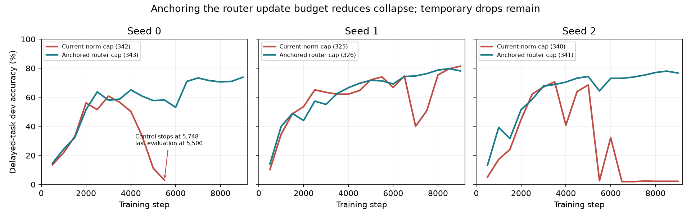

# Training findings and next changes — 10 November 2026

The strongest current intervention is the anchored router update cap combined with wide gradient-norm calculation. It prevented complete collapse in all three tested seeds, but it has **not fixed training**: the anchored runs still lost as much as 12.0 percentage points during training, and none passed the key-binding probe. My recommendation is to keep that recipe as the experimental reference, measure the changes in model behavior around the remaining drops, and use those measurements to target the recurrent computation and routing. Further blanket learning-rate reductions or more rollback attempts have weaker support.

This review uses the canonical SQLite database through experiment 343, the saved failure and weight-intervention diagnostics, the A5 report and coordinator corrections, and source code at `3127fa4` plus the observational logging additions described below. Results are measurements of these runs, not claims of general reliability. The [extracted evidence](training_review/p1_17_training_review_2026_11_10.json) includes record hashes, data selections, evaluation curves, status, and source paths. No new training outcome is claimed in this report.

The most important reporting correction is that the recent GRU and Transformer overall scores include **five tasks**, while the HSN/A5 runs train and evaluate **delayed only**. I previously reported those aggregate scores without making this difference sufficiently explicit. Their 92% overall scores do not mean 92% delayed-memory accuracy.

| Experiment | Model and steps | Overall dev | Delayed-task dev | Later queries |
| --- | --- | ---: | ---: | ---: |
| 331 | Dense HSN, 9k | 79.82% | 79.82% | 61.99% |
| 332 | Dense HSN, 12k | 77.80% | 77.80% | 58.08% |
| 334 | GRU, 9k | 81.85% | 79.16% | 60.66% |
| 335 | GRU, 12k | 83.32% | 79.68% | 61.72% |
| 336 | GRU, 27k | 92.00% | 78.69% | 59.86% |
| 337 | Transformer, 9k | 77.60% | 36.92% | 20.96% |
| 338 | Transformer, 12k | 88.24% | 35.32% | 23.89% |
| 339 | Transformer, 27k | 92.74% | 70.23% | 50.71% |

All are seed 0. HSN 27k was canceled as requested. Comparing the delayed column fixes the evaluation denominator, but training exposure still differs because the GRU/Transformer training mix contains five tasks. A fair architecture comparison also needs matched task selection, data fingerprints, answer/token exposure, training budget, precision, and hardware conditions. Future reports should display task selection beside overall accuracy and refuse to silently rank incompatible aggregates.

The paired cap results are more informative about the training fix because they share the same delayed task and recipe. Both sides use float64 gradient norms, cell/router update ratios of 0.003, lr 0.0025, beta2 0.95, and a 9k WSD schedule. The intervention only anchors the router's allowed update radius to its initial norm.

| Seed | Current-norm cap | Anchored router cap | Anchored later queries | Largest anchored peak-to-subsequent drop |
| --- | --- | --- | ---: | ---: |
| 0 | 342: failed at 5,748; last evaluated 2.96% at 5,500 | 343: 73.85% final | 57.82% | 11.99 pp, 4,000→6,000 |
| 1 | 325: 81.42% final; 34.62 pp drop at 6,500→7,000 | 326: 78.17% final | 60.21% | 4.84 pp, 1,500→2,000 |
| 2 | 340: 2.16% final after a 70.65% peak | 341: 76.72% final | 57.10% | 9.92 pp, 5,000→5,500 |

These drops use the saved evaluations, every 500 steps. Unsampled declines can be larger. Seed 0 illustrates why a maximum adjacent-evaluation drop is insufficient: its largest adjacent drop was 5.74 pp, but its cumulative decline reached 11.99 pp. All three anchored runs finished without optimizer skips or rollbacks. Their key-swap follow rates were only 3.12%, 8.48%, and 3.73% for seeds 0, 1, and 2; unchanged-answer fractions were 92.98%, 79.61%, and 89.89%. The frozen binding requirements remain follow ≥50%, unchanged ≤10%, with at least 20 eligible cases. All three later-query scores remain below the existing 62.3% key-blind reference.

**What the evidence establishes.** The original cap limited each displacement to a fraction of the *current* weight norm. As that norm grew, the allowed absolute step grew too. In the original trio, router norm reached 6.32 in the successful run 272, compared with 15.86 and 24.17 in failed recipes 273 and 294. The association alone did not prove causation, but the later same-code anchored comparison provides stronger intervention evidence that controlling this feedback helps. The limiter already implements the ceiling and records the final applied displacement; this functionality should be retained, not implemented again.

An anchored radius still permits cumulative movement. Router norms in the anchored runs ended around 4.48, 6.92, and 7.51 despite initial reference norms around 0.70. Bounding individual steps does not bound total drift, routing changes, or sensitivity of the recurrent dynamics. The latest results support this distinction directly.

There is also a **confirmed numerical error distinct from the training instability**. At experiment 316 step 7,508, every captured gradient element was finite, but the native scalar norm overflowed to infinity. Recalculation gave a norm of 3.2566e20. Native clipping zeroed the gradient; the implemented float64 path preserved its direction and produced a norm approximately 1.0. This matches the extremal-norm behavior documented by [PyTorch](https://docs.pytorch.org/docs/2.15/notes/numerical_accuracy.html). The wide path fixes that reduction problem; it cannot repair genuinely non-finite backward values. Run 342 failed even with the wide path: non-finite gradients appeared at 5,739 and ten consecutive skipped updates ended the run at 5,748. Its saved dump reports NaNs across many upstream modules. The first operation producing those NaNs still needs to be isolated.

The weight-intervention diagnostics implicate several interacting paths, not a single bad document or universally guilty parameter group. On the same captured window from 235, replacing earlier encoder or predictor weights reduced the raw norm by about 265× or 495×. For 239, replacing the shared path reduced it about 55×, while replacing the router reduced it only 1.49×. These mixed-checkpoint interventions change sensitivity, but do not establish which module initiated drift. Lower gradient norm alone also does not prove improved prediction. See the [intervention results](/home/joe/hsn-experiments/a5-stability/selector-results.md).

Large raw gradients do not directly flood Adam's moments: the training loop clips gradients before the optimizer. Update direction and the effect of a finite displacement remain open questions. Likewise, bounded cell-state values do not imply bounded derivatives through recurrent composition. The theoretical motivation for studying that amplification is described by [Pascanu, Mikolov and Bengio](https://proceedings.mlr.press/v28/pascanu13.html); the paper does not identify which HSN path is responsible.

**What has not worked reliably.** Original memory/router caps succeeded on one of three historical seeds. Broader caps, tighter caps, gradient-growth damping, and shortcut dropout failed to deliver a reliable solution across their tested seeds. Lowering lr to 0.001 produced a 66.75% run at 9k (295), but the 18k exposure run (298) ended at 1.98%. That longer run also changed the WSD horizon and execution varied between attempts, so it is evidence against declaring low lr a general solution, not an exact continuation experiment. The earlier adaptive controller preserved some behavior by nearly stopping learning. Rollback rescued some trajectories temporarily and remains recovery machinery; it does not establish prevention of the drift.

**Priority 1: make failure visible before choosing another optimizer change.** Add queryable task-specific scores, complete evaluation drawdown, failure/partial status, applied-update measurements, and binding outcomes. These are now exposed by the optional `training_measurements`, `training_evaluations`, `training_diagnostics`, and `training_steps` SQL views. Historical JSON records remain authoritative, and missing measurements stay NULL. Failed runs keep NULL final scores, with their saved partial evaluation labeled separately. The schema version remains compatible with the other existing worktrees.

The added logging is deliberately observational. `diag_stability=true` samples route-set changes across observations on the same diagnostic documents and measures how a fixed small perturbation of recurrent state changes later state and logits. Position, horizon, and perturbation size are configuration fields. It preserves model mode, RNG, parameters, and the training stream. Measurements are labeled eager/no-autocast: a directional finite difference is not a spectral norm, the compiled backward, or evidence that all perturbation directions are stable. Resets and padding are excluded from the sensitivity denominator, and eligible counts are stored. Route churn's first observation is NULL and its reference step is recorded; restarting an observer restarts that comparison history.

Worker telemetry adds timestamped device GPU utilization, device memory, and experiment-process memory through `training_gpu_samples`. The worker's latest reported training step is approximate alignment, not an exact timestamp for an optimizer update. Sampling is bounded and records dropped samples. A one-second poll can reveal sustained dips but misses short kernel-scale gaps; CPU sampling can lengthen intervals. Device utilization includes other device activity, so the existing card-isolation record remains necessary.

**Priority 2: capture the onset and test whether each signal predicts damage.** Finite drops can occur with all gradients finite and without a guard firing. Extend bounded event capture so it can trigger independently of skip/rollback decisions, based on training-only observations of sustained sensitivity change, route churn, and monitor-loss change. Preserve pre-update optimizer state, RNG, loader position, recurrent state, previous byte, and before/after applied weights. Record raw and clipped gradients separately. Current diagnostics sampled every 250 steps can miss the initiating event; they must not be described as an exact event replay.

Evaluate signal usefulness on held-out seeds and repeat attempts: warning lead time before an accuracy drop, false alarms per training interval, missed drops, and compute cost. Compare against a simple gradient-norm signal. Dev curves are suitable for auditing predictions after the run; they should not become an online controller's tuning input. Freeze trigger choices before confirmatory runs. A tiny step or low gradient is not automatically useful learning.

**Priority 3: target the recurrent path identified by the captures.** Keep wide clipping and the anchored router cap in the experimental reference. Compare the same captured window under early/late weights and state, and separate the actual forward response from the straight-through backward estimator. Examine gate and candidate derivatives, predictor/shared paths, routing margins, and cumulative applied movement. Extend selected caps only where those interventions show a benefit; failed broad-cap sweeps argue against indiscriminately slowing every module.

Candidate normalization (A4) is an available, opt-in experiment, not an established fix: dense HSN uses it while these A5 runs explicitly disable it. No A5-plus-A4 run is registered through 343, but earlier top-K/A4 runs include failures (188 and 193), so enabling it cannot be assumed to solve routed training. If captures implicate candidate amplification, test A4 with the anchored reference and matched seeds, checking that its sparse straight-through selection gradient remains intact. Any new recurrent equation or regularization objective needs an explicit opt-in amendment and the existing guardrails.

A more dynamic update controller is a secondary option after signals prove useful: propose a bounded step, measure its effect on a fixed training monitor, and reduce the responsible group's radius when the step causes damage. It must retain every document and advance optimizer moments, EMA, scheduler, stream, and recurrent state exactly once for an accepted step. A rejected trial must restore all of them before retrying; scaling weights alone is insufficient. Validate both learning speed and retained accuracy. This remains a proposed experiment, not a guarantee against a future drop, and is more expensive than the logging added here.

**Priority 4: diagnose binding separately from stability.** The decoder already receives selected-cell readout, summary `q`, and shared input `u`; lack of key-swap following does not by itself prove the decoder ignores the cells. Route identity, value storage, overwrite, and readout each need an intervention. On stable checkpoints, compare factual and swapped-key routes, intervene on the selected-cell values, and measure the contribution of each decoder input while holding the rest fixed. Use the existing oracle-gate diagnostic before further architecture changes where required by the A5 plan. Dropout already failed in its tested settings, so stronger dropout is not the next default. Preserve the held-out-key metric, task distribution, and binding thresholds.

**Priority 5: measure the performance problem directly.** HSN 9k used 8,156 MiB peak process GPU memory and 208.92 ms median steps, against GRU's 710 MiB and 15.96 ms in these recipes. These are descriptive measurements, with different training mixes, execution paths, and architectures. The observed HSN utilization dips and GRU's gradual memory growth are useful leads, not evidence of a particular bottleneck or memory leak. Collect CPU/CUDA phase traces separating training, data preparation, diagnostics, evaluation, compilation, and checkpoint writes; distinguish allocated memory, allocator-reserved memory, process VRAM, and host RAM. [PyTorch's profiler](https://docs.pytorch.org/tutorials/recipes/recipes/profiler_recipe.html) supports the timing attribution needed before optimizing synchronization or sparse kernels. The new telemetry alone does not provide that attribution or energy measurements.

Reproducibility must accompany these comparisons. Runs 299 and 300 had the same code, config, seed, and data but diverged in gradient norm at step 2 and loss at step 3. Controlled seeds exist; execution is still variable. Record backend, compiler/cache settings, precision, deterministic flags, threads, and data fingerprint, and repeat at least one seed when testing a promising fix. [PyTorch's reproducibility guidance](https://docs.pytorch.org/docs/2.15/notes/randomness.html) explains why seeds alone are insufficient. Near-tied routing remains a plausible amplifier; [top-K ties are not guaranteed stable](https://docs.pytorch.org/docs/2.15/generated/torch.topk.html), but that is not proof of the cause of these particular failures.

The next bounded queue should first validate the logger on a short run, then compare current-reference and anchored-router seed 2 at the existing 9k schedule. A short delayed-only GRU baseline provides a task-matched measurement and telemetry reference. Allow roughly an hour after validation, retain all records and checkpoints, and stop admitting work if it cannot fit the remaining window. This queue investigates and validates instrumentation; it does not change the training algorithm. Before promoting a subsequent training fix, require stable completed runs across the existing controlled seeds, report worst drawdown and final/later accuracy together, verify useful learning continues, and pass the unchanged binding and framework checks. Longer exposure is needed before claiming that a late catastrophic decline has been prevented.

Local sources beyond the SQLite extract: [A5 report](/home/joe/A5-report.md), [coordinator corrections](/home/joe/hsn-handoff/NOTE-for-codex-A5.md), [original cap analysis](/home/joe/hsn-experiments/a5-cap-followup/original-cap-analysis.json), [norm-overflow validation](/home/joe/hsn-experiments/a5-stability/norm-clipping316-validation.json), [repeatability evidence](/home/joe/hsn-experiments/a5-stability/prefix-repeatability.json), and [cap semantics](amendments/A5_update_norm_reference.md).

Implementation validation before queue launch: 64 focused tests passed after the final integration
changes, including SQL partial-result handling, cumulative drawdown, logging noninterference,
route-set semantics, telemetry bounds, worker behavior, and protocol identity. An earlier broader
selection passed 96 tests; these selections overlap. Two CUDA checks passed (the default-training
golden and update-cap coverage). Lint and targeted strict type checks passed. The canonical
database was backed up before view installation. The logging check and full GPU experiment
outcomes remain pending at this report revision.
