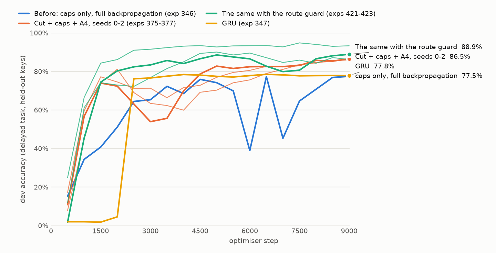

# A6 results — the A5 accuracy drops, the GPU pauses and the GRU bar (10 Nov 2026)

Branch `claude/a5-fix` (from `codex/a5-norm` at `38123a1`). Every score comes from the canonical
SQLite database `/home/joe/hsn-experiments/experiments.sqlite`; the replay evidence, probe scripts
and logs are in `/home/joe/hsn-experiments/a5-fix/`. Runs are 9,000 steps of the A5 recipe (top-K
routing, key addresses, selected-cell readout, lr 2.5e-3, β2 0.95, WSD, float64 gradient norms) on
the delayed task, B32, compiled, unguarded: no spike guard, no rollback, every document kept.

**What came out.**

1. *The collapses.* The mid-run accuracy drops of the A5 runs are exploded gradients through the
   *feedback reads* of the recurrent state, taken as full-size steps along one document's
   direction. Cutting those reads out of the backward pass (`train.feedback_detach`, opt-in,
   forward unchanged) removes them on every seed (sections 1 to 3).
2. *The accuracy.* With the cut, the candidate norm of amendment A4 trains (it diverged before)
   and the recipe finishes above every GRU run on every one of six seeds (section 3c).
3. *The sag.* That recipe still loses 5 to 21 points mid-run and recovers. The cause is a
   router unit taking over the positions where values are written, which undoes the key binding
   (section 3d). `train.route_guard` (opt-in) halves that unit's router step when the takeover
   starts, at whatever step that is; on all six seeds the deep sag is gone and the final score
   is higher (section 3e).
4. *The GPU pauses* were the diagnostics and probes running eager forwards, and Python's garbage
   collector; both are fixed (section 4).

| 9,000 steps, delayed task, dev (held-out keys) | Final dev | Later queries | Worst drop during the run |
| --- | ---: | ---: | ---: |
| Before: anchored caps, full backpropagation (exps 343 / 326 / 346, seeds 0 / 1 / 2) | 73.8 / 78.2 / 77.5 % | 57.8 / 60.2 / 62.5 % | 12.0 / 4.8 / 36.9 pp |
| Before: current-norm caps (exps 342 / 325 / 345) | failed / 81.4 / 2.2 % | – / 65.3 / 2.2 % | 57.9 / 34.6 / 66.8 pp |
| Feedback cut + anchored caps (exps 360 / 361 / 349) | 81.2 / 79.0 / 84.0 % | 65.8 / 66.6 / 70.7 % | 2.2 / 6.8 / 4.5 pp |
| + A4, scored on averaged weights, seeds 0 to 5 (exps 375-377, 418-420) | 85.9 / 86.5 / 86.5 / 84.7 / 82.1 / 84.6 % | 76.7 / 76.3 / 75.8 / 79.0 / 71.0 / 73.6 % | 10.9 / 21.3 / 20.0 / 5.1 / 13.7 / 14.7 pp |
| **+ route guard, seeds 0 to 5 (exps 421-426)** | **86.2 / 93.3 / 88.9 / 95.6 / 84.9 / 85.3 %** | **75.8 / 92.3 / 82.1 / 94.1 / 81.2 / 75.3 %** | **5.8 / 1.8 / 8.7 / 1.5 / 5.2 / 6.0 pp** |
| GRU, delayed task (exps 154, 347, 204, 206, 405-407) | 76.7 to 79.3 % | 56.2 to 59.7 % | 0.5 to 1.3 pp |

Means over the six seeds: 85.1 % without the guard and 89.0 % with it (higher on every seed, by
0.3 to 10.9 points), against 79.3 % for the GRU's best run. Later queries, where the dev keys
were never seen in training and a key-blind reader tops out at 62.3 %: 75.4 % and 83.5 %, against
56 to 60 %. No step is skipped in any of these runs. With the guard the model reaches 0.6 dev at
step 1,000 to 1,500 and stays above it (the GRU's speed bar is 2,500 to 3,000). Ten runs pass the
frozen key-binding verdict, the first of this project: three of the six guarded 9k runs (exps
422, 424, 425) and one of the six unguarded (exp 418), and six runs stopped at step 5,000 (exps
384, 386, 389, 399, 401, 413); the others are "partial".

Over 27,000 steps the recipe ends at 90.6 % with the guard and at 90.6 % without it (later
queries 83.5 % and 82.8 %, exps 417 and 416), against 78.7 % for the GRU and 70.2 % for the
Transformer at 27k. The guard changes the path, not the end: with it the run is at 90.6 % by step
3,000 and between 88 and 95 % from there on; without it the run sags to 78.6 % at step 3,000 and
needs the whole schedule to climb back.



(Thick lines are seed 2, thin lines seeds 0 and 1. The GRU line is exp 347, the delayed-only run,
evaluated every 500 steps: chance until step 2,000, 76.2 % at 2,500, then a plateau; every stored
delayed-only GRU run has that shape. The HSN lines from "cut + caps + A4" on are scored on
averaged weights, which changes the curve's noise and not its end point: section 3b.)

## 1. What the drops are

`docs/p1_17_training_findings_2026_11_10.md` left the cause open ("capture the onset ... target the
recurrent computation and routing"). I replayed training windows on the stored checkpoints of exps
345 (current-norm caps, before its collapse) and 346 (anchored caps, inside its 36.9-point drop),
weights frozen, and repeated the backward pass of the exploding windows with one path cut at a
time (`a5-fix/probe/probe_paths.py`, `p345_5000.json`, `p346_6000.json`; forward values identical
across variants).

| Cut in the backward pass | 346 @ 6,000, worst window | 345 @ 5,000, worst window |
| --- | ---: | ---: |
| nothing (the training gradient) | 159.2 | 29.0 |
| the selection's mask (straight-through) | 158.2 | 29.2 |
| the selection's unit weights | 159.6 | 29.0 |
| every scorer feature (`u`, `ε`, `h`) | 158.2 | 29.2 |
| the gate | 105.6 | 28.1 |
| `q → P` (the predictor's read of the summary) | 65.7 | 28.4 |
| `q → S` (the shared transform's read) | 37.5 | 4.7 |
| both reads of `q` | 6.9 | 4.7 |
| the cell's read of `u` and `ε` | 13.6 | 22.6 |
| the cell's read of its own `h` and the messages | 2.5 | 29.5 |
| an ordinary window, nothing cut | 2 to 3 | 1.8 |

What this shows:

- **Not the router's estimator.** Detaching the straight-through mask, the unit weights or all
  scorer features leaves an exploding window's gradient unchanged. The paths that matter are the
  *feedback reads* of the recurrent state: the summary `q` read by `P` (through `ε`) and by `S`
  (through `u`), and a cell's read of its own state and its neighbours' messages.
- **Jumps, not growth.** The state gradient is flat along the window and jumps 7× to 22× at single
  positions (346, window 67: 0.59 for every position after 14, 13 at position 13, 27 before
  position 9). Several jumps in one document multiply.
- **A cell of hard switches.** From step 1,500 on, 95 to 99 % of the candidate's coordinates are
  saturated (`|c| > 0.99`) and the gate is either closed or fully open (1 to 2 % open, mean 0.015).
  Such a cell passes almost no gradient anywhere and a very large one where a coordinate is in
  transition. The forward dynamics are just as sharp: a 1e-3 perturbation of the state at position
  32 has grown 120 to 1,000 times 96 positions later at step 6,000 and 220 to 830 times at the
  healthy step 4,500 (10 to 330 times at steps 1,500 and 8,500; `prof346_*.json`).
- **One document takes the step.** The exploding document's gradient is 10 to 10⁹ times the
  others'. The global clip rescales the batch by that norm, so the other 31 documents vanish from
  the step and AdamW moves at full size along one document's switching direction. A burst is some
  hundreds of such steps (346: a tenth of the steps above a norm of 350 in steps 5,751 to 6,000
  and above 4,300 in 6,001 to 6,250, against a run median of 2).
- **A second mechanism, in the router.** Without the update caps the router's weights grow
  without bound and its routes churn (345: norm 0.7 → 16 before the collapse; exp 355 and 356
  below: 15 and 19 by step 4,500). Top-K always writes K cells; most positions are filler, where a
  write can only hurt, so the selected cells receive a steady "should not have been selected"
  gradient and the router keeps moving away from whatever feature currently picks them. The caps
  hold this back (they cut the router's step about tenfold and the cell's about twofold: 346's
  proposed update ratios are 0.027 and 0.0075 against caps of 0.003).
- **A4 is not the answer here.** With the candidate norm the candidate is not saturated, and the
  same feedback loops compound smoothly instead of in jumps: exp 350 (A4, full backpropagation, no
  caps) reached gradients of 10³⁶ to 10³⁸ and non-finite values at step 1,479.

## 2. What was changed

All opt-in, left out of the configuration hash at the defaults, forward values unchanged; the
equations of §2.2–§2.6 run as before (`docs/amendments/A6_feedback_gradient.md`).

- **`train.feedback_detach`** — the named feedback reads are constants in the backward pass. With
  `[summary, eps, state, router]` the state's backward recurrence is the gated carry `(1 − b) ⊙ h`
  alone, which cannot amplify (tested against the exact product of the gates). The memory path of
  this task (write from `u`, hold by the carry, read by the decoder) keeps its full gradient.
- **`train.state_grad_ratio`** / **`train.state_grad_clip`** — every path kept; at each position a
  document's gradient into the state is limited to a multiple of the batch's typical document
  there (or to an absolute number). A healthy window is plain backpropagation through time.
- **`model.address_init`** — the start value of the scorer's two address columns (A5 extension).

Framework: the diagnostics' state window and the end-of-run probes replay compiled graphs instead
of the eager forward; records carry `phases`; `scripts/gpu_phase_report.py` attributes the card's
time series (section 4).

## 3. Runs

Seed 2 is the seed of exp 345 (collapse) and exp 346 (36.9-point drop). "Worst drawdown" is the
largest fall from an earlier peak over the saved evaluations (every 500 steps). Arms shared the
card three at a time, so step times are not timings. `final` of a failed or cancelled arm is not a
score; its last evaluation is given.

**The recommended recipe** — `train.feedback_detach=[summary,eps,state,router]` with exp 346's
caps (`cell.*` and `router.*` at 0.003, the router's radius anchored to its initial norm):

| Exp | Recipe | Final dev | Later | First | Worst drawdown | Skips | Swap follow / unchanged | Binding | Router norm |
| --- | --- | ---: | ---: | ---: | ---: | ---: | --- | --- | ---: |
| 360 | **cut + caps**, seed 0 | 81.2% | 65.8% | 98.5% | 2.2 pp | 0 | 15.5% / 64.8% | does not bind keys | 1.84 |
| 361 | **cut + caps**, seed 1 | 79.0% | 66.6% | 92.9% | 6.8 pp | 0 | 24.3% / 44.5% | partial | 2.19 |
| 349 | **cut + caps**, seed 2 | 84.0% | 70.7% | 98.9% | 4.5 pp | 0 | 24.6% / 53.1% | partial | 2.01 |

**What each part does** (seed 2):

| Exp | Recipe (seed 2) | Final dev | Later | First | Worst drawdown | Skips | Swap follow / unchanged | Binding | Router norm |
| --- | --- | ---: | ---: | ---: | ---: | ---: | --- | --- | ---: |
| 346 | caps only (before) | 77.5% | 62.5% | 94.3% | 36.9 pp | 0 | 9.1% / 73.6% | does not bind keys | 2.67 |
| 348 | cut only | 78.2% | 59.9% | 98.9% | 4.0 pp | 0 | 11.0% / 68.0% | does not bind keys | – |
| 349 | **cut + caps** | 84.0% | 70.7% | 98.9% | 4.5 pp | 0 | 24.6% / 53.1% | partial | 2.01 |
| 368 | `[summary, eps]` cut + caps | 76.3% | 56.5% | 98.7% | 4.0 pp | 0 | 3.5% / 90.0% | does not bind keys | 4.25 |
| 364 | `state_grad_ratio=3` + caps | 68.2% | 47.2% | 91.9% | 71.5 pp | 0 | 6.2% / 80.5% | does not bind keys | 5.79 |
| 355 | `state_grad_clip=4`, no caps (collapsed at 7,000; cancelled at 8,220) | – | – | – | 52.7 pp | 0 | – / – | – | – |
| 354 | `state_grad_clip=4` + `address_init=1`, no caps (at chance from 1,000; cancelled) | – | – | – | 19.1 pp | 0 | – / – | – | – |
| 356 | cut + `address_init=1`, no caps (drifting down; cancelled at 5,177, last evaluation 30.2 %) | – | – | – | 14.5 pp | 0 | – / – | – | – |
| 363 | cut + caps + `address_init=1` | 77.4% | 59.9% | 97.1% | 14.3 pp | 0 | 10.9% / 74.5% | does not bind keys | 23.08 |
| 366 | cut + cell cap + `address_init=1`, router frozen (`router_lr_mult=0.001`) | 63.1% | 66.5% | 59.3% | 13.5 pp | 0 | 30.3% / 49.3% | partial | 4.06 |
| 350 | A4, full backpropagation, no caps (non-finite at 1,479; stopped at 1,487) | – | – | – | 0.0 pp | 10 | – / – | – | – |

The router norm is the last diagnostic sample's; runs without an update limiter do not record it
(348 ends at 10.2, measured from its checkpoint).

- *The cut alone* (348) is as smooth as with the caps but stays at the key-blind level: its router
  grows to a norm of 10 (0.7 at the start; 2.0 with the caps) and later queries do not improve.
- *The caps alone* (346, and 343 / 326 on the other seeds) do not remove the drops.
- *Cutting only the summary's readers* (`[summary, eps]`, 368) is as smooth as the full cut on this
  seed but ends at the key-blind level.
- *A limit on the state gradient instead of the cut* does not remove them either. An absolute
  per-document limit (355) collapsed at step 7,000 with the router at norm 23; the scale-free
  limit with the caps (364) learned faster than any other arm here (0.67 at step 2,500, 0.73 at
  4,000) and then fell to chance twice (steps 5,000 and 6,500). Both keys stay in the code, opt-in, because these runs are in the
  database; neither is a fix.
- *Starting the address columns at 1* (`model.address_init`) gives a fast start (0.52 at step
  1,000 in 363) that does not last: the router moves away from the address routes (in 356 the
  `a_prev` column goes from 0.9 to 0.0 and the other columns' norm from 2.9 to 18.8 by step
  4,500). With the router all but frozen on those routes (366) the
  key swap is followed more often than in any other run (30.3 %, unchanged 49.3 %) and later
  queries are at 66.5 %, but the first query falls to 59.3 % and the run ends at 63.1 %. So the
  memory does follow the key when the routes are consistent; a write route and its query's read
  route share only about a third of their cells under this prior (0.34 simulated, 0.125 by
  chance), which is not enough.
- *A4 with full backpropagation* (350) is non-finite by step 1,479.

**The full run** (exp 371: the recipe on seed 2 for 27,000 steps, alone on the card):

| | Final dev | Later | First | Worst drawdown | Skips | Swap follow / unchanged | Binding |
| --- | ---: | ---: | ---: | ---: | ---: | --- | --- |
| Routed HSN, cut + caps, 27k (exp 371) | 90.0% | 82.1% | 98.9% | 5.4 pp | 0 | 44.0% / 29.3% | partial |
| GRU 2M, 27k, five-task mix (exp 336), delayed task | 78.7% | 59.9% | – | – | 0 | – | – |
| Transformer 2M, 27k, five-task mix (exp 339), delayed task | 70.2% | 50.7% | – | – | 0 | – | – |
| Transformer 2M, 27k, delayed only (exp 262) | 49.9% | 31.9% | – | – | 0 | – | – |

It reaches 0.6 dev at step 3,500, holds 74 to 85 % from step 8,500 to the start of the decay
(21,600) and is still rising at the end (86.3 % at 23,000, 88.7 % at 24,500, 90.0 % at 27,000).
The gain over the 9k runs is on later queries (70.7 % → 82.1 %) and the key swap is followed
almost twice as often (24.6 % → 44.0 %), still under the frozen 50 % threshold. One seed.

## 3b. The wobble, and scoring averaged weights

With the cut the recipe no longer collapses, but its dev accuracy still moves from one evaluation
to the next (`a5-fix/wobble.py`, evaluations after step 3,000):

| Run | Typical change between evaluations | Largest fall |
| --- | ---: | ---: |
| before, caps only (exp 346) | 6.5 pp | 31.9 pp |
| cut + caps (exps 360 / 361 / 349) | 1.8 / 1.8 / 3.0 pp | 2.2 / 1.2 / 4.0 pp |
| cut + caps, 27k (exp 371) | 1.9 pp | 5.4 pp |
| GRU (exp 347) | 0.4 pp | 0.7 pp |

It is noise of the last few optimiser steps, not of the solution. Replaying exp 371 from step
15,000 with an evaluation every 100 steps (`a5-fix/probe/ema_probe.py`, 14 evaluations):

| Weights scored | Mean dev | Range | Typical change | Largest fall |
| --- | ---: | ---: | ---: | ---: |
| the training weights | 79.6% | 70.0 to 83.2% | 3.2 pp | 10.8 pp |
| their moving average, decay 0.99 | 85.3% | 83.5 to 86.4% | 0.7 pp | 1.7 pp |
| their moving average, decay 0.998 | 85.2% | 81.0 to 87.1% | 0.7 pp | 0.9 pp |

`train.weight_ema` (opt-in; the amendment's "which weights are scored") makes the average what a
run's evaluations and probes score; training is unchanged step for step. At the end of a run,
after the learning-rate decay, the two coincide (exps 375 to 377: 85.9 / 86.5 / 86.5 % averaged,
85.9 / 86.7 / 86.4 % for the training weights), so the average changes the curve, not the final
score. The GRU gains nothing from it either (`p1_18_a6_ema_gru`, delayed-only, 9,000 steps: 77.8 %
on seed 0 with the average, exp 405, against 77.8 % without, exp 347; 78.4 % with and 76.7 %
without on seed 2, exps 406 and 407, two separate runs), so the comparison below is not an
artefact of how the HSN is scored.

One change at a time on seed 2 (`p1_18_a6_wobble`, against exp 349's 84.0 %): a peak rate of
1.5e-3 has no fall at all but learns more slowly and ends at 80.7 % (exp 373); a cosine schedule
ends at 65.3 % (exp 374); the candidate norm is the next section.

## 3c. With the candidate norm (A4)

Under full backpropagation the candidate norm of amendment A4 (`model.cand_norm=rms`) diverged
(exp 350). With the feedback cut it trains without a burst (largest gradient norm of exp 372:
4.1), learns faster than any other arm, and ends higher:

| Exp | Recipe, 9,000 steps | Final dev | Later | First | 0.6 dev at | Swap follow / unchanged | Binding |
| --- | --- | ---: | ---: | ---: | ---: | --- | --- |
| 372 | cut + caps + A4, seed 2, training weights | 88.9% | 80.5% | 98.4% | 2,000 | 61.1% / 19.9% | partial |
| 375 | cut + caps + A4, seed 0, averaged weights | 85.9% | 76.7% | 96.3% | 1,500 | 42.0% / 34.0% | partial |
| 376 | cut + caps + A4, seed 1, averaged weights | 86.5% | 76.3% | 98.1% | 1,500 | 52.9% / 28.0% | partial |
| 377 | cut + caps + A4, seed 2, averaged weights | 86.5% | 75.8% | 98.6% | 1,500 | 36.8% / 40.0% | partial |
| 418 | cut + caps + A4, seed 3, averaged weights | 84.7% | 79.0% | 91.1% | 1,000 | 77.9% / 9.8% | binds keys |
| 419 | cut + caps + A4, seed 4, averaged weights | 82.1% | 71.0% | 94.6% | 1,500 | 33.5% / 48.7% | partial |
| 420 | cut + caps + A4, seed 5, averaged weights | 84.6% | 73.6% | 96.9% | 1,500 | 31.9% / 50.5% | partial |
| 349 / 360 / 361 | cut + caps, without A4 | 84.0 / 81.2 / 79.0% | 70.7 / 65.8 / 66.6% | – | 4,000 to 4,500 | 15 to 25% | – |

Six seeds scored on averaged weights (exps 375 to 377, 418 to 420): 85.1 % mean (82.1 to 86.5),
75.4 % on later queries (71.0 to 79.0), against 81.4 % and 67.7 % without A4 (three seeds) and
76.7 to 79.3 % for the GRU's runs. Every one of the six is above every GRU run. No step skipped.

Over 27,000 steps (exp 416, seed 2, alone on the card) the same recipe ends at 90.6 % (later
queries 82.8 %, first 99.4 %, swap followed 55.2 %), where the recipe without A4 ended at 90.0 %
(exp 371): the candidate norm changes how fast the model gets there (0.6 dev at step 2,000
against 3,500), not where a long run ends. With the average, the dev accuracy of exp 416 moves
0.5 points between evaluations after step 3,000 (largest fall 1.1), against 1.9 (5.4) in exp 371.

**But every run sags mid-run.** After reaching 72 to 92 % by steps 1,500 to 2,500, each falls
and then recovers: worst drawdown 14.0 / 10.9 / 21.3 / 20.0 / 5.1 / 13.7 / 14.7 points for exps
372, 375, 376, 377, 418, 419, 420, and 13.1 in the 27k run (91.7 % at step 2,500, 78.6 % at
3,000). Seeds 1 and 2 drop back under 0.6 dev during it, so the speed bar is passed and then
lost. Gradient norms stay ordinary throughout; this is not the burst of section 1.

## 3d. What the sag is: the router takes the value routes away

`route-check` and two read-only probes on the kept checkpoints (`a5-fix/routecheck/`,
`a5-fix/probe/route_flip.py`, `address_columns.py`):

| Run @ step | Query route ∩ its fact's value-write route | ∩ other facts' |
| --- | ---: | ---: |
| 375 @ 2,000 → 3,500 | 0.47 → 0.16 | 0.13 → 0.12 |
| 376 @ 2,000 → 4,000 → 9,000 | 0.51 → 0.17 → 0.14 | 0.10 → 0.12 → 0.13 |
| 377 @ 2,000 → 3,000 | 0.44 → 0.19 | 0.12 → 0.11 |
| 372 @ 9,000 | 0.16 | 0.13 |
| 386 @ 5,000 (binds keys, below) | 0.62 | 0.10 |

At step 2,000 a value is written into the cells its key selects: the key-address mechanism of A5
binds. By steps 3,000 to 4,000 it no longer does, and it does not come back; the runs recover to
86 % by a weaker strategy.

How it is lost (exp 376): the positions where a fact's value is written are served by two
dedicated router units (their weight is on the *previous* byte's address, the key); every other
position by one common unit. That unit then takes the value positions over:

| Step | Value-position slots on the dedicated units | On the common unit | Binding overlap (train documents) |
| ---: | ---: | ---: | ---: |
| 1,500 | 63% | 38% | 0.56 |
| 2,000 | 44% | 55% | 0.46 |
| 2,500 | 23% | 76% | 0.31 |
| 3,000 | 14% | 85% | 0.22 |
| 4,000 | 5% | 95% | 0.17 |

In every run inspected (376, 389, 396, 398) the unit that takes them is the one that reads the
query keys. Its weight on the *current* byte's address grows at a steady pace for the whole run
(0.11 → 0.55 in exp 376, 0.13 → 0.62 in exp 389) while the value units' weights level off (0.15
to 0.29); when its scores overtake theirs, top-K hands it the positions, the value units stop
receiving a gradient there and cannot win them back. For a given class of positions the switch
can be abrupt: in exp 386 the training loss doubled within ten steps (2,801 to 2,810) at ordinary
gradient norms. The takeover is not tied to a step count.

**Fixed settings delay it and do not prevent it** (seed 1; all scored on averaged weights):

| Exp | Change against exp 376 | Steps | Peak dev (step) | Final dev | Later | Swap follow / unchanged | Binding |
| --- | --- | ---: | ---: | ---: | ---: | --- | --- |
| 376 | – | 9,000 | 81.2% (2,000) | 86.5% | 76.3% | 52.9% / 28.0% | partial |
| 386 | cell and router caps halved (0.0015) | 5,000 | 89.5% (5,000) | 89.5% | 87.8% | 91.1% / 1.7% | **binds keys** |
| 384 | peak rate 1.5e-3 | 5,000 | 87.3% (4,500) | 82.4% | 79.3% | 84.5% / 6.7% | **binds keys** |
| 385 | caps on encoder, shared transform, predictor too | 5,000 | 73.9% (5,000) | 73.9% | 55.9% | 43.5% / 37.9% | partial |
| 388 | cell and router caps halved, full length | 9,000 | 93.1% (3,000) | 84.6% | 75.0% | 70.7% / 15.0% | partial |
| 387 | peak rate 1.5e-3, full length | 9,000 | 93.7% (4,000) | 73.1% | 64.1% | 67.9% / 14.9% | partial |
| 389 | `train.adaptive_lr` (loss-triggered rate cuts) | 5,000 | 97.4% (3,000) | 89.0% | 89.0% | 88.5% / 2.5% | **binds keys** |

While the value routes hold, the model binds held-out keys: exps 384, 386 and 389 are the first
runs to pass the frozen key-swap verdict, and later-query accuracy reaches 85 to 96 % (key-blind
level 62.3 %). They are stopped at step 5,000. Over the full length the same two settings lose
the route later (exps 387, 388) and end at or below the reference. The existing loss-triggered
controller (exp 389) cut every rate 4 to 32 times after its training monitor's loss jumped at
step 2,700, and the takeover went on at the same pace: the router's proposed step is about ten
times its update cap, so a rate cut does not change the step it actually takes. With the router
held still from step 1,500 of exp 376 (`probe/freeze_probe.py`) the run stays at 79 to 83 %
through step 2,750 and is at 74.9 % at 3,250, where the original is at 63.5 % by 3,000: most of
the damage is the router's own movement, not all of it.

## 3e. Acting on the takeover when it happens: `train.route_guard`

A fixed setting moves the takeover; it does not remove it. The guard
(`docs/amendments/A6_feedback_gradient.md`, "Related: `train.route_guard`") watches the routes
during training, with no extra forward pass, and when an established route is being taken over
while the training loss is no longer improving it halves the *applied* router step of the unit
that is taking it, at whatever step that happens. Three versions were run on the configuration
that sags (caps 0.003, lr 2.5e-3, A4, averaged weights):

| Version | What counts as the event | Runs | Result |
| --- | --- | --- | --- |
| 1 | routes lost to the unit with the most slots | exps 396-398 (seed 1, 5k) | did not work: the taker is not the most-used unit; 65.6 / 70.2 / 69.9 % |
| 2 | any established (input byte, unit) route lost; the unit that gained most | exps 399-401 (seed 1, 5k); 402-404 (seeds 0-2, 9k, stopped near step 4,000) | held once (90.3 % and 93.1 % at 5k, binds keys), then dips of 8 to 20 points on all three seeds: it slowed units that were picking up the filler's positions, never the taker |
| 3 | a unit that serves the supervised positions (from the loss mask) above its own record on bytes whose established routes belong to other units | exps 413-415 (seeds 0-2, 5k); 421-426 (seeds 0-5, 9k); 417 (27k) | the deep sag is gone on every seed; 89.0 % mean at 9k against 85.1 % |

Version 3 over the full 9,000 steps against the same configuration without the guard (averaged
weights; the two differ in nothing else):

| Seed | With the guard | Later | Worst drawdown | Swap follow / unchanged | Events | Without | Later | Worst drawdown |
| ---: | ---: | ---: | ---: | --- | ---: | ---: | ---: | ---: |
| 0 | 86.2% (exp 421) | 75.8% | 5.8 pp | 50.4% / 28.4%, partial | 40 | 85.9% (exp 375) | 76.7% | 10.9 pp |
| 1 | 93.3% (exp 422) | 92.3% | 1.8 pp | 93.4% / 2.3%, **binds keys** | 62 | 86.5% (exp 376) | 76.3% | 21.3 pp |
| 2 | 88.9% (exp 423) | 82.1% | 8.7 pp | 62.1% / 15.0%, partial | 44 | 86.5% (exp 377) | 75.8% | 20.0 pp |
| 3 | 95.6% (exp 424) | 94.1% | 1.5 pp | 96.8% / 1.3%, **binds keys** | 48 | 84.7% (exp 418) | 79.0% | 5.1 pp |
| 4 | 84.9% (exp 425) | 81.2% | 5.2 pp | 83.0% / 7.4%, **binds keys** | 63 | 82.1% (exp 419) | 71.0% | 13.7 pp |
| 5 | 85.3% (exp 426) | 75.3% | 6.0 pp | 58.4% / 20.1%, partial | 57 | 84.6% (exp 420) | 73.6% | 14.7 pp |
| mean | 89.0% | 83.5% | | | | 85.1% | 75.4% | |

The first event comes at step 1,400 to 2,100 in each run, where the unguarded runs begin to sag;
by the end exactly one unit per run (the one that serves the answer positions) is at the floor
of its step scale and every other unit is untouched. The same guard stopped at step 5,000 (exps
413 to 415): 88.3 / 81.6 / 82.5 % with worst drawdowns of 6.8 / 3.1 / 0.0 points, against 77.0 /
70.3 / 82.8 % and 10.9 / 21.3 / 20.0 without.

A more sensitive setting (a reading every 50 steps, an event at 5 % lost) is worse, not better
(`p1_18_a6_final_guard_fast`, seeds 0 to 2, 9,000 steps: 95.3 / 77.9 / 81.3 %, exps 427 to 429,
against 86.2 / 93.3 / 88.9 % at the defaults): its first events come while the routes are still
forming, seed 1 then needs until step 4,000 to reach 0.6 dev, and seed 2 sags 21.8 points
anyway. The defaults stay.

Over 27,000 steps (seed 2, each run alone on the card):

| Dev accuracy at step | 2,500 | 3,000 | 6,000 | 9,000 | 12,000 | 15,000 | 18,000 | 21,000 | 24,000 | 27,000 |
| --- | ---: | ---: | ---: | ---: | ---: | ---: | ---: | ---: | ---: | ---: |
| with the guard (exp 417) | 87.3% | 90.6% | 93.1% | 93.3% | 92.6% | 90.6% | 89.9% | 90.7% | 91.8% | 90.6% |
| without (exp 416) | 91.7% | 78.6% | 84.1% | 86.1% | 86.3% | 87.0% | 88.0% | 87.8% | 89.5% | 90.6% |

The guarded run has no early sag (worst drawdown 7.2 points, from its peak of 95.4 % at step
10,000 to 88.1 % at 15,500, against 13.1) and ends where the unguarded one does: 90.6 %, later
queries 83.5 % against 82.8 %, swap followed 51.5 % against 55.2 %, both "partial". Through the
long constant-rate phase the guard fired 123 times, all on one unit, and the value routes still
eroded slowly.

What the guard does not do. It reduces the sag, it does not remove every fall: four of the six
seeds still slide 5 to 9 points late in the constant-rate phase (steps 5,000 to 7,000) before the
decay lifts them. On seed 0 the reader's router rows were at the floor (1/64 of their step) by
step 2,500 and the readings still showed its share creeping up, because the units that lose the
route also un-learn it (their weight on the previous byte's address is pushed through zero, exps
375 and 376), which slowing the taker cannot stop. An event that comes while the route is still
forming slows that run (exps 414 and 415 at 5k: 55 % and 77 % at step 3,500 before catching up).
The `restore` option (rewinding the gaining unit's rows) was worse in the one run that tried it
(exp 400: 77.9 %). Runs are not bit-reproducible on this card and the variation between two runs
of one configuration is several points (seed 1 with the second version: 90.3 % at step 5,000 in
exp 399, a 20-point dip in exp 403), so six seeds with one run each are an indication, not a
proof. The guard is opt-in and off by default.

## 4. The GPU pauses

`scripts/gpu_phase_report.py` on exp 346's card time series (alone on the card, one sample per
second; phases estimated from the reported step, since the run predates `phases`): 97 of the 961
samples during the fit are below 50 % utilisation (10.1 %), 78 of them within 30 steps of a
diagnostic or evaluation step; the GRU run 347 has none. The pauses are the 250-step diagnostics:
each sample ran the eager routed forward on four documents (0.85 s, twice per sample with an
update limiter) and a batched GPU SVD of 713 32×64 matrices for the participation ratio (0.47 s;
0.05 s on the CPU), 3.7 s per sample with the stability observer, 133 s of the run. The three
end-of-run probes ran the same eager forward for 79 s at about 25 % utilisation.

Changes (all values equal to the eager ones to rounding; an eager trainer is unchanged):

- the diagnostics' state window replays a compiled no-gradient variant of the training window
  that also returns the per-position states and gates (`CompiledWindow(..., capture=True)`),
  compiled once before training starts;
- the participation ratio is computed from the Gram matrix (`(Σσ²)² / Σσ⁴ = ‖H‖_F⁴ / ‖HHᵀ‖_F²`), no
  decomposition;
- the probes pad each batch to the evaluation window's shape and replay that graph
  (`PaddedWindow`), no new compile.

| Same recipe, same load (three arms on the card) | Diagnostics | Probes (v1 + v2 + v3) | Evaluations |
| --- | ---: | ---: | ---: |
| exp 349, eager diagnostics and probes | 465.7 s | 76.4 s | 62.7 s |
| exp 360, compiled diagnostics and probes | 12.4 s (0.36 s per sample) | 10.4 s | 34.7 s |

Alone on the card (exp 371, 27,000 steps): 108 diagnostic samples took 8.5 s in total (0.08 s
each; 3.7 s each in exp 346) and the three probes 5.0 s (78.9 s).

**What was left, and the second fix.** A 5 Hz trace of exp 371 still showed half-second dips to
0 % every 10 to 16 s (2.8 % of the time below 50 %), tied to no training event. An instrumented
solo run (`a5-fix/probe/dip_probe.py`, 1,400 steps: every step's wall time, every collector pass,
the card at 20 Hz) attributes every one of them to a **full pass of Python's garbage collector**:
0.28 to 0.35 s each over about 980,000 tracked objects (the compiled graphs, their guards, the
modules), 12 of them in 1,340 steps, each an idle stretch of 0.35 to 0.5 s on the card. Plain
steps are otherwise steady (median 99.1 ms, 99th percentile 100.3 ms). With the long-lived objects
moved to the collector's permanent generation after an evaluation (`gc.freeze()`; protocol
`gc_freeze`, on by default for compiled runs, undone when the fit ends) a full pass takes 1 to
2 ms and the idle stretches are gone:

| Steps 541 to 1,400, alone on the card | Full collector passes | Idle stretches on the card | Steps over 150 ms (statistics steps aside) |
| --- | ---: | ---: | ---: |
| before (`dip_base.json`) | 7 × 0.32 s | 6 (0.35 to 0.51 s) | 9 |
| frozen after step 520 (`dip_freeze.json`) | 50 × ≤ 0.002 s | 0 | 2 |

With both fixes on, the two 27,000-step runs alone on the card (exps 416 and 417, one sample
per second over 48 minutes of training each): mean utilisation 85 %, 3.4 % and 3.3 % of the
samples below 50 % (exp 346: 10.1 %), step time 0.100 s.

What still interrupts the card after both fixes: an evaluation every 500 steps (0.8 s, mostly
busy), a statistics step every 100 steps (0.28 s, busy: two extra passes for the per-term gradient
norms) and the steady 88 % between them (the per-position launches of a small recurrent model).
P2.10's fused kernels would shorten the step; they do not touch any of the pauses above.

**The diagnostics switch.** `protocol: {diagnostics: false}` (or `enqueue --diagnostics off`)
takes no diagnostic sample during training at all: no hooks, no state window, nothing compiled for
them. It is execution-only: the training, the arm id, the evaluations, the kept checkpoints, the
end-of-run state statistics and the probes are the same, and a rule that reads a `diag:` value is
refused at expansion rather than left without data. Default on.

Not changed: the stability observer (`diag_stability`, opt-in) still perturbs the state inside an
eager forward; the one-off `trained_state` window at the end is eager (3 to 6 s); the first
compile of a run is unchanged.

## 5. What is not established

- **The sag is reduced, not removed.** With the guard, four of six seeds still slide 5 to 9
  points late in the constant-rate phase. The guard slows the unit that takes the value routes; the
  units that lose them also un-learn them (their weight on the previous byte's address is pushed
  through zero), and nothing here addresses that. A change to how the router is trained (the
  selection gradient, or the competition between units) would be an amendment of its own.
- **Seeds and repeats.** Six seeds with and without the guard, one run each; execution is not
  bit-reproducible on this card and two runs of one configuration can differ by several points.
- **Binding.** Ten runs pass the frozen key-swap verdict (follow ≥ 50 %, unchanged ≤ 10 %), three
  of the six guarded 9k runs among them; the others are "partial" (swap followed 32 to 62 %),
  and the runs that lose the value route end with a query's route no longer overlapping its
  fact's (0.14 to 0.16).
- **Why the caps help the cut.** 349 against 348 is one seed. The caps cut the router's step
  about tenfold and the cell's about twofold; which of the two matters was not separated.
- **The forward dynamics are unchanged.** Without A4 the cell is still a bank of hard switches;
  the cut stops the optimiser from following those directions, it does not make the cell smooth.
- **Other tasks and the dense HSN** were not run with the cut, A4 or the guard. The comparison
  with the Transformer and the GRU is on the delayed task only, where the HSN arms trained on
  that task alone and the 27k baselines on the five-task mix (the delayed-only Transformer is
  lower). The guard's reading of "which unit serves the supervised positions" has only been
  tried where the supervised positions are a query's key.
- **Long runs.** Over 27,000 steps the guard gives a better path and the same end point (one
  seed, section 3e): through 18,000 steps at a constant rate the value routes still erode.
- **Cost.** The routed HSN step is 0.100 s against 0.014 to 0.016 s for the GRU and the
  Transformer, with 2.1 GB against 0.7 GB of GPU memory. The guard and the weight average add no
  measurable step time (0.292 s with three arms on the card, with and without).

## 6. Reproduce

```bash
cd /home/joe/hsn-a5-fix                      # branch claude/a5-fix
python -m hsn.experiments enqueue configs/sweeps/p1_18_a6_seeds.yaml --mem-estimate-mib 3000
python -m hsn.experiments enqueue configs/sweeps/p1_18_a6_screen.yaml --only "carry_anchored/s2"
setsid nohup python -m hsn.experiments worker --max-concurrent 3 --require-clean \
    --exit-when-empty --telemetry-max-samples 20000 > worker.log 2>&1 &
python scripts/gpu_phase_report.py --exp 346 --exp 360 --exp 416

# the recipe with A4 and the weight average, and with the route guard (9,000 steps, seeds 0-5 / 0-2)
python -m hsn.experiments enqueue configs/sweeps/p1_18_a6_final_seeds.yaml --mem-estimate-mib 3000
python -m hsn.experiments enqueue configs/sweeps/p1_18_a6_ema.yaml --only "a4_ema99/*"
python -m hsn.experiments enqueue configs/sweeps/p1_18_a6_final_27k.yaml      # 27k, alone on the card
```

Read-only probes used above (`/home/joe/hsn-experiments/a5-fix/`): `wobble.py` (movement between
evaluations), `probe/route_flip.py` (which unit serves which kind of position at each kept
checkpoint), `probe/address_columns.py` (the scorer's address weights), `probe/freeze_probe.py`
(a run resumed with the router held still), `guard_state.py` (the guard's events in a
checkpoint), `plot_curves.py` (the figure).

Checks on the branch tip: 1,162 CPU tests pass with the card hidden (145 device skips) and all
92 CUDA-marked tests pass on the card (the default-training golden, the compiled window and the
A5 tests among them); ruff, ruff-format and mypy clean. Every new key is left out of the
configuration hash at its default. The suite used to depend on test order when the CUDA tests
were skipped (a test file left `train.deterministic` switched on for the tests after it);
`tests/conftest.py` now restores those switches after every test.
